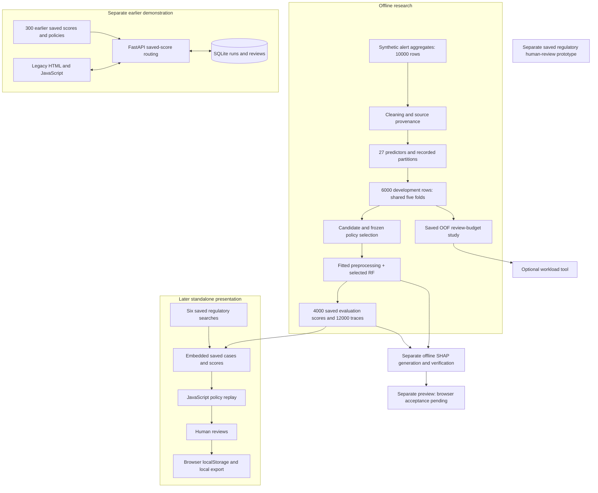

# Audited teammate architecture

This document describes the sibling `../github` source and verified assets inside `../private_handoff/main/TRUEFLAG_PRIVATE_ASSETS.zip`. Archived member paths below are not restored files. There is no current live model-to-API integration.

## Implementation evidence

| Responsibility | Original path |
|---|---|
| Cleaning/provenance | `../github/research/src/trueflag/datarobot_cleaning.py` |
| Preprocessing/fit scope | `../github/research/src/trueflag/model_feasibility.py` |
| Selection/refinement | `../github/research/src/trueflag/model_selection.py`, `model_refinement.py` |
| Predictor contract | Archive: `research/data/splits/datarobot_provisional_v1/predictor_contract.json` |
| Selected pipeline/results | Archive: `research/Deliverables/TrueFlag_Model_Selection_20261018_183648/` |
| Current UI | Archive: `presentation/current.html` |
| Earlier API and persistence | `../github/legacy_api/src/trueflag/local_workspace.py` |
| Legacy UI | `../github/legacy_api/TrueFlag_Workspace.html`, `src/trueflag/web/workspace.js` |
| Explanation extension | `../github/extensions/src/{explain,verify_explanations,build_preview}.py` |
| Workload analysis | `../github/research/scripts/review_budget_lib.py`, `../github/extensions/src/workload.py` |
| Regulatory worksheet | Archive: `optional/regulatory_review/` |
| Technical status/limits | `../github/docs/TECHNICAL_HANDOFF.md` |

## Limits

- No incoming transaction stream, entity graph, live retrieval, LLM provider, inference API, or integrated later-model persistence.
- Demo roles are visibility controls, not authentication. Current HTML embeds data accessible independently of role visibility.
- SAR is a synthetic disposition proxy; previously exposed evaluation records do not establish new independent validation.
- Global importance, policy traces and individual attributions are different evidence. Original hidden TreeSHAP provenance is incomplete; the separate extension establishes a different chain.
- Both source roots use regular package `trueflag`; naive combined import paths collide. Full historical training requires optional recovery inputs and remains unverified.
