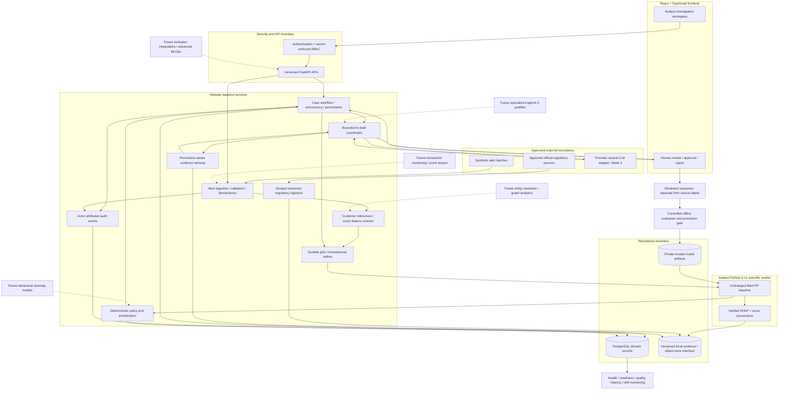

# Target architecture — five-week MVP and later expansion

This is a target, not an implementation claim. Initialization status is in PRODUCT_SCOPE and SETUP_STATUS. Use a modular service with a separately pinned scientific worker; introduce distributed systems only when justified.

Solid arrows represent intended MVP flows; dashed arrows are future integrations. Monitoring/evaluation are MVP operational capabilities; automatic retraining and advanced registry infrastructure are not.

| Component | Responsibility |
|---|---|
| Ingestion/preparation | Validate exact contract, classify synthetic data, preserve missingness and source identity; never manufacture transaction history |
| RF/XAI | Produce versioned scores and independently checked explanations; no policy/filing authority |
| Policy | Thresholds, supported KYC and explicit processing failures; deterministic versioned decisions |
| Cases/review | Assignment, state transitions, optimistic concurrency, approvals and authorized reporting |
| Retrieval/corpus | Evidence IDs, permissions, jurisdiction, institution scope, source hashes and as-of context |
| AI coordinator | One bounded provider workflow, source-cited draft or abstention; no autonomous consequential write |
| Audit/storage | Separate observations, scores, decisions, reviews and source labels with transactional linkage |
| Monitoring/evaluation | Operational failures and drift; reviewed offline experiments and explicit model promotion |

Preserve the baseline namespace in the worker; the API uses `app`. Do not add graph/behavioral features to the frozen 27-predictor pipeline. A graph database, Kafka, Kubernetes and multiple agents are not prerequisites for this MVP.
