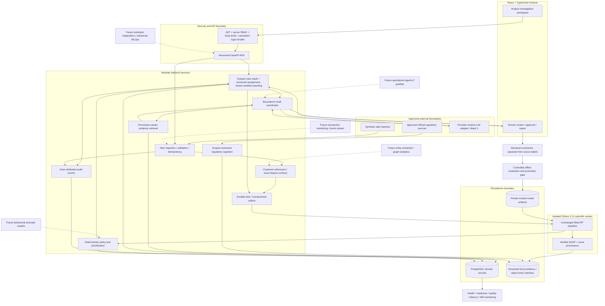

# Target architecture — five-week MVP and later expansion

This is a target, not an implementation claim. Initialization status is in PRODUCT_SCOPE and SETUP_STATUS. Use a modular service with a separately pinned scientific worker; introduce distributed systems only when justified.

Current acceptance and seven-phase mapping are in [IMPLEMENTATION_STATUS](IMPLEMENTATION_STATUS.md). Phase 1 security and Phases 2.1–2.3 [loading](PHASE2_1_MODEL_LOADER.md), [scoring](PHASE2_2_RF_SCORING.md) and [policy recommendations](PHASE2_3_POLICY_ENGINE.md) are verified locally. HTTP/worker integration, SHAP, retrieval and job flows remain proposed in the [integration design](PHASE2_INTEGRATION_PLAN.md).

| Boundary | Implemented now | Pending |
|---|---|---|
| API/security | JWT/Argon2, analyst/supervisor/admin, per-case SQL scope, body limits, request IDs, persistent login throttle | Enterprise IAM, tenant isolation, perimeter controls |
| Case service | Scoped list/detail, filtered pagination/sorting, versioned assignment and transactional change audit | Notes, approvals, reports and full review state machine |
| Data | Synthetic ingestion, durable idempotency, linked cases, nine domain tables | Assessment/job/explanation persistence and new data sources |
| UI | React account verification, including supervisor identities | Case/session/assignment workbench |
| Scientific worker | Separate verified RF loader/scorer; 27-feature contract and 4000-score identity replay | Worker deployment, API/ingestion integration and SHAP; no model is loaded by the current API |
| Policy engine | Separate deterministic rules, verified full-precision thresholds, priority validation, manual-review fallbacks and 12000-route parity | Persistent recommendation/audit storage and authorized workflow integration; every output requires human decision |

Solid arrows represent intended MVP flows; dashed arrows are future integrations. Monitoring/evaluation are MVP operational capabilities; automatic retraining and advanced registry infrastructure are not.

| Component | Responsibility |
|---|---|
| Ingestion/preparation | Validate exact contract, classify synthetic data, preserve missingness and source identity; never manufacture transaction history |
| RF/XAI | Produce versioned scores and independently checked explanations; no policy/filing authority |
| Policy | Thresholds, supported KYC and explicit processing failures; deterministic versioned decisions |
| Cases/review | Scoped reads, assignment and optimistic concurrency implemented; state transitions, approvals and authorized reporting pending |
| Retrieval/corpus | Evidence IDs, permissions, jurisdiction, institution scope, source hashes and as-of context |
| AI coordinator | One bounded provider workflow, source-cited draft or abstention; no autonomous consequential write |
| Audit/storage | Separate observations, scores, decisions, reviews and source labels with transactional linkage |
| Monitoring/evaluation | Operational failures and drift; reviewed offline experiments and explicit model promotion |

Preserve the baseline namespace in the worker; the API uses `app`. Do not add graph/behavioral features to the frozen 27-predictor pipeline. A graph database, Kafka, Kubernetes and multiple agents are not prerequisites for this MVP.
