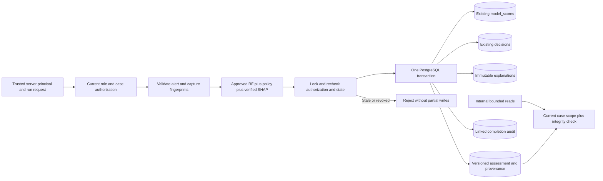
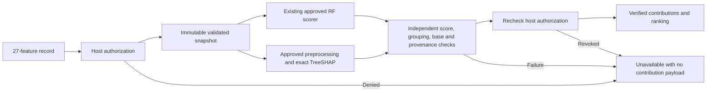
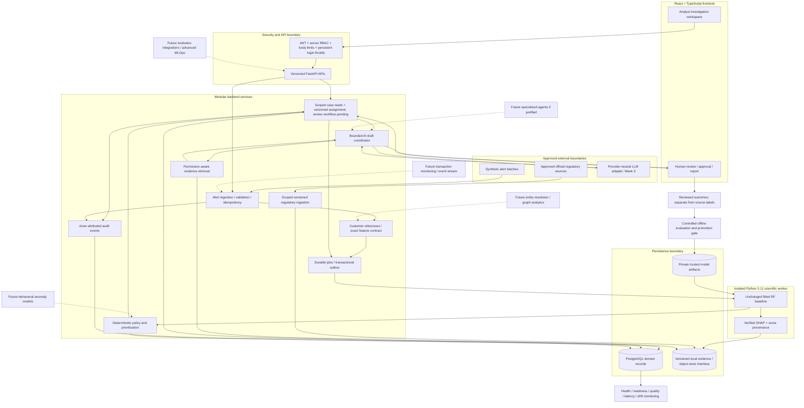

# Target architecture — five-week MVP and later expansion

This is a target, not an implementation claim. Initialization status is in PRODUCT_SCOPE and SETUP_STATUS. Use a modular service with a separately pinned scientific worker; introduce distributed systems only when justified.

Current acceptance is in [IMPLEMENTATION_STATUS](IMPLEMENTATION_STATUS.md). Phases 2.1-2.5 now include verified RF/policies/SHAP and [internal immutable assessment persistence](PHASE2_5_ASSESSMENT_PERSISTENCE.md). HTTP, durable jobs, deployed workers and hard timeouts remain proposed; ingestion does not invoke ML.

| Boundary | Implemented now | Pending |
|---|---|---|
| API/security | JWT/Argon2, analyst/supervisor/admin, per-case SQL scope, body limits, request IDs, persistent login throttle | Enterprise IAM, tenant isolation, perimeter controls |
| Case service | Scoped list/detail, filtered pagination/sorting, versioned assignment and transactional change audit | Notes, approvals, reports and full review state machine |
| Data | Synthetic ingestion, durable receipts, 11 domain tables, immutable assessment/explanation history and atomic completion audit | Durable jobs/failure history, new sources, runtime DB roles |
| UI | React account verification, including supervisor identities | Case/session/assignment workbench |
| Scientific worker | Separate verified RF loader/scorer; 27-feature contract and 4000-score identity replay | Worker deployment and API/ingestion integration; no model is loaded by the current API |
| Policy engine | Frozen deterministic recommendations, 12000-route parity and immutable linked decision records | Authorized HTTP/workflow integration; all recommendations require human decision |
| Explanation service | Exact SHAP, 41-to-27 grouping, 4000-reference parity, independent verification and immutable permission-scoped storage | Authenticated HTTP/worker wiring and hard timeouts |

Implemented Phase 2.5 internal flow (no HTTP inference endpoint or deployed worker):

Implemented library flow (the later API/workbench flow below remains a target):

Solid arrows represent intended MVP flows; dashed arrows are future integrations. Monitoring/evaluation are MVP operational capabilities; automatic retraining and advanced registry infrastructure are not.

| Component | Responsibility |
|---|---|
| Ingestion/preparation | Validate exact contract, classify synthetic data, preserve missingness and source identity; never manufacture transaction history |
| RF/XAI | Produce versioned scores and independently checked explanations; no policy/filing authority |
| Policy | Thresholds, supported KYC and explicit processing failures; deterministic versioned decisions |
| Cases/review | Scoped reads, assignment and optimistic concurrency implemented; state transitions, approvals and authorized reporting pending |
| Retrieval/corpus | Evidence IDs, permissions, jurisdiction, institution scope, source hashes and as-of context |
| AI coordinator | One bounded provider workflow, source-cited draft or abstention; no autonomous consequential write |
| Audit/storage | Separate observations, scores, decisions, reviews and source labels with transactional linkage |
| Monitoring/evaluation | Operational failures and drift; reviewed offline experiments and explicit model promotion |

Preserve the baseline namespace in the worker; the API uses `app`. Do not add graph/behavioral features to the frozen 27-predictor pipeline. A graph database, Kafka, Kubernetes and multiple agents are not prerequisites for this MVP.
