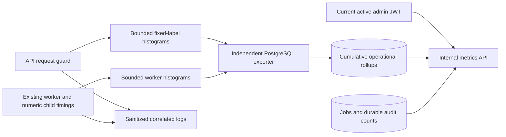
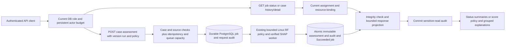
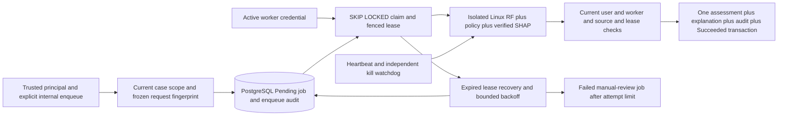
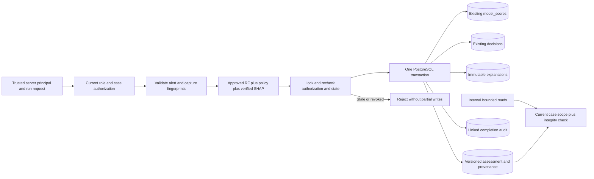
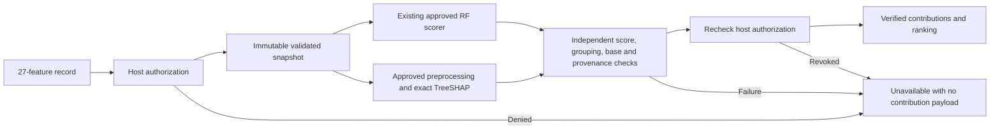
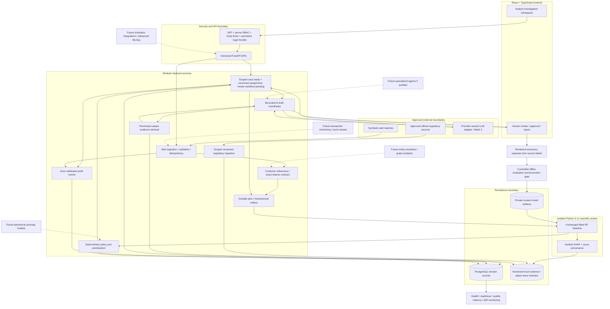
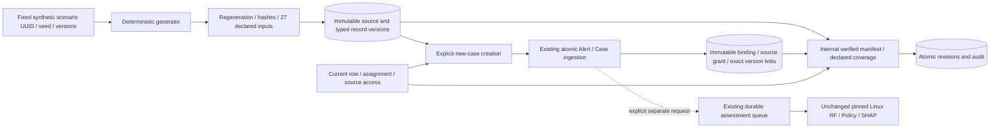
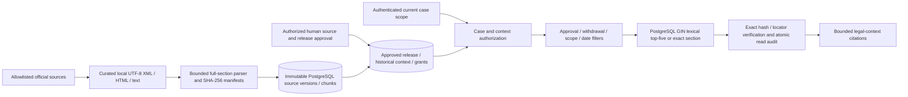

# Target architecture — five-week MVP and later expansion

Phase 3.1 design proposals are collected in [Investigation architecture](PHASE3_1_INVESTIGATION_ARCHITECTURE.md), [evidence model](PHASE3_1_EVIDENCE_MODEL.md), [retrieval/RAG contracts](PHASE3_1_RETRIEVAL_RAG_CONTRACTS.md) and [security/evaluation](PHASE3_1_SECURITY_EVALUATION.md). The investigation/RAG proposals remain pending; Phase 3.2 internal synthetic evidence is implemented below.

This is a target, not an implementation claim. Initialization status is in PRODUCT_SCOPE and SETUP_STATUS. Use a modular service with a separately pinned scientific worker; introduce distributed systems only when justified.

Current acceptance is in [IMPLEMENTATION_STATUS](IMPLEMENTATION_STATUS.md). Phases 2.1-2.9 include approved ML, immutable results, bounded durable Linux jobs, protected APIs and [internal operational monitoring/load-recovery evidence](PHASE2_8_OPERATIONS.md). The [React workbench](PHASE2_9_FRONTEND.md) consumes scoped overview/request/status/history/detail APIs; production deployment acceptance remains pending; ingestion does not automatically score.

| Boundary | Implemented now | Pending |
|---|---|---|
| API/security | Current JWT/roles/case scope, protected assessment APIs, strict DTOs, shared per-user request budget, queue admission and sensitive-read audit | Enterprise IAM, tenancy, perimeter and production SQL roles |
| Case service | Scoped list/detail, filtered pagination/sorting, versioned assignment and transactional change audit | Notes, approvals, reports and full review state machine |
| Data | Synthetic ingestion, receipts, 36 domain tables including versioned synthetic evidence, immutable assessments/jobs and bounded operational rollups | Production retention/governance, new sources and least-privilege SQL roles |
| UI | Memory-only React sessions, authorized alert dashboard, safe case details, verified SHAP/history and asynchronous assessment workflow | Assignment editor, notes, evidence, human approval/report workflows |
| Scientific worker | Bounded Linux execution, fencing/recovery/retries, stage timing and measured local fault/load acceptance | Production capacity/SLO, HA and operational deployment |
| Policy engine | Frozen rules, 12000-route parity, immutable recommendations and case-scoped HTTP retrieval | Human review workflow; no automatic case action |
| Explanation service | Exact SHAP, verified 41-to-27 grouping, immutable storage, bounded worker, redacted APIs and reusable case/batch UI | Production acceptance |

Implemented Phase 2.10.1-2.10.3 staging/preview/import boundary: admin-only contract/template/raw-CSV upload/owned metadata, private durable API volume, upload receipts plus versioned mapping/preview and diagnostic tables, expiry/orphan reconciliation and audit. Only explicit approved import creates canonical alerts/cases; no ML jobs are created. See [phased onboarding](PHASE2_10_BATCH_ONBOARDING.md) and [concrete staging contracts](PHASE2_10_1_CSV_STAGING.md) and [mapping/preview API](PHASE2_10_2_VALIDATION_PREVIEW.md) [durable import](PHASE2_10_3_DURABLE_IMPORT.md) and [explicit bounded batch assessment](PHASE2_10_4_BATCH_ASSESSMENT.md).

```mermaid
flowchart LR
  Admin[Current active admin] --> Stream[Authenticated bounded CSV stream]
  Stream --> Spool[Private generated spool]
  Spool --> Structural[UTF-8/CSV syntax and resource checks]
  Structural --> Receipt[(Owned upload receipt and creation audit)]
  Structural --> Bytes[(Private retained file)]
  Receipt --> Owned[Owned metadata API]
  Bytes --> Preview[2.10.2: permission-checked versioned mapping and streaming validation]
  Preview --> Diagnostics[(Value-free paginated diagnostics and completion audit)]
  Preview --> Approval[2.10.3: explicit owner approval bound to preview]
  Approval --> Queue[(PostgreSQL import queue and audit)]
  Queue --> ImportWorker[Separate scoped Linux import worker with read-only CSV]
  ImportWorker --> Chunks[Canonical transaction core and fenced chunk commit]
  Chunks --> Rows[(Alerts, cases, row receipts, checkpoints and audits)]
  Rows --> Explicit[Explicit 2.10.4 Start Assessment]
  Explicit --> Dispatch[Bounded API dispatcher and existing shared budgets]
  Dispatch --> AssessmentQueue[(Existing ML jobs and atomic member links)]
  AssessmentQueue --> ML[Existing trusted Linux RF / policy / SHAP worker]
  ML --> BatchResults[Verified results and SQL aggregate progress]
  React[2.10.5 admin React batch workflow] --> Stream
  React --> Preview
  React --> Approval
  React --> Explicit
  BatchResults --> React
  React --> Export[Bounded owned result export and formula protection]
  Export --> AuditExport[(Committed range and digest audit)]
```

Implemented Phase 2.8 operational flow (no frontend or additional service):

Implemented Phase 2.7 API flow (all routes require current authentication and case scope):

Implemented Phase 2.6 internal job flow (no public inference endpoint):

Implemented Phase 2.5 internal flow (no HTTP inference endpoint or deployed worker):

Implemented library flow (the later API/workbench flow below remains a target):

Solid arrows represent intended MVP flows; dashed arrows are future integrations. Monitoring/evaluation are MVP operational capabilities; automatic retraining and advanced registry infrastructure are not.

| Component | Responsibility |
|---|---|
| Ingestion/preparation | Validate exact contract, classify synthetic data, preserve missingness and source identity; never manufacture transaction history |
| RF/XAI | Produce versioned scores and independently checked explanations; no policy/filing authority |
| Policy | Thresholds, supported KYC and explicit processing failures; deterministic versioned decisions |
| Cases/review | Scoped reads, assignment and optimistic concurrency implemented; state transitions, approvals and authorized reporting pending |
| Retrieval/corpus | Evidence IDs, permissions, jurisdiction, institution scope, source hashes and as-of context |
| AI coordinator | One bounded provider workflow, source-cited draft or abstention; no autonomous consequential write |
| Audit/storage | Separate observations, scores, decisions, reviews and source labels with transactional linkage |
| Monitoring/evaluation | Operational failures and drift; reviewed offline experiments and explicit model promotion |

Preserve the baseline namespace in the worker; the API uses `app`. Do not add graph/behavioral features to the frozen 27-predictor pipeline. A graph database, Kafka, Kubernetes and multiple agents are not prerequisites for this MVP.

## Phase 2.10.5 batch browser and export boundary

- `frontend/src/batch.tsx`, `batch-api.ts` and `batch.css` reuse existing authentication, APIs and SHAP/history components. Exact server-generated mapping, separate explicit import/assessment, bounded cancellable polling and resume links; no browser model or raw-cell preview.
- One minimal backend export route reuses owned batch/current case scope, verified projections, fixed fields and shared rate budget. Bounded CSV bytes and range/digest audit commit before download; no new schema, queue or worker.
- [Concrete workflow, API, failure behavior and acceptance](PHASE2_10_5_BATCH_FRONTEND.md). Full 2.10.6 acceptance and Phase 3 remain pending; files are unscanned.

## Phase 2.10.6 acceptance boundary

- No new runtime service, public API, schema or scientific behavior. The complete existing CSV/approval/import/dispatch/Linux ML/persistence/React/export architecture is exercised through actual TCP APIs and isolated PostgreSQL schemas.
- New consolidated cross-stage tests verify rejection/conflict/reuse through history/export; controlled real RF/SHAP stage-boundary SIGKILL tests verify no partial publication; real API/lifespan/dispatcher restart plus browser reload verifies durable resume and no reassessment.
- Bounded 100/1000-row workloads retain default parser/import/export/rate limits; a test-only 20-job queue measures backpressure. 5000 rows are rejected at the default 2000-row ingress limit. [Acceptance matrix, measurements and residual boundaries](PHASE2_10_6_ACCEPTANCE.md).
- Local synthetic evidence does not certify production security/capacity. Malware scanning, enterprise identity/SQL roles/tenancy, TLS/retention/HA and source/data governance remain separate gates. No Phase 3 implementation.

## Implemented Phase 3.2 internal evidence boundary

- No new service container, public evidence route or frontend. Twelve additive PostgreSQL tables and internal services support future retrieval. Full 27-field matrix, source/case isolation, correction/revocation semantics and tests: [Phase 3.2](PHASE3_2_EVIDENCE_FOUNDATION.md).
- Existing legacy Evidence anchors, alerts, cases, assessments and frozen scientific pipeline are preserved. One generated source can bind only to its newly ingested case. Existing cases retain unavailable raw-history coverage.
- All 27 RF features are explicit synthetic declarations; zero are claimed ledger-derived. Source coverage and observed transactions are separate from declarations. Unsupported/missing feature input blocks case creation while retaining an evidence-only fixture.
- Public retrieval/analytics in 3.3 and later RAG/provider/investigator work remain separate scope. No graph/vector/agent infrastructure is required here.

## Implemented Phase 3.3 retrieval and analytics

- [Read service](../backend/app/services/evidence_read.py) builds case-bound signed snapshots, exact authorized version projections, one-hop relationships and stored assessment views. [Decimal analytics](../backend/app/services/evidence_analytics.py) computes allowlisted single-currency/window facts with explicit reversal/coverage rules.
- [Six bounded API routes](../backend/app/api/evidence.py) share existing authentication, rate budget, PostgreSQL state and audit. No new container, schema, graph/vector service, broker or inference endpoint.
- Snapshot selection uses one highest authorized linked release per source; correction history is retained without duplicate totals. Withdrawals invalidate later reads/cursors. Existing 27 RF inputs and scientific behavior are unchanged; corrected declarations remain visibly separate from immutable case inputs.
- [Concrete architecture, parameters, limits and acceptance](PHASE3_3_RETRIEVAL_ANALYTICS.md). Regulatory corpus/LLM/provider/investigator/frontend work remains later scope.
## Phase 3.4 - Implemented reference boundary; publication gated

- Additive migration 0013, ten tables; no new service, model, frontend, embedding store or LLM. Reuse current actor/case authorization, safe API guards and audits. Historical scope: U.S. bank / English / November 2, 2026; knowledge cutoff November 4.
- Runtime never fetches URLs. Curator admission, source approval, release publication, explicit access and server configuration are separate operations. No official source is currently approved/published. Unconfigured authorized retrieval returns `unavailable`; FinCEN historical validity remains blocked.
- Citations identify exact immutable release/version/chunk/UTF-8 text with authority and limitations; they cannot assert a customer violation or authorize a case action. [Implementation and limits](PHASE3_4_REGULATORY_KNOWLEDGE.md), [human approval dossier](PHASE3_4_APPROVAL_DOSSIER.md).
## Phase 3.5.1 deterministic investigation foundation

- Implemented a separate PostgreSQL evidence-only coordinator/worker, immutable input manifests and packets, and raw-record numeric/reference verification. Reuse Phase 3.3 authorized projections/analytics and stored Phase 2 assessments; no new scoring, provider, regulatory lookup or frontend.
- Requester/case/source authority and revisions bind every run; publication and later disclosure recheck them. Separate purpose-bound worker identity, bounded steps/deadlines/leases/retries, idempotent intent bindings and atomic audit/result/job publication. Migration 0014 adds five tables; local demo deployment is unchanged.
- [Contracts, data flow, operational bounds, verification and exclusions](PHASE3_5_1_EVIDENCE_COORDINATOR.md). This is a deterministic evidence foundation, **not a validated AI investigator**; regulatory and provider approval gates remain independent.
