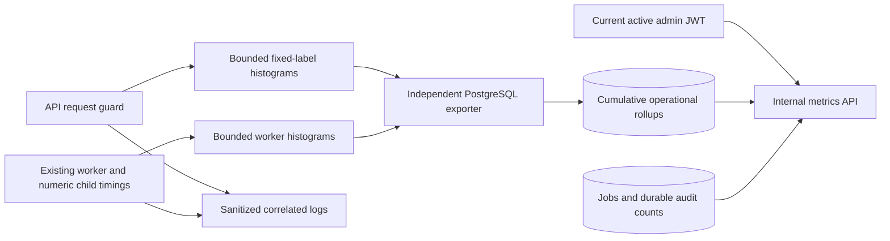
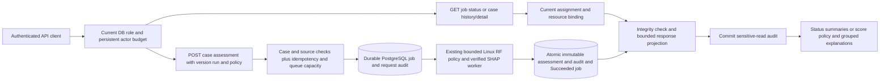
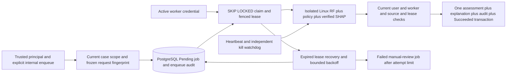
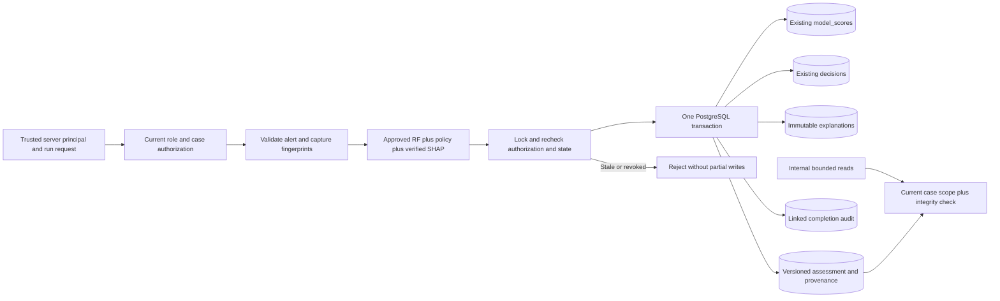
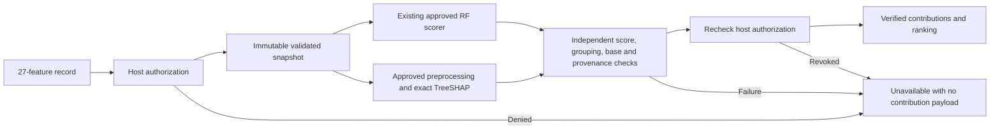
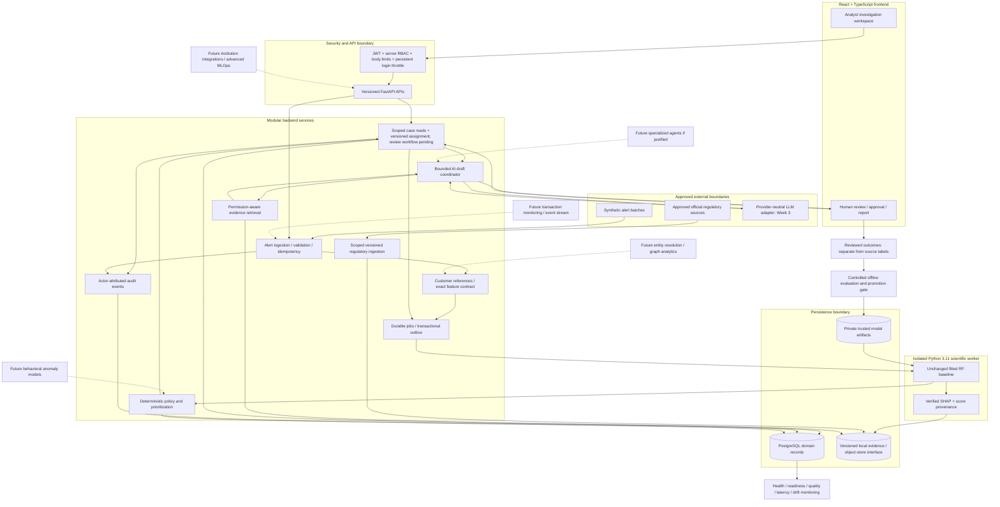

# Target architecture — five-week MVP and later expansion

This is a target, not an implementation claim. Initialization status is in PRODUCT_SCOPE and SETUP_STATUS. Use a modular service with a separately pinned scientific worker; introduce distributed systems only when justified.

Current acceptance is in [IMPLEMENTATION_STATUS](IMPLEMENTATION_STATUS.md). Phases 2.1-2.9 include approved ML, immutable results, bounded durable Linux jobs, protected APIs and [internal operational monitoring/load-recovery evidence](PHASE2_8_OPERATIONS.md). The [React workbench](PHASE2_9_FRONTEND.md) consumes scoped overview/request/status/history/detail APIs; production deployment acceptance remains pending; ingestion does not automatically score.

| Boundary | Implemented now | Pending |
|---|---|---|
| API/security | Current JWT/roles/case scope, protected assessment APIs, strict DTOs, shared per-user request budget, queue admission and sensitive-read audit | Enterprise IAM, tenancy, perimeter and production SQL roles |
| Case service | Scoped list/detail, filtered pagination/sorting, versioned assignment and transactional change audit | Notes, approvals, reports and full review state machine |
| Data | Synthetic ingestion, receipts, 24 domain tables, immutable assessments/jobs and bounded operational rollups | Production retention/governance, new sources and least-privilege SQL roles |
| UI | Memory-only React sessions, authorized alert dashboard, safe case details, verified SHAP/history and asynchronous assessment workflow | Assignment editor, notes, evidence, human approval/report workflows |
| Scientific worker | Bounded Linux execution, fencing/recovery/retries, stage timing and measured local fault/load acceptance | Production capacity/SLO, HA and operational deployment |
| Policy engine | Frozen rules, 12000-route parity, immutable recommendations and case-scoped HTTP retrieval | Human review workflow; no automatic case action |
| Explanation service | Exact SHAP, verified 41-to-27 grouping, immutable storage, bounded worker and redacted case-scoped API retrieval | Workbench integration |

Implemented Phase 2.10.1-2.10.3 staging/preview/import boundary: admin-only contract/template/raw-CSV upload/owned metadata, private durable API volume, upload receipts plus versioned mapping/preview and diagnostic tables, expiry/orphan reconciliation and audit. Only explicit approved import creates canonical alerts/cases; no ML jobs are created. See [phased onboarding](PHASE2_10_BATCH_ONBOARDING.md) and [concrete staging contracts](PHASE2_10_1_CSV_STAGING.md) and [mapping/preview API](PHASE2_10_2_VALIDATION_PREVIEW.md) [durable import](PHASE2_10_3_DURABLE_IMPORT.md) and [explicit bounded batch assessment](PHASE2_10_4_BATCH_ASSESSMENT.md).

```mermaid
flowchart LR
  Admin[Current active admin] --> Stream[Authenticated bounded CSV stream]
  Stream --> Spool[Private generated spool]
  Spool --> Structural[UTF-8/CSV syntax and resource checks]
  Structural --> Receipt[(Owned upload receipt and creation audit)]
  Structural --> Bytes[(Private retained file)]
  Receipt --> Owned[Owned metadata API]
  Bytes --> Preview[2.10.2: permission-checked versioned mapping and streaming validation]
  Preview --> Diagnostics[(Value-free paginated diagnostics and completion audit)]
  Preview --> Approval[2.10.3: explicit owner approval bound to preview]
  Approval --> Queue[(PostgreSQL import queue and audit)]
  Queue --> ImportWorker[Separate scoped Linux import worker with read-only CSV]
  ImportWorker --> Chunks[Canonical transaction core and fenced chunk commit]
  Chunks --> Rows[(Alerts, cases, row receipts, checkpoints and audits)]
  Rows --> Explicit[Explicit 2.10.4 Start Assessment]
  Explicit --> Dispatch[Bounded API dispatcher and existing shared budgets]
  Dispatch --> AssessmentQueue[(Existing ML jobs and atomic member links)]
  AssessmentQueue --> ML[Existing trusted Linux RF / policy / SHAP worker]
  ML --> BatchResults[Verified results and SQL aggregate progress]
```

Implemented Phase 2.8 operational flow (no frontend or additional service):

Implemented Phase 2.7 API flow (all routes require current authentication and case scope):

Implemented Phase 2.6 internal job flow (no public inference endpoint):

Implemented Phase 2.5 internal flow (no HTTP inference endpoint or deployed worker):

Implemented library flow (the later API/workbench flow below remains a target):

Solid arrows represent intended MVP flows; dashed arrows are future integrations. Monitoring/evaluation are MVP operational capabilities; automatic retraining and advanced registry infrastructure are not.

| Component | Responsibility |
|---|---|
| Ingestion/preparation | Validate exact contract, classify synthetic data, preserve missingness and source identity; never manufacture transaction history |
| RF/XAI | Produce versioned scores and independently checked explanations; no policy/filing authority |
| Policy | Thresholds, supported KYC and explicit processing failures; deterministic versioned decisions |
| Cases/review | Scoped reads, assignment and optimistic concurrency implemented; state transitions, approvals and authorized reporting pending |
| Retrieval/corpus | Evidence IDs, permissions, jurisdiction, institution scope, source hashes and as-of context |
| AI coordinator | One bounded provider workflow, source-cited draft or abstention; no autonomous consequential write |
| Audit/storage | Separate observations, scores, decisions, reviews and source labels with transactional linkage |
| Monitoring/evaluation | Operational failures and drift; reviewed offline experiments and explicit model promotion |

Preserve the baseline namespace in the worker; the API uses `app`. Do not add graph/behavioral features to the frozen 27-predictor pipeline. A graph database, Kafka, Kubernetes and multiple agents are not prerequisites for this MVP.
