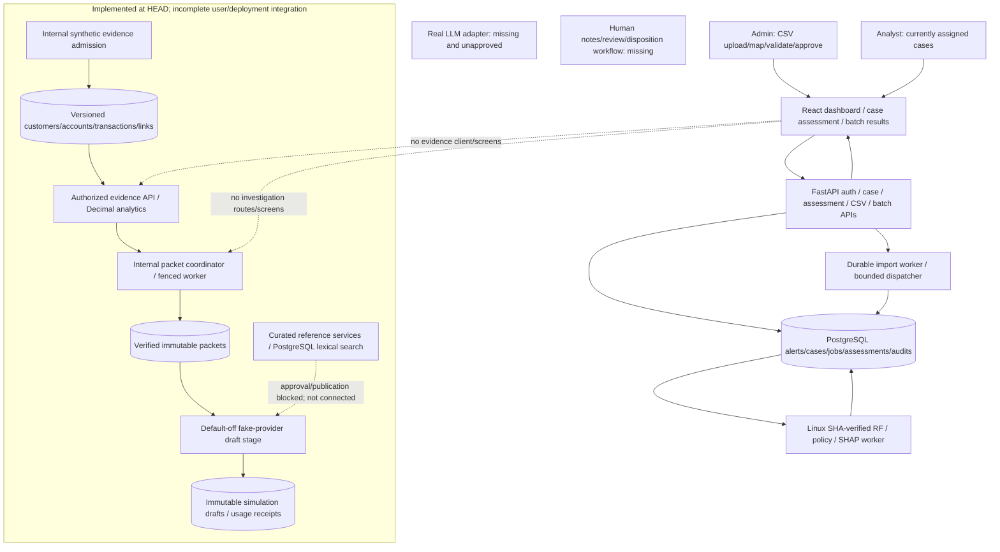

# TrueFlag AI - current system audit

**Audit date:** November 13, 2026 (America/New_York). **Inspected HEAD:** `a3b2ba4`, branch `codex/project-initialization`. Audit/planning only: no application, model, threshold, fixture, credential, permission or live-schema changes. Seven pre-existing branding/startup files remain outside this audit's changes.

## 1. Executive finding

TrueFlag is a functional **synthetic AML alert-triage application with substantial investigation backend foundations**. It is not yet an end-to-end AI investigation/case-management platform.

| Boundary | Confirmed state |
|---|---|
| Connected application | Login -> authorized case dashboard -> single/batch assessment -> real frozen RF + policy + SHAP -> immutable history/results/export |
| Backend without analyst integration | Assignment, versioned evidence/KYC/accounts/transactions/relationships, financial analytics and investigation packet coordinator; no corresponding complete analyst screens |
| Simulated capability | Provider-neutral draft stage uses only `DeterministicFakeProvider`; constrained selections and server-rendered summaries, not a live LLM |
| Missing workflow | Case notes, evidence requests, escalation, review/adoption, human dispositions/approval history and case dossier export |
| Blocked capability | Real-provider activation/evaluation; official regulatory source approval/publication and independent labels |

Read the [completion matrix](FEATURE_COMPLETION_MATRIX.md), [21-step user journey](END_TO_END_USER_JOURNEY_GAPS.md), [RAG/LLM readiness](RAG_LLM_READINESS.md), [security findings](SECURITY_RELIABILITY_GAP_REPORT.md) and [dependency-driven roadmap](REMAINING_IMPLEMENTATION_ROADMAP.md).

## 2. Running application differs from repository HEAD

Read-only checks against the existing demo, not test-fixture assumptions:

| Observation | Result | Implication |
|---|---|---|
| Frontend / backend readiness | `http://127.0.0.1:8088/` and `http://127.0.0.1:8010/ready`: HTTP 200 | Existing application is reachable; this alone does not attest to HEAD |
| Running DB revision | `0012_evidence_foundation`; 36 domain tables + Alembic | Regulatory/investigation migrations are absent from the demo |
| Repository expected revision | `0015_investigation_drafts`; 57 domain tables + Alembic | Source release and served release contract differ; exact served Git SHA is unknown |
| Existing records | 3 users; 10 alerts; 10 cases; 11 assessments; 11 assessment jobs | Persisted ML demonstration exists; no individual contents/credentials were disclosed |
| Existing onboarding | 4 uploads; 3 validations; 2 imports; 1 batch assessment | Onboarding has persisted state; counts do not independently prove every historic row's correctness |
| Existing evidence | 0 evidence sources, 0 `evidence_case_bindings`, 0 evidence transactions | Current demo cases have no supported generated transaction history |
| Later tables | `reference_versions`, `reference_approvals`, `corpus_releases`, `investigation_runs`, `investigation_draft_runs` absent | Later services cannot run against this demo schema |
| Inspected local settings | Simulation/external provider flags false; regulatory context unset | Local configuration is not an attestation of the older serving image's environment; later DB tables are absent regardless |
| DB role | Current connection has superuser/create-role/create-database privileges | Demo credentials are not a least-privilege application boundary |

`backend/app/main.py` checks its compiled `EXPECTED_SCHEMA_REVISION`; current source would reject readiness on revision 0012. Healthy readiness at 0012 therefore cannot be used as evidence that HEAD is deployed. No migrations, image rebuilds or service restarts were performed by this audit.

## 3. AS-IS architecture



## 4. Component and execution inventory

| Layer | Actual implementation / responsibility |
|---|---|
| React | `frontend/src/App.tsx`: memory-only session, role-aware navigation, visibility/access guard; `workbench.tsx`: authorized cases, scoring workflow, SHAP/history; `batch.tsx` + `batch-api.ts`: admin CSV/import/assessment/export |
| HTTP | `backend/app/main.py` registers routers in `app/api/`; 36 declared `/api/v1` routes plus `/health` and `/ready`; no investigation, notes or disposition router |
| Foundation | `services/ingestion.py`, `services/cases.py`, `security/auth.py`, `security/request_guard.py`, `security/bootstrap.py`; atomic ingestion, current DB roles, assignment/version checks, scoped reads, controlled account CLI |
| Frozen ML | `backend/trueflag_ml/{trust,loader,scoring,policy,explainability,explanation_verification}.py`; approved artifacts, exact input ordering, original fitted preprocessing, class-1 SAR-positive score, recommendation-only routing, grouped SHAP |
| Queue/persistence | `services/{assessment_jobs,assessments,assessment_api,batch_assessments,csv_imports}.py`; `workers/{assessment_worker,assessment_child,csv_import_worker}.py`; leases, recovery, backpressure, immutable assessments and audits |
| Evidence | `models/evidence.py`, `services/{synthetic_evidence,evidence,evidence_read,evidence_analytics}.py`, `api/evidence.py`; synthetic version admission and new-case binding, current source grants, exact records, typed projections and allowlisted arithmetic |
| Investigation | `services/{investigation_coordinator,investigation_packets,investigation_verifier}.py`; `models/investigations.py`, `workers/investigation_worker.py`; explicit internal request, frozen manifest, independent source arithmetic and immutable packet |
| Draft simulation | `schemas/investigation_drafts.py`, `services/{investigation_drafts,investigation_provider,investigation_provider_runner,investigation_draft_verifier}.py`; separate child queue, minimized input, fixed fake subprocess and constrained proposals |
| Regulatory | `services/{reference_parser,references,reference_evaluation}.py`, `api/references.py`, `models/references.py`, `contracts/regulatory_*`; curated immutable references, approved-only scoped retrieval, release/citation checks, unreviewed evaluation preparation |
| Operations/deployment | `core/telemetry.py`, `services/monitoring.py`, `api/monitoring.py`; Dockerfiles, `docker-compose.yml`, Alembic 0001-0015 and `.github/workflows/ci.yml`; no deployed investigation worker profile or production identity/HA perimeter |

Path conventions in this table: `core/`, `services/`, `models/`, `api/`, `schemas/`, `security/` and `workers/` are under **`backend/app/`**; frontend filenames are under **`frontend/src/`**. Tests are under `backend/tests/`, `backend/ml_tests/` and `frontend/e2e/`.

### Dependencies and schema boundaries

| Area | Actual contract / responsibility |
|---|---|
| Backend dependency source | `backend/pyproject.toml` requires Python 3.11; `backend/requirements.lock` pins FastAPI/SQLAlchemy/Alembic/psycopg/Pydantic/auth/test dependencies |
| Scientific runtime | `backend/ml-requirements.txt`: numpy 2.3.5, pandas 3.0.1, scikit-learn 1.9.0, scipy 1.17.0, joblib 1.5.3, SHAP 0.51.0, numba 0.68.1; isolated Linux images avoid the known native Windows SHAP DLL limitation |
| Frontend | `frontend/package.json` + `package-lock.json`: React 19, TypeScript 5.9, Vite 7, Vitest, Playwright/Chromium; Node >=22.12 contract |
| Foundation + ML tables | `models/domain.py`: users, alerts/cases, legacy evidence placeholder, ingestion receipts, scores/decisions/assessments/explanations/jobs/workers, audit, throttles and metrics; 24 tables through 0011 |
| CSV/batch tables | Included in those 24: uploads/validations/issues/imports/rows/import workers and batch assessments/items/requests; staged files live on private volume, not as public static assets |
| Evidence schema 0012 | `models/evidence.py`: 12 source/version/identity/record/customer/account/relationship/transaction/access/binding/link/state tables. `evidence_case_bindings` records source-bound new cases; legacy `evidence` is not this typed foundation |
| Reference schema 0013 | `models/references.py`: 10 source/document/version/chunk/approval/release/member/context/grant/event tables |
| Investigation schema 0014 | `models/investigations.py`: 5 worker/run/request/job/packet tables |
| Draft schema 0015 | `models/investigation_drafts.py`: 6 run/request/job/attempt/receipt/draft tables; simulation only |
| Data/feature contract | `backend/app/schemas/alerts.py`: exact 27 predictors; `schemas/csv_validation.py` separates three metadata columns and declared units; no bank-feed connector, rolling feature builder or automatic transaction-to-predictor derivation |

The complete capability-to-service/API/table/test mapping is in [FEATURE_COMPLETION_MATRIX.md](FEATURE_COMPLETION_MATRIX.md). Test-only control routes from the browser harness are not production APIs.

### Confirmed ML path

1. Admin ingestion/CSV validation accepts exactly 27 predictors plus three CSV metadata columns; no online feature builder or retraining is present.
2. Import creates alerts/cases atomically. Assessment is a separate explicit action; assignment still needs the manager API before an ordinary analyst can access a new unassigned case.
3. Assessment API returns asynchronous jobs. The Linux worker loads SHA-allowlisted fitted assets and original custom module compatibility code; `predict_proba` selects verified class 1.
4. Frozen Efficiency/Balanced/Coverage routing remains separate from scoring. Coverage additionally retains successfully processed High-priority cases; recommendations cannot close cases.
5. Exact TreeSHAP is verified in its SAR-positive output space and grouped from 41 encoded features to 27 predictors. Null income is distinct from observed zero.
6. Assessment/explanation/provenance/audit/job status commit atomically. React polls boundedly, displays stored results/history, and exports only authorized allowlisted fields.

No new AML generalization/accuracy claim follows from matching saved predictions. Training occurred in teammate research; runtime has no trainer. Private staged originals under `assets/local/baseline/` are dependencies, not publicly redistributable application assets. Independent banking/time-split performance and complete training-data reproducibility remain unverified by this audit.

### Original research lineage, not a new training run

| Evidence path under `assets/local/baseline/` | Confirmed responsibility / limit |
|---|---|
| `reference/research/src/trueflag/model_feasibility.py` | Development-only loader, `TrainingScopeGuard`, original preprocessing factories; LR imputes/scales income with missing indicator, RF/HGB retain native NaN; early fixed 4,000/2,000 development split |
| `reference/research/src/trueflag/model_selection.py` | Five-fold 6,000-row development comparison; candidate eligibility from policy targets, then Balanced review reduction, mean average precision and deterministic tie order; freezes selection/thresholds before a 6,000-row final refit and 4,000-row reproduction |
| Same selection code | Explicitly calls this **exposed-population reproduction**; recorded local access checks are not an exhaustive reconstruction of archived exposure. The 4,000 replay is not a new untouched time/customer holdout |
| `reference/research/src/trueflag/model_refinement.py` | Additional archived candidate/refinement/reuse logic; its presence does not mean the deployed RF was replaced or retrained |
| `contracts/selected_policy_settings.json` | Current approved loader dependency names selected RF `20261018_183648_RF`; SHA identity and thresholds remain frozen |
| `reference/extensions/src/{explain,verify_explanations,common}.py` | Original explanation/verification extension retained as reference; current service adds controlled loading and stored explanations rather than calling an arbitrary extension HTTP server |
| `baseline.manifest.json` | Local staged identities verified; rights statement is **no source license supplied; local reuse only**. Broader distribution/production rights are not established |

The input schema guarantees finite typed numbers, exact fields, supported KYC and a nonblank category; it does not establish banking semantics for every count/binary/unit. CSV accepts an explicit `baseline_source_units` declaration, not currency conversion or a verified bank codebook. Preserve the frozen contract; resolve semantic provenance in a separately versioned data dictionary/admission profile before broader datasets.

## 5. Data consistency finding

`synthetic_evidence.reconciliation()` explicitly returns `transaction_derived_fields: []`. All 27 inputs are declared synthetic values, even when a generated source creates a structurally linked case. Currency/codebook/window ambiguities remain declared. CSV/legacy cases do not acquire generated events automatically; `EvidenceService.create_case()` intentionally refuses binding an arbitrary existing case to invented history.

The linked chain is supported in isolated backend scenarios through assessment and packet/draft persistence. It is absent from the current demo and stops before human decisions. A credible capstone needs a versioned, connected scenario catalog and user-facing evidence workflow, not retrospective claims that these events generated the frozen predictors. See the data design and acceptance gates in the [roadmap](REMAINING_IMPLEMENTATION_ROADMAP.md).

Packet scope is narrower than the activity API: `investigation_packets.assemble()` emits **count/totals and concentration per selected currency**; `investigation_verifier.py` independently reconstructs that exact plan from raw records. Other activity calculations are not automatically included in a packet. Contradictory KYC is detected as a source observation conflict; no expected-activity profile or causal/criminal conclusion is inferred.

## 6. Validation ledger - November 13

Commands run against this working tree; test-fixture schemas are isolated on the recovery clone, with synthetic data. No actual credentials/customer feature values are printed. Counts below are separate overlapping runs, not unique-test totals.

| Command | Current result / boundary |
|---|---|
| `.venv\Scripts\python.exe -B scripts/run_investigation_verification.py --full --drafts` | **FAIL: 880 passed / 3 failed assertions / 1 setup error / 0 skipped**, 2363.11 s (39m23s); isolated pinned Linux/PostgreSQL with real ML opt-in |
| `npm.cmd test -- --reporter=dot` in `frontend` | 48 passed / 0 failed / 0 skipped; initial sandbox startup failure was filesystem/esbuild access, then rerun with approved local access |
| `npm.cmd run lint` / `npm.cmd run build` | Passed; existing installed dependencies, ignored build artifacts only |
| `DATABASE_URL=<recovery-clone-url in process memory> .venv\Scripts\python.exe -B scripts/run_frontend_e2e.py` | 11 Chromium tests passed / 0 failed / 0 skipped; 2.3 minutes; real API/PG/import/ML workers |
| `.venv\Scripts\python.exe -B scripts/run_ml_verification.py --check scoring` | 4,000 matched, max absolute error 0, 0 mismatches/failures |
| Same runner `--check policy` | 12,000 routes/traces matched; 0 mismatches or retained/reduction-candidate total differences |
| Same runner `--check shap` | 4,000 verified / 0 unavailable / 0 mismatches; all saved encoded/grouped/base differences 0; model score difference 0; maximum reconstruction residual `3.1086244689504383e-15` |
| `.venv\Scripts\python.exe -B -m ruff check .` / `-m ruff format --check .` | Passed; 219 Python files formatted |
| `.venv\Scripts\python.exe -B scripts/run_ml_verification.py --check tests` | 178 passed / 0 failed / 0 skipped in the pinned offline Linux ML runtime |
| `npm.cmd run format:check` in `frontend` | Passed; all matched frontend files formatted |
| `.venv\Scripts\python.exe -m pip check` / pinned runner `--check dependencies` | Both passed; installed dependency compatibility only, not CVE assurance |
| `.venv\Scripts\python.exe -B scripts/check_publication.py` | Passed: 281 source candidates, including the six new audit docs; ignore/credential-shape checks, not complete secret-history analysis |
| `.venv\Scripts\python.exe -B -m pytest backend/tests/test_alert_contract.py backend/tests/test_foundation.py backend/tests/test_security_foundation.py -q --tb=short -p no:cacheprovider --basetemp runtime/full-audit-windows-<unique-id>` | Native Windows + isolated SQLite: 65 passed / 0 failed / 0 skipped, 24.47 s; PostgreSQL/real-assessment opt-ins unset, process-only random signing secret and `PYTHONPATH=backend`; no live DB connection |
| Focused four-node pytest command below in the same pinned Linux/PostgreSQL environment | **4 passed / 0 failed / 0 errors / 0 skipped**, unchanged tests in fresh disposable schemas; does not overwrite the full-run result |

Scientific tolerance: score comparison `atol=1e-12`, `rtol=0`; SHAP grouped-feature comparison `atol=1e-12`, probability reconstruction `atol=1e-6`, `rtol=0`. Missing-income records 87 and observed-zero-income records 22 remained distinct in the actual 4,000-case SHAP replay. Policies require exact route equality, not numeric approximation.

Clock/fixture limits: `scripts/serve_frontend_acceptance.py` creates real synthetic DB records but uses a test-only issuer that backdates `iat` by 60 seconds for Docker guest-clock issues; `backend/tests/test_foundation.py::headers()` backdates by 2 seconds. Neither changes production authorization or expiry. Initial browser list cases are inserted as test fixtures; the batch tests exercise actual ingestion. Component fixtures contain mock rendering values and do not establish model correctness; separate actual-model and browser tests do. Production clock synchronization, strict unmodified live-login acceptance and a browser workflow beyond ML remain separate gates.

The Windows subset emitted one Starlette TestClient/httpx deprecation warning; no package changes were made. It is not the full Windows/PostgreSQL suite or a native Windows SHAP acceptance run.

### Current full-suite failures: release acceptance is not green

| Exact test | Observed failure | Audit interpretation / required next proof |
|---|---|---|
| `backend/tests/test_assessment_jobs.py::test_case_permissions_and_revocation` | Fixture alert creation returned 401 instead of 201 (`conftest.py:133`); test body did not run | Authentication/setup interruption; cannot claim that test's revocation acceptance passed |
| `backend/tests/test_cases.py::test_revoked_supervisor_and_inactive_analyst_access` | Revoked supervisor assignment returned 401 instead of expected 403 (`:312`) | Access denied, but expected current-role behavior was not reproduced |
| `backend/tests/test_csv_imports.py::test_cross_user_isolation_unauthorized_and_case_scope` | Analyst import read returned 401 instead of expected 403 (`:287`) | Denied disclosure, but role/ownership sequence did not complete as asserted |
| `backend/tests/test_references.py::test_withdrawal_serializes_with_inflight_disclosure` | In-flight citation hook did not reach its two-second barrier (`:379`) | Withdrawal/disclosure serialization was not established by that execution; cause not identified from the timeout alone |

These are **not observed unauthorized-success responses**. Clock drift is a plausible hypothesis for unexpected 401s given existing fixture workarounds, but is not a proven root cause. Do not weaken authentication or stretch timeouts merely to make acceptance green. A focused unchanged-test rerun is recorded separately; it cannot erase the failed full-run evidence. No code fixes were performed in this audit.

Focused rerun's exact pytest argument list (inside `trueflag-assessment-verify:phase2-5`, `/workspace`; actual invocation used `pytest.main` with a counts-only reporting plugin):

```text
pytest backend/tests/test_assessment_jobs.py::test_case_permissions_and_revocation backend/tests/test_cases.py::test_revoked_supervisor_and_inactive_analyst_access backend/tests/test_csv_imports.py::test_cross_user_isolation_unauthorized_and_case_scope backend/tests/test_references.py::test_withdrawal_serializes_with_inflight_disclosure -q --tb=no -p no:cacheprovider --basetemp /tmp/audit-focused
```

Isolation matches the reviewed full runner: validated recovery-clone name, process-only `DATABASE_URL`/`TRUEFLAG_TEST_POSTGRES_URL`, real-ML opt-in, fresh random test signing secret, read-only source/artifact mounts, 2 CPUs/3 GiB, dropped capabilities/no-new-privileges and temporary scratch. Credentials are supplied on stdin and not recorded in the command/report. Result: intermittent full-run failures, root cause **unconfirmed**. No broad rerun or corrective source change was used to hide them.

### Preservation and audit scope

- SHA-256 comparison: **275 pre-existing tracked/unignored files unchanged**, including the unrelated branding/startup work; private `.env` unchanged; **25 baseline-manifest artifacts verified**, zero differences.
- Exactly six new audit Markdown documents; internal document links/fences and representative source references checked. No local commit or push; HEAD remains `a3b2ba4`.
- Only isolated test schemas/build scratch/generated ignored reports were written; live business data and schema were not migrated or changed by audit actions.

Not performed: production-like database writes/migrations, external LLM calls, government-site fetches, vulnerability-registry scans, penetration certification, new load claims, real banking accuracy or legal certification. Historical documentation test counts are not relabeled as current runs.

## 7. Assessment

- **Capstone triage workflow:** functional browser-tested sample paths in an isolated HEAD environment; full-release acceptance is blocked by the current regression failures.
- **Complete investigation platform:** not yet delivered; data, deployment, UI, human workflow, live LLM and regulatory gates remain.
- **First implementation recommendation:** release/schema reconciliation on a recoverable copy, then an authorized connected-evidence/assignment/packet-review vertical slice. No model rewrite, new agent framework, graph database or event broker is required.
