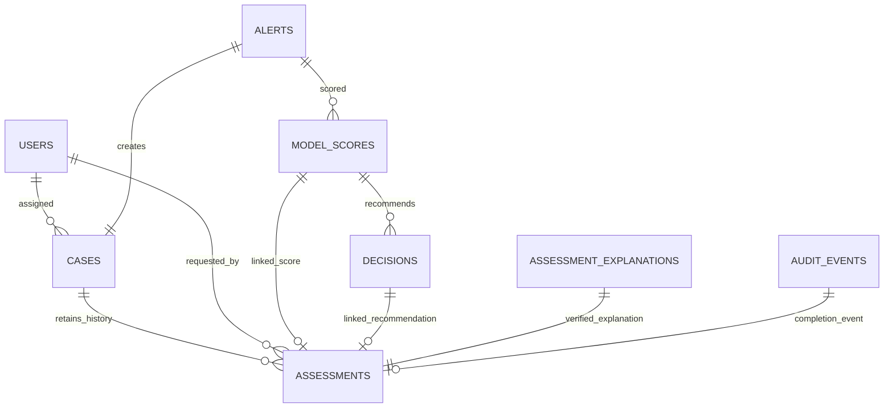

# PostgreSQL schema - Phase 2.5

Source of truth: `backend/app/models/domain.py` and `backend/alembic/versions/`. Expected revision: **0004_assessments**; 11 domain tables plus `alembic_version`.

| Table | Responsibility / relationships |
|---|---|
| users | Active identity, password hash and current analyst/supervisor/admin role |
| alerts | Synthetic source identity, exact 27-predictor JSON, contract and ingestion fingerprint |
| cases | One case per alert; optional assignee, state/disposition and optimistic version |
| alert_ingestions | Durable unique hashed-key receipt; request digest, linked alert/case, actor and creation response |
| evidence | Case-scoped source reference, hash/type and metadata; retrieval workflow pending |
| model_scores | Alert/model/input identity, processed score or failed/null score; assessment-linked rows immutable |
| decisions | Score-linked policy mode/version, recommendation/status/reason; assessment-linked rows immutable |
| audit_events | Actor/action/resource/details; assessment-linked completion events immutable |
| login_throttles | HMAC client key, window start and atomic attempt count |
| assessment_explanations | Immutable verified SHAP payload and independent-verification metadata; no raw predictor values |
| assessments | Immutable completed run, case/alert/actor, versions, hashes, child links and provenance |

- Assessment unique constraints: global `run_id`; actor-scoped `key_sha256`; `(case_id, version)`; each child record linked at most once. Every child FK is non-null; no cascading history deletion.
- Phase 2.5 decision route width: 40. Processed values: legacy `retain`/`dismiss` plus `retain_human_review`/`review_reduction_candidate`; failed route remains null. The new service writes explicit recommendations only.
- Per-case locks serialize version allocation. Active actor/case/alert locks and source fingerprints enforce current scope/state and provenance in the service transaction; cross-record content digest is checked on retrieval.
- DB triggers protect assessments, explanations and referenced score/decision/audit rows from UPDATE/DELETE; PostgreSQL TRUNCATE is blocked on all five tables. Schema owners remain privileged; least-privilege runtime roles are pending.
- Reassessment appends a new version; it does not update an existing run or a human case disposition. Failed jobs/attempts are not represented as completed assessments.
- Upgrade: `alembic -c backend/alembic.ini upgrade head`; drift: `alembic -c backend/alembic.ini check`. Downgrade refuses retained assessment history. Never disable history protection as a normal rollback procedure.
