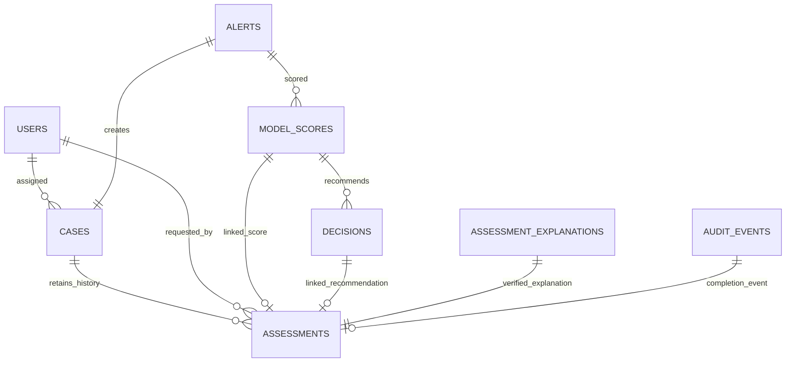

# PostgreSQL schema - Phase 2.8

Source of truth: `backend/app/models/domain.py` and `backend/alembic/versions/`. Expected revision: **0007_operations**; 15 domain tables plus `alembic_version`.

| Table | Responsibility / relationships |
|---|---|
| users | Active identity, password hash and current analyst/supervisor/admin role |
| alerts | Synthetic source identity, exact 27-predictor JSON, contract and ingestion fingerprint |
| cases | One case per alert; optional assignee, state/disposition and optimistic version |
| alert_ingestions | Durable unique hashed-key receipt; request digest, linked alert/case, actor and creation response |
| evidence | Case-scoped source reference, hash/type and metadata; retrieval workflow pending |
| model_scores | Alert/model/input identity, processed score or failed/null score; assessment-linked rows immutable |
| decisions | Score-linked policy mode/version, recommendation/status/reason; assessment-linked rows immutable |
| audit_events | Actor/action/resource/details; assessment-linked completion events immutable |
| login_throttles | HMAC client key, window start and atomic attempt count |
| operational_metrics | Non-customer per-instance/minute cumulative count/sum/fixed histogram, indexed by minute; bounded best-effort retention |
| assessment_api_throttles | One current authenticated actor budget: window timestamp and count; no features/IP/raw token |
| assessment_workers | Dedicated active non-login execution identity; unique high-entropy token hash and provisioning admin |
| assessment_jobs | Immutable request envelope; Pending/Running/Succeeded/Failed state, fencing token, lease/deadline, bounded attempts/backoff and completed assessment link |
| assessment_explanations | Immutable verified SHAP payload and independent-verification metadata; no raw predictor values |
| assessments | Immutable completed run, case/alert/actor, versions, hashes, child links and provenance |

- Assessment unique constraints: global `run_id`; actor-scoped `key_sha256`; `(case_id, version)`; each child record linked at most once. Every child FK is non-null; no cascading history deletion.
- Phase 2.5 decision route width: 40. Processed values: legacy `retain`/`dismiss` plus `retain_human_review`/`review_reduction_candidate`; failed route remains null. The new service writes explicit recommendations only.
- Per-case locks serialize version allocation. Active actor/case/alert locks and source fingerprints enforce current scope/state and provenance in the service transaction; cross-record content digest is checked on retrieval.
- DB triggers protect assessments, explanations and referenced score/decision/audit rows from UPDATE/DELETE; PostgreSQL TRUNCATE is blocked on all five tables. Schema owners remain privileged; least-privilege runtime roles are pending.
- Reassessment appends a new version; it does not update an existing run or a human case disposition. Failed jobs/attempts are not represented as completed assessments.
- Upgrade: `alembic -c backend/alembic.ini upgrade head`; drift: `alembic -c backend/alembic.ini check`. Downgrade refuses retained assessment history. Never disable history protection as a normal rollback procedure.

## Phase 2.6 queue invariants

- Unique global run ID and actor-scoped key digest; valid four-state combinations and attempt range 0-3 enforced by constraints. State values are stored lowercase.
- Ready/expiry indexes support SKIP LOCKED claim and bounded reaping. Each claim rotates its fencing token; DB clock determines validity and durable backoff.
- Job envelope and terminal history are immutable; DELETE/TRUNCATE of jobs and UPDATE/DELETE of job audit events are blocked. Migration downgrade refuses retained jobs.
- One caller-owned transaction links the existing immutable assessment write, completion audit and Succeeded job. No features are duplicated in queue rows and no human disposition is changed.

## Phase 2.7 API controls

- Queue capacity check uses one PostgreSQL transaction advisory lock across enqueue processes; Pending/Running count only, matching original receipts bypass admission. Existing worker/model/assessment schema is preserved.
- Per-user API fixed windows use atomic upsert in an independent transaction; read/audit failures and hidden resource probes cannot roll back the request debit. The existing login throttle is unchanged.
- The audit guard additionally protects `assessment.history_read` and `assessment.detail_read`, while preserving the existing completion-audit assembly transaction.

## Phase 2.8 telemetry boundary

- New `operational_metrics` table only; existing input, model, job and immutable-result schemas remain unchanged.
- Cumulative snapshot primary key: random operational instance ID, minute, fixed metric name and label. Upsert replaces counts and rejects older decreasing snapshots; no double-counting on export retry.
- Export is outside domain transactions with a dedicated bounded pool and timeout. Best-effort 120-minute cleanup affects only generated telemetry rows. Durable jobs/audits are authoritative; telemetry can be lost during crashes/extended outages.
- Internal metrics return bounded aggregates, never operational instance IDs, business identifiers or customer features. See PHASE2_8_OPERATIONS for quantile/coverage limits.
