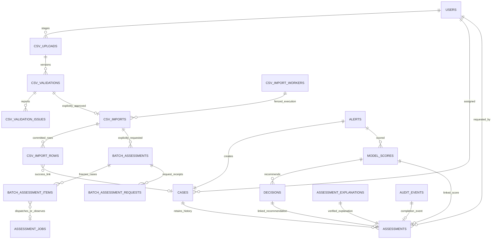

# PostgreSQL schema - Phase 3.5.2

Source of truth: `backend/app/models/` and `backend/alembic/versions/`. Expected revision: **0015_investigation_drafts**; 57 domain tables plus `alembic_version`. Earlier phase sections retain historical schema counts. No automatic live-demo migration is performed.

## Phase 3.5.2 additive tables

| Table | Responsibility |
|---|---|
| investigation_draft_runs | Immutable parent/requester/manifest, provider configuration and prompt fingerprints |
| investigation_draft_requests | Immutable actor/idempotency-key to exact child intent bindings |
| investigation_draft_jobs | Fenced child state/attempt/deadline/lease/recovery scheduling; references existing investigation worker identities |
| investigation_draft_attempts | Immutable request, packet/minimized-input hashes and conservative input/output reservations before delivery |
| investigation_draft_receipts | Immutable completion/failure hash, observed simulated usage or explicit unknown, attempt elapsed time |
| investigation_drafts | Immutable structurally checked simulation draft, exact parent/attempt/manifest linkage and provenance |

Composite FKs bind parent/actor/manifest and result/attempt/run. PostgreSQL deferred guards enforce complete envelopes, terminal result/receipt consistency and reservation limits. History cannot be updated/deleted/truncated; retained rows/audits block downgrade. No provider secret, raw source document or copied 27-feature snapshot is stored here. [Phase 3.5.2](PHASE3_5_2_LLM_INVESTIGATOR.md).

| Table | Responsibility / relationships |
|---|---|
| users | Active identity, password hash and current analyst/supervisor/admin role |
| alerts | Synthetic source identity, exact 27-predictor JSON, contract and ingestion fingerprint |
| cases | One case per alert; optional assignee, state/disposition and optimistic version |
| alert_ingestions | Durable unique hashed-key receipt; request digest, linked alert/case, actor and creation response |
| evidence | Case-scoped source reference, hash/type and metadata; retrieval workflow pending |
| model_scores | Alert/model/input identity, processed score or failed/null score; assessment-linked rows immutable |
| decisions | Score-linked policy mode/version, recommendation/status/reason; assessment-linked rows immutable |
| audit_events | Actor/action/resource/details; assessment-linked completion events immutable |
| login_throttles | HMAC client key, window start and atomic attempt count |
| csv_uploads | Owner-scoped CSV staging receipt, intent-key hash, private generated reference, trusted SHA/sizes/counts, status/expiry and creation-audit link; no headers/feature values |
| csv_validations | Upload-scoped mapping/version/digest, units/validator/contract identities, full-file counts and completion-audit link; no row values |
| csv_validation_issues | Composite validation/row-number key; canonical field/error/warning codes only, paginated and bounded by staged row count |
| csv_import_workers | Separately provisioned/revocable non-login import execution identity and token hash; no ML/HTTP privileges |
| csv_imports | Frozen actor/key/approval binding and preview/source references; mutable fenced chunk lease, counters/checkpoint, bounded retries and terminal state |
| csv_import_rows | Unique import/logical-row receipt, created/reused/invalid/conflict status and authorized success links; no raw row values |
| batch_assessments | Owned explicit import/policy/model intent, artifact provenance, bounded dispatch scheduling/backpressure and audited completion |
| batch_assessment_items | Frozen case/version/source-row/run membership; immutable job/reused-result links; aggregate outcomes join the authoritative ML job records |
| batch_assessment_requests | Immutable actor/key/content receipts; multiple keys for one intent reuse its single batch |
| operational_metrics | Non-customer per-instance/minute cumulative count/sum/fixed histogram, indexed by minute; bounded best-effort retention |
| assessment_api_throttles | One current authenticated actor budget: window timestamp and count; no features/IP/raw token |
| assessment_workers | Dedicated active non-login execution identity; unique high-entropy token hash and provisioning admin |
| assessment_jobs | Immutable request envelope; Pending/Running/Succeeded/Failed state, fencing token, lease/deadline, bounded attempts/backoff and completed assessment link |
| assessment_explanations | Immutable verified SHAP payload and independent-verification metadata; no raw predictor values |
| assessments | Immutable completed run, case/alert/actor, versions, hashes, child links and provenance |

- Assessment unique constraints: global `run_id`; actor-scoped `key_sha256`; `(case_id, version)`; each child record linked at most once. Every child FK is non-null; no cascading history deletion.
- Phase 2.5 decision route width: 40. Processed values: legacy `retain`/`dismiss` plus `retain_human_review`/`review_reduction_candidate`; failed route remains null. The new service writes explicit recommendations only.
- Per-case locks serialize version allocation. Active actor/case/alert locks and source fingerprints enforce current scope/state and provenance in the service transaction; cross-record content digest is checked on retrieval.
- DB triggers protect assessments, explanations and referenced score/decision/audit rows from UPDATE/DELETE; PostgreSQL TRUNCATE is blocked on all five tables. Schema owners remain privileged; least-privilege runtime roles are pending.
- Reassessment appends a new version; it does not update an existing run or a human case disposition. Failed jobs/attempts are not represented as completed assessments.
- Upgrade: `alembic -c backend/alembic.ini upgrade head`; drift: `alembic -c backend/alembic.ini check`. Downgrade refuses retained assessment history. Never disable history protection as a normal rollback procedure.

## Phase 2.6 queue invariants

- Unique global run ID and actor-scoped key digest; valid four-state combinations and attempt range 0-3 enforced by constraints. State values are stored lowercase.
- Ready/expiry indexes support SKIP LOCKED claim and bounded reaping. Each claim rotates its fencing token; DB clock determines validity and durable backoff.
- Job envelope and terminal history are immutable; DELETE/TRUNCATE of jobs and UPDATE/DELETE of job audit events are blocked. Migration downgrade refuses retained jobs.
- One caller-owned transaction links the existing immutable assessment write, completion audit and Succeeded job. No features are duplicated in queue rows and no human disposition is changed.

## Phase 2.7 API controls

- Queue capacity check uses one PostgreSQL transaction advisory lock across enqueue processes; Pending/Running count only, matching original receipts bypass admission. Existing worker/model/assessment schema is preserved.
- Per-user API fixed windows use atomic upsert in an independent transaction; read/audit failures and hidden resource probes cannot roll back the request debit. The existing login throttle is unchanged.
- The audit guard additionally protects `assessment.history_read` and `assessment.detail_read`, while preserving the existing completion-audit assembly transaction.

## Phase 2.8 telemetry boundary

- New `operational_metrics` table only; existing input, model, job and immutable-result schemas remain unchanged.
- Cumulative snapshot primary key: random operational instance ID, minute, fixed metric name and label. Upsert replaces counts and rejects older decreasing snapshots; no double-counting on export retry.
- Export is outside domain transactions with a dedicated bounded pool and timeout. Best-effort 120-minute cleanup affects only generated telemetry rows. Durable jobs/audits are authoritative; telemetry can be lost during crashes/extended outages.
- Internal metrics return bounded aggregates, never operational instance IDs, business identifiers or customer features. See PHASE2_8_OPERATIONS for quantile/coverage limits.

## Phase 2.10.1 private CSV staging

- Migration 0008 adds csv_uploads only; existing alert/case/assessment schemas are preserved. Unique actor/key and storage keys, bounded counts and chronological expiry checks.
- Upload content is on a private API volume, never a DB feature snapshot or public file. Row values and raw headers are not duplicated in metadata. Creation receipt/audit commits together; no alerts/cases/jobs are created.
- Filesystem and PostgreSQL cannot share an atomic commit. Fsync/rename, rollback cleanup, retained ambiguous-commit bytes and bounded expiry/orphan reconciliation are specified in [staging contracts](PHASE2_10_1_CSV_STAGING.md). Receipt/audit retention survives expiry; downgrade refuses retained upload receipts.

## Phase 2.10.2 mapping and preview

- Migration 0009 adds only the two preview tables. Unique `(upload_id,mapping_sha256)` and `(upload_id,version)`; FK/audit integrity, bounded count consistency and logical row-number constraints. No canonical domain schema changes.
- Actor locking serializes version allocation and authorization; mapping, complete diagnostic batches and audit commit together. Service/API history is append-only, without a database-wide tamper-proof claim. Downgrade refuses retained validation records.
- Original file SHA, mapping/validator/contract versions and units assertion bind preview identity. Retrieval rechecks current role/ownership, TTL and file integrity. Diagnostic receipts contain no cells and remain after byte expiry; institutional metadata retention is pending. See [preview contract](PHASE2_10_2_VALIDATION_PREVIEW.md).

## Phase 2.10.3 durable approved imports

- Migration 0010 adds three tables; no feature/case/ML schema changes. One import/preview and actor/key uniqueness, row PK, FK/state/count/chunk constraints; database guards freeze approval envelopes, terminal imports, row receipts, approved preview diagnostics/source identity and import audit history.
- Original single-alert wrapper retains its contract; a shared transaction core permits chunk-wide atomic alerts/cases/ingestion receipts/row receipts/checkpoints/audits. Invalid rows are excluded; source conflicts do not overwrite cases. Exact source identities reuse existing canonical cases.
- PostgreSQL database-clock SKIP LOCKED claims, random fencing, bounded retries/recovery, global advisory admission and fresh admin/worker checks. File TTL is not extended; retained progress/approval receipts remain readable after byte expiry. Failed imports explicitly retain committed and remaining counts. See [import schema and recovery](PHASE2_10_3_DURABLE_IMPORT.md).

## Phase 2.10.4 explicit batch assessment

- Migration 0011 adds three tables; existing feature, model, assessment and job schemas are unchanged. Unique import/policy/artifact intent and actor/key receipts; one member/case and one originating link/job. Metadata and terminal links/audits are guarded; history downgrades refuse retained batches.
- Existing enqueue statements now have a caller-owned transaction core. Group transaction atomically persists queue jobs, member links and audits; database lock release provides dispatcher crash recovery. The original inference lease/retry/fencing state machine remains authoritative.
- Counters come from one joined SQL aggregate, not mutable cached job counters. Cases with verified prior assessments or compatible active jobs are reused; direct jobs retain their original authority. Originating jobs additionally recheck current bulk permission/provenance before computation and publication. [Batch API, counters and recovery](PHASE2_10_4_BATCH_ASSESSMENT.md).

## Phase 2.10.5 frontend and export

- No migration/table changes: head remains `0011_batch_assessments`, 24 domain tables. Existing assessment/job/result schemas preserved.
- `batch.assessment.exported` reuses protected batch audit history; stores actor/batch, requested range, actual counts, byte count, export schema, timestamp and SHA, never exported values. Permission/result verification and audit commit precede CSV disclosure; failures roll back and return no file. [Contract](PHASE2_10_5_BATCH_FRONTEND.md).

## Phase 3.1 evidence/investigation design - no schema implementation

- Actual metadata inspected at `0011_batch_assessments`: existing Alert/Case/Evidence/Assessment/AssessmentExplanation columns match the audited model. No migration/DDL/data change in this subphase; 24 domain tables remain the Phase 2 baseline.
- Existing Evidence is only a case-linked URI/hash/kind/JSON metadata anchor. It supplies no implemented customer/account/transaction/versioned-corpus/retrieval workflow. Existing decisions rows are model recommendations, not human dispositions.
- [Proposed keys, source/version envelope, typed payloads, case links, revisions, private content and ER model](PHASE3_1_EVIDENCE_MODEL.md) are review artifacts. Use additive migration planning after approval; no implicit legacy-source backfill, invented transaction history or frozen feature-contract change.
- Corpus/investigation/review records are later subphase proposals. Current schema has no enterprise tenancy/RLS guarantee. Retention/access revocation and source/entity linkage require review before 3.2.

## Phase 3.2 versioned synthetic evidence

- Head: `0012_evidence_foundation`, **36 domain tables**. Twelve additive tables, no legacy rewrite or automatic evidence migration. [Frozen contract and 27-field matrix](PHASE3_2_EVIDENCE_FOUNDATION.md).
- Source/release/identity/record-version and typed customer/account/relationship/transaction payloads use UUIDs and composite same-source/kind FKs. Source owner/scenario, release number/hash and identity/version are unique. Exact duplicates are one observation; new releases retain explicit predecessor versions.
- Immutable `evidence_case_bindings` proves a newly generated source created its mandatory Alert/Case through existing ingestion. Source access and exact record-version memberships are explicit, case-scoped and revocable. `case_evidence_states` tracks separate evidence/access revisions. No binding or fabricated history for existing cases.
- PostgreSQL update/delete/truncate guards protect history and evidence audits; deferred constraints require complete releases and exactly one correctly typed payload per record. Money uses exact Decimal/NUMERIC(24,8), explicit currency, offset-aware or unknown timestamps and original time text.
- Empty downgrade to 0011 is supported. Any evidence state/history or `evidence.%` audit refuses destructive downgrade. Retained-data rollback requires compatible forward migration or separately approved recovery; no auto-purge.

## Phase 3.3 retrieval / analytics persistence boundary

- No DDL or data backfill. Head remains `0012_evidence_foundation`, 36 domain tables. Reuse immutable typed versions, current case/source grants and exact link membership.
- Sensitive `evidence.retrieval.*` reads append existing guarded audit events atomically before disclosure: actor/case, reference/request/response hashes, snapshot/revisions, counts and retrieval version. No raw observations, predictor values or tokens in audit/log payloads.
- Frozen latest-authorized linked release selection prevents counting corrected source snapshots twice. Reassignment, link/grant changes invalidate signed contexts; unlinked admission cannot change their results. No derived-fact table, cache or model write is introduced. [Read/reproducibility contract](PHASE3_3_RETRIEVAL_ANALYTICS.md).
## Phase 3.4 additive reference corpus

- New head: `0013_reference_corpus`; **46 domain tables**. Previous Phase 3.2/3.3 counts below describe their historical heads. Existing case/evidence/assessment columns and records are preserved.
- `reference_sources` / `reference_documents`: immutable publisher identity, authoritative URL, scope, language and authority class; RF routing policies remain separate.
- `reference_versions` / `reference_chunks`: immutable original bytes, extracted text, selected complete sections, independent SHA-256 identities, parser/retrieval/date metadata, predecessors and exact UTF-8 locators. Expression GIN index on `to_tsvector('english'::regconfig, body_text)`; no separate vector service.
- `reference_approvals` / `corpus_releases` / `corpus_members` / `reference_contexts`: immutable explicit expected-hash human/test provenance and fixed historical release scope. One document version per release; typed same-document version/chunk FKs. Approval does not automatically grant access or configure the server.
- `reference_grants`: active/revision changes only, audited; grant identity retained. `reference_events`: immutable source/version/release withdrawals. Existing `evidence.%` audit immutability also protects `evidence.reference.%` actions.
- PostgreSQL triggers reject history update/delete/truncate and incomplete versions at commit. Empty downgrade supported; any retained reference row or reference-read audit blocks downgrade. SQLite migrations are compatibility only; service methods require PostgreSQL. [Contract, limits and acceptance](PHASE3_4_REGULATORY_KNOWLEDGE.md).
## Phase 3.5.1 investigation foundation

| Table | Responsibility / integrity |
|---|---|
| `investigation_runs` | Immutable requester/case/alert/assessment identity, bounded input manifest/SHA and coordinator version; unique frozen intent |
| `investigation_requests` | Immutable requester/key -> exact run/manifest binding; composite FK prevents cross-actor/hash bindings |
| `investigation_jobs` | One job/run, bounded attempts, Pending/Running/Succeeded/Abstained/Failed/Invalidated, not-before, worker lease/token/deadline and sanitized error |
| `investigation_workers` | Separate purpose-bound token digest, admin provenance; identity immutable, revocation permanent |
| `investigation_packets` | Immutable run/manifest-bound packet/SHA and independent source verification report; unique run; <=512 KiB application bound |

- Deferred guards require job/idempotency envelopes at run commit and packet/job consistency at publication. No legacy model/evidence/case column rewrite. Existing `evidence.%` audit protection covers new `evidence.investigation.%` events.
- Empty 0014 rollback is supported; retained run/worker/request/job/packet/audit history blocks destructive downgrade. Existing demo remains on its prior running schema; acceptance uses isolated PostgreSQL/SQLite environments. [Detailed contract](PHASE3_5_1_EVIDENCE_COORDINATOR.md).
