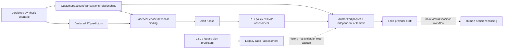

# TrueFlag AI - end-to-end user journey gaps

**Audit:** November 13, 2026; source HEAD `a3b2ba4`. This describes implemented behavior, not the target architecture. The running demo is older: schema 0012, no transaction evidence, no investigation/reference tables. Current tests use isolated schemas at HEAD; see [validation ledger](CURRENT_SYSTEM_AUDIT.md#6-validation-ledger---november-13).

## 1. Twenty-one-step analyst journey

Legend: **Yes** = connected workflow within stated scope; **Backend** = service/API only; **Partial** = incomplete workflow; **No** = missing; **Blocked** = approval required. Synthetic means actual server processing of fictional records, not a static screenshot. Tests named here establish specific boundaries; current execution results are in the ledger.

| # / intended action | Can user do it? / UI | Backend and persistence | Synthetic-data reality | Authorization / error boundary | Meaningful verification | Missing acceptance |
|---|---|---|---|---|---|---|
| 1. Log in | Yes: `App.tsx` login | `/auth/token`, `/auth/me`; users and login audits persist; JWT held in memory | Real DB users; no default demo password embedded | Argon2; signed expiry/issuer/audience; current active user/role; throttles and sanitized denials | Auth/security tests; Chromium login/logout | Account administration/MFA/SSO absent; browser test backdates token `iat` for clock drift; production login clock gate remains |
| 2. See permitted cases/alerts | Yes: dashboard | `/cases`, case overview; stored alerts/cases/jobs | Real persisted test alerts; initial browser list is an ORM fixture | Analyst assignment filter; supervisor/admin workspace scope; deny/clear on permission failures | Cases PostgreSQL tests; Chromium filters/sort/pagination/isolation | No team/tenant hierarchy; imported cases start unassigned |
| 3. Import or select alerts | Yes, role-dependent: admin Batch Processing; analyst selects assigned case | Upload/contract/mapping APIs, durable staging metadata; no analyst upload privilege | Browser batch tests submit actual synthetic CSV; no bank feed | Admin + ownership; request/file/row/concurrency bounds; 413/429 paths | CSV upload tests; `batch.spec.ts` | A manager must assign imported cases through API; no assignment UI |
| 4. Validate inputs | Yes: mapping/preview/errors | Exact 30-column CSV contract: 27 predictors + 3 metadata; immutable validation identity/issues | Actual parsed CSV values, explicit units; null income distinct from zero | No silent feature invention; digest/mapping binding; bounded errors without raw values | Mapping/validation, malformed CSV, concurrency, income tests | Predictor values are declarations, not transaction-derived features |
| 5. Approve import | Yes: explicit confirmation | Approval binds file digest, mapping/version, validation and units; request/audit persist | Validated staged file, not fabricated prediction rows | Current owner/admin rechecked; idempotency/conflict handling; no automatic approval | Import tamper/retry/permission tests; browser lost-response retry | No malware scanning; approval is import consent, not legal source approval |
| 6. Create/store cases | Yes: asynchronous import progress | Import worker reuses atomic ingestion; row outcomes/checkpoints; alerts/cases/audits persist | Actual cases from accepted synthetic rows; invalid rows excluded | Bounded chunks, fenced leases, rollback, source conflicts; no silent overwrites | Import PostgreSQL/recovery tests; browser resume | CSV path supplies no transaction evidence; no inferred history should be attached |
| 7. Start scoring | Yes: case or batch action | Explicit assessment/job requests return 202; immutable feature snapshot; durable jobs | New synthetic inputs, not client-supplied scores | Case-level checks, idempotency, queue/rate limits; execution rechecks | API/worker tests; actual browser Run Assessment | Ordinary analyst needs assignment; no scoring on import automatically |
| 8. RF prediction | Yes: stored result | SHA-verified original fitted pipeline; SAR-positive `classes_` mapping; versioned score | Actual frozen RF computes results | No uploaded model loading; failures sanitized/manual review | 4,000-score replay; actual-model end-to-end worker | Saved parity is not new AML accuracy or out-of-distribution validation |
| 9. Policy recommendation | Yes: score/policy view | Exact frozen Efficiency/Balanced/Coverage; stored version/reason | Actual deterministic routing of RF output | Validation rejects malformed scores; safe failure; no automatic dismissal | 12,000-route replay and boundary/priority tests | Model routing is not a human disposition or regulatory conclusion |
| 10. SHAP explanation | Yes: contribution chart/table | TreeSHAP; 41 encoded contributions grouped to 27; verification metadata persists | Actual fitted model and explainer | Reconstructs correct output; failure never silently fabricates an explanation | Actual SHAP replay; worker/browser detail tests | Contributions are neither causality nor evidence of crime |
| 11. Open case | Yes: details/history | Authorized overview/history/detail APIs; assessment history immutable | Actual DB case and assessment versions | Permission revalidation and state clearing; bounded polling | `workbench.spec.ts`, component/API tests | Current case view is mainly triage; no complete investigation workspace |
| 12. Review KYC/accounts/transactions | Backend; no UI | Evidence read APIs; versioned customers/accounts/transactions/relationships, source ACLs | Connected fictional scenarios exist in backend tests; live demo has none | Case + source access, revision-bound cursor; cross-case aliases do not grant access | `test_evidence_read.py`, evidence foundation tests | Evidence tabs, source references, coverage and seeded connected cases absent |
| 13. Calculate indicators | Backend; no UI | Evidence `/activity`: totals/flows/velocity/concentration/patterns; deterministic Decimal calculations | Actual observed test records; no invented missing transactions/FX rates | Bounded windows/records/currencies; explicit reversal policy; incomplete coverage surfaced | `test_evidence_analytics.py`, numeric/reversal oracles | Controls/results UI; expected-activity data for KYC comparison (currently abstains) |
| 14. Assemble verified packet | Backend; no public investigation route/UI | Coordinator + worker, frozen manifest, independently checked immutable packet/jobs/audit | Real DB evidence and stored assessment signals in backend scenarios | Current case/source/revision checks before retrieval/publication; idempotency/recovery/fencing | `test_investigation_coordinator.py` | Protected gateway, worker deployment, packet/status/history UI |
| 15. Retrieve approved regulation | Blocked; no UI | Reference search/resolve APIs enforce approval/release/context/scope/dates; versioned references | Candidate official text is real source material, not synthetic law; not admitted in demo | Unapproved/withdrawn/wrong-context content denied; isolated evaluation bypass is not production access | Reference approval/withdrawal/date/access tests | Human source approval, independent labels, published release/grant/context; coordinator integration and citation UI |
| 16. Real LLM proposes cited findings | No; simulated backend only | Only `DeterministicFakeProvider`; durable draft infrastructure stores simulated selections/receipts | Deterministic fake, not learned reasoning; server-rendered facts are real | Default off, restricted packet/DSL, no enabled external adapter/egress | `test_investigation_drafts.py` exercises simulation and containment | Approved real transport/model/data handling, usage/cost handling and meaningful model evaluation |
| 17. Independently verify claims/citations | Partial: backend checks only | Source membership/revision, numeric reproducibility, stored model identities; constrained draft verification | Deterministic verification against original records; no fake self-approval | Stale/revoked inputs invalidate publication; unsupported fields/citations rejected | Coordinator/draft numeric, tamper, concurrency and revocation tests | Natural-language entailment, real-model hallucination/abstention/legal evaluation; numeric validity alone is insufficient |
| 18. Analyst reviews findings/evidence/limits | Partial: ML review only | ML read APIs work; packet/draft service results persist without analyst HTTP/UI | Actual RF/SHAP review; no live LLM finding to review | ML reads case-scoped; no human adoption permission/state machine yet | ML browser workflow; packet/draft backend tests | Connected evidence/packet/draft viewer, clear simulation label, adopt/reject/rationale and source staleness handling |
| 19. Notes/evidence requests/escalation | No | No domain entities/services/routes for these actions | No persisted user workflow | Cannot claim authorization/rollback enforcement for nonexistent actions | No acceptance tests for these actions | Append-only notes, typed requests/escalation states, permissions, notifications only if needed |
| 20. Human disposition | No | Case disposition fields exist; no decision transition service; `decisions` represents model routing | No demonstrated immutable human outcome | No human maker/checker or reason/version enforcement | No end-user decision acceptance | Explicit human decision/rationale/provenance, state machine, optimistic concurrency and approval policy |
| 21. Complete decision/audit history | Partial | Atomic audits and immutable ML/evidence/investigation records; admin latest-100 audit API | Real recorded operations; missing human operations cannot appear | Protected-domain triggers, app ACLs; DB superuser remains outside boundary | Rollback/immutability tests for implemented domains | Case timeline/audit projections, human decision history, complete authorized dossier export, DB role hardening |

## 2. Connected data chain: implemented versus absent

| Link / dataset | Confirmed support | Gap / required constraint |
|---|---|---|
| Customer -> account -> transaction | Typed evidence versions, source-bound identities, links and immutable corrections | Present in isolated generated scenarios; zero live evidence sources/transactions |
| Transactions -> 27 ML predictors | **No implemented derivation**: `synthetic_evidence.reconciliation()` reports `transaction_derived_fields: []` | Never claim aggregate counts/spend/income arose from observed records; declare origin per feature |
| Scenario -> alert/case | `EvidenceService.create_case()` atomically binds a new case to that source | Deliberately refuses arbitrary existing-case backfill; source membership is not established by matching an alias |
| CSV -> case -> assessment | Complete independent triage path | CSV carries declarations only; no legitimate automatic underlying transaction history |
| Evidence + assessment -> packet | Backend coordinator verifies frozen source/access/assessment revisions | No public route, deployment profile or analyst packet screen; source tables absent in running older release |
| Packet -> draft | Real job/storage infrastructure around deterministic fake | No real provider or semantic-quality acceptance |
| Draft -> human decision | Missing | Require explicit review records tied to exact packet/draft versions; never reinterpret model `decisions` as human approval |
| Frozen 4,000-record scientific set | Existing prediction/routing/explanation replay preserved | It is not the connected investigation demo dataset; do not fabricate histories or change saved results to improve narrative consistency |

## 3. Minimum connected demonstration cohort

**Proposed, not implemented by this audit:** reuse `services/synthetic_evidence.py` and `EvidenceService.create_case()` to create a separate, reproducible scenario catalog.

- Record generator version, seed, scenario/source IDs, as-of date, expected coverage, correction/reversal semantics and source-to-case binding.
- Classify every predictor as declared synthetic, source-observed, reproducibly derived or unavailable. Derive only justified fields using documented units/windows/codebooks; KYC/credit attributes need appropriate sources, not transaction inference.
- Preserve null income versus zero, unknown currency, partial windows, contradictions and explicit abstentions. A plausible story must not override unavailable evidence.
- Include normal activity, unusual flows, high priority/low score, missing transactions, conflicting KYC, reversals, duplicate requests and source-access revocation.
- Run the actual RF/policy/SHAP and store actual results. Set scenario expectations for structural/numeric consistency, not desired fabricated risk scores.
- Provision/assign users through supported services; require an analyst browser path from assigned case through evidence, packet, human review and final disposition.

## 4. Immediate workflow bottleneck

Admin import and ML triage work; **the next user-visible step is evidence review, not adding another agent**. First reconcile the release safely, establish connected cases, and expose existing assignment/evidence/packet services with authorization. Human workflow and approved real-provider/regulatory integration follow the dependency gates in the [roadmap](REMAINING_IMPLEMENTATION_ROADMAP.md).
