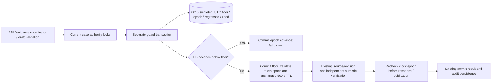

# G0.3.2 — clock safety and snapshot validity policy

**Date:** November 14, 2026 (America/New_York). **Branch/base:** `codex/project-initialization` / `a3b2ba49cd92c4aa0401842fa4999897fdc28713`, dirty candidate. **Status: clock containment implemented; focused/restart/migration checks PASS; full application acceptance FAIL (929 passed, 6 failed).** No live migration, deployment, SQL-role change, provider activation, commit or Git push.

## 1. Current clock architecture

| Category | Establishes time | Validates / consumes it | G0.3.2 scope |
|---|---|---|---|
| Transaction/customer/source event timestamps | Declared synthetic source UTC/timezone observations | Source/version hashing, requested-window filters and independent Decimal calculations | Unchanged; never replace evidence dates with current wall time |
| Audit/created/changed-at metadata | Existing Python aware UTC defaults and DB records | Immutable history/provenance checks, revision counters | Unchanged |
| Evidence snapshot/cursor expiry | PostgreSQL UTC seconds + **900**, server signed | Signature/issuer/audience/exact claims, current DB seconds, authority/source/revision checks | New durable time floor and epoch; TTL unchanged |
| HTTP bearer authentication | Python aware UTC `iat`/`exp`, current server key | Existing PyJWT checks, issuer/audience and active current user; zero added leeway | Unchanged; this is not the custom evidence-token contract |
| Assessment/import/investigation/draft leases | Existing PostgreSQL UTC availability/deadline fields | Existing row locks, lease-token fencing, bounded recovery/backoff | Unchanged |
| Assembly/provider elapsed budgets | Existing monotonic elapsed measurements | Existing bounded steps/process timeouts | Unchanged; no monotonic value persisted as a cross-host UTC deadline |

Reviewed [G0.3](G0_3_DATABASE_RECOVERY_AND_MIGRATION.md), [G0.3.1](G0_3_1_SNAPSHOT_INTEGRITY_INVESTIGATION.md), `evidence_read.py`, `investigation_{coordinator,packets,verifier,drafts}.py`, API error mappings, worker CLI signing, `evidence.py::atomic`, authentication, migrations and release fences. Drafts continue to be bounded simulations; no live provider/RAG is activated.

## 2. Confirmed risks and required properties

- Old stateless rule: `now < expires <= now + 900`. A backward step can reject otherwise-current evidence; replaying an expired token after DB time rewinds inside its original window could pass time validation.
- A floor written in the caller's transaction would be erased by the expired-read exception/rollback. Process-local memory would be lost on restart and would not coordinate API/worker instances.
- A floor alone cannot invalidate every token issued before a detected incident. A still-unexpired token might otherwise be accepted again after the clock catches up.
- Historical intermittent failure **remains causally unconfirmed**. Containing the demonstrated mechanism is not proof that this was its cause.
- Required: no expiry extension, no forged/source-stale evidence acceptance, durable regression detection, bounded failure, safe recovery and no case disposition/SAR side effect.

## 3. Options evaluated

| Option | Benefit | Rejection / limitation |
|---|---|---|
| Clock synchronization/monitoring only | Necessary operational hygiene | Does not make already-recorded expiry irreversible after a regression |
| Process-local monotonic TTL | Good elapsed budget within execution | Not a portable persisted UTC deadline across hosts/boots; insufficient cross-process state |
| Add expiry leeway / extend 900 s | Fewer availability rejections | Changes the security window and hides the problem; rejected |
| Clamp `now` to a stored maximum and keep accepting | Nondecreasing logical readings | Accepts requests while actual clock is behind/uncertain; rejected |
| Durable floor, reject while behind | Preserves observed expiry across rollback/restart | Needs an epoch to invalidate all pre-incident tokens, not just already-expired ones |
| **Durable floor + regression epoch** | Small state, independent commits, cross-process containment | Selected; adds one singleton table and opaque-token metadata; still requires operational time synchronization |
| External trusted-time/quorum service or irreversible token ledger | Stronger external/individual history | New availability/security dependency or per-token storage; premature for this local single-database boundary |

An existing audit/metrics table was not repurposed as a mutable security clock. That would mix retention/aggregation semantics and grow a time-observation ledger unnecessarily.

## 4. Selected policy and justification

### Durable observation protocol

1. Authorized case/evidence operations use `SnapshotTime.observe()` in a **separate PostgreSQL transaction/connection**.
2. Lock the singleton row **before** sampling `clock_timestamp()`. Convert to whole UTC seconds, matching the existing integer-second token boundary.
3. If raw seconds are at least the retained high-water mark: advance/retain the floor, clear the regressed flag and return the current epoch.
4. If raw seconds are below the floor: retain the floor, advance the epoch **once on entry** to the incident, mark regressed, commit, then raise `ClockUnavailable`.
5. All observations remain unavailable while raw time is below the floor. When it catches up, recovery can clear the flag but **cannot reduce the epoch**. Every pre-incident snapshot/cursor remains invalid.
6. Independently commit successful time observations too: an expired-token error, publication rollback or process exit must not erase the observed expiry boundary.

The guard transaction uses lock timeout 1 s, statement timeout 2 s, idle-in-transaction timeout 3 s and `synchronous_commit=on`. Existing connection/pool limits still apply; these SQL limits are not an end-to-end latency SLA. Singleton locking serializes only short observations, not financial calculation/SHAP/provider work.

Invariants: once a committed observation reaches an expiry `E`, retained floor `H >= E`. A later raw sample below `H` is unavailable; a sample at least `H` still rejects `expires <= now`. An incident also advances the epoch irreversibly, so an old-epoch token cannot revive even if it had not yet expired when regression was detected. These properties assume the committed guard state itself is retained.



### Token and publication boundaries

- Snapshot/cursor claims add a strict integer `clock_epoch`. Signing uses a new internal HMAC domain (`trueflag.evidence-read.signing.v2`). Old opaque tokens are rejected; clients obtain a fresh authorized context.
- Case evidence identities, reference hashes, RF/Policy/SHAP values and persistent investigation manifests do **not** gain a clock-dependent factual revision. A safe retry can reassemble unchanged facts with a fresh token after recovery.
- `ensure_clock()` rechecks the epoch before returning evidence, publishing/reading investigation packets and publishing verified simulated drafts. No trusted time/state means no result release.
- Existing API handling returns sanitized **503** for clock/storage uncertainty, **422** for invalid/old/expired tokens and existing **404/409** for authority/scope failures. No new public endpoint or raw time-state exposure.
- The guard's `used` marker, nondecreasing floor and constrained epoch transitions are trigger protected. Downgrade refuses to erase used/regressed clock history. Empty, unused initialization can be downgraded for development rehearsal.

## 5. Changes and compatibility

| Files | Change |
|---|---|
| `backend/app/models/snapshot_clock.py`, `models/__init__.py` | One singleton security-state model, registered with existing metadata |
| `backend/alembic/versions/0016_snapshot_clock.py` | Add/seed table and protection triggers; no case/source/scientific transformation |
| `backend/app/services/snapshot_clock.py` | Independent durable UTC observation and fail-closed handling |
| `backend/app/services/evidence_read.py` | Guard mint/validation/response, epoch claim and signing-domain rotation; retain existing scope/signature/TTL rules |
| `backend/app/services/investigation_coordinator.py`, `investigation_drafts.py` | Final epoch rechecks; preserve numeric/source validation and worker lease semantics |
| `backend/app/core/schema.py` | Candidate expects `0016_snapshot_clock`; G0.2 fences reject older schemas |
| `backend/tests/test_snapshot_clock_integrity.py`, `test_snapshot_clock_policy.py` | Replace the old vulnerable-behavior characterization with denial; add rollback/process/concurrency/retention negatives |
| Relevant migration/schema tests | Include the added table and distinguish unused clock state from used clock-history retention |
| Ignored deployment metadata | Regenerated matching backend/frontend identity for schema 0016; no images deployed |

Live demo remains at **0012**. The older deployment is not a verified deployment of this candidate. No bearer-authentication code, lease/deadline implementation, frozen scientific input or routing policy changed.

## 6. Security and recovery verification

| Scenario | Required outcome | Actual evidence |
|---|---|---|
| Normal snapshot / unchanged TTL | Authorized reads, same source identity, cursor expiry not refreshed | PASS in focused clock suite |
| Expiry and forward movement | Exact 900 s boundary rejects; retained floor survives caller rollback | PASS |
| Backward movement | No evidence result while raw time is below floor | PASS |
| Catch-up / expired replay | Old token stays rejected; new epoch can mint fresh context | PASS |
| Not-yet-expired pre-incident token | Rejected by epoch even after catch-up | PASS |
| Concurrent regression observers | One incident epoch increment, serialized post-lock samples | PASS |
| API/worker/fresh interpreters | Shared durable floor/epoch; a new process cannot forget detection | PASS: actual Linux subprocesses |
| Database/process restart | Persisted incident unchanged; expired replay blocked; fresh epoch works | PASS: actual disposable PostgreSQL restart and fresh Python process |
| Source/role revocation | Still denied after time recovery; no stale-scope bypass | PASS |
| Tampered totals / forged references | Independent raw-record rejection; no packet/audit partial publication | PASS in focused probes; neighboring/full ledger below |
| Storage missing / lock timeout | Sanitized unavailable outcome, no evidence returned | PASS |
| Floor/epoch/reset/truncate attempts | Protected DB transitions; used-history downgrade refused | PASS |
| Worker retry/recovery/old lease nonce | Bounded manual-review fallback, no duplicate publication | PASS in focused probes; neighboring/full ledger below |

Restart rehearsal created only a dedicated synthetic schema in the new isolated test database. The retained snapshot/key files are owner-only, ignored diagnostics. The live PostgreSQL container was not restarted. This was a controlled normal restart, not a power-loss/PITR/failover certification.

### Verification ledger

| Run | Passed | Failed | Errors | Skipped | Interpretation |
|---|---:|---:|---:|---:|---|
| Initial focused clock/integrity/policy | 24 | 0 | 0 | 0 | PASS; 30.178549 s |
| First neighboring evidence/worker run | 126 | 3 | 0 | 0 | Retained; 169.389351 s |
| Three-case triage | 3 | 0 | 0 | 0 | PASS; 5.126600 s, after correcting one downgrade expectation |
| Three cases × ten cycles | 30 | 0 | 0 | 0 | PASS; 37.900405 s; no blind retry-until-pass |
| Superseded full run | 492 | 0 | 0 | 0 | INTERRUPTED; exit 2, 548.781677 s, not a full-suite PASS |
| Complete full Linux/PostgreSQL | 929 | 6 | 0 | 0 | FAIL; 935 collected, 909.638485 s |
| Focused clock suite after controlled-start correction | 24 | 0 | 0 | 0 | PASS; 33.786277 s |
| Pinned offline ML suite | 178 | 0 | 0 | 0 | PASS |

One neighboring failure was an authoring error in this phase: an **unused** guard correctly allows downgrade to proceed to the existing investigation-history guard. Restored the original assertion. The other two neighboring failures passed individually; their original rejection details were unavailable, so cause remains unconfirmed. They are `test_result_hidden_after_evidence_revocation` and `test_json_limits_shared_rate_capacity_and_no_raw_predictors`. Added value-free clock-state diagnostics for recurrence; no availability assertion or security check was relaxed. The first full run was interrupted after the confirmed assertion correction to avoid spending resources on superseded test code.

The complete full run recorded 59 clock-backstep observations and six failures. **Five have direct guard evidence**: observed UTC second was one below retained floor, `unsafe=true`, `regressed=true`, epoch advanced to 2. These are recorded fail-closed outcomes, not inferred from coincident wall-clock samples.

| Full-run failing case | Observed failure / classification |
|---|---|
| `test_numeric_oracle_from_original_generated_observations[inconsistent_kyc]` | ClockUnavailable before obtaining context/oracle input; floor − raw = 1 s |
| `test_missing_conflicting_multicurrency_reversals_and_decimal_profiles[multi_currency]` | Expected-success assertion failed; same-case guard denial recorded, 1 s regression |
| `test_expired_lease_crash_recovery_and_stale_worker_fencing` | Assembly failed closed before the test's lease-expiry simulation, 1 s regression |
| `test_provider_deadline_kills_process_group` | Context preparation failed closed before reaching the provider-timeout assertion, 1 s regression |
| `test_api_worker_and_fresh_processes_share_regression_state` | The controlled test started below the migration's retained floor before its intended simulation, 1 s regression; test-only setup corrected below |
| `test_real_worker_process_death_then_restart_has_one_packet` | Child did not reach the expected `RETRIEVED` handshake. Its precise original child exception was not retained; cause remains unconfirmed |

Corrected only the controlled tests' `anchor()` helper to select `max(current DB second, retained floor)` as the **injected simulated starting instant**. It does not change the real clock, reset state, add grace or alter uncontrolled integration tests. All 24 affected controlled tests then passed. Production code was unchanged after the complete full run; the entire suite was not rerun merely to seek a green result. The four other directly observed availability failures and the unconfirmed child failure remain release blockers. The original nine tamper-output cases were not among the failures; independent financial/source checks remain intact.

Exact commands (repository root; local protected state/diagnostics and existing pinned images required):

```powershell
.venv\Scripts\python.exe -B scripts/build_release_manifest.py
.venv\Scripts\python.exe -B runtime/g0-3-2/run.py --mode clock --label focused-clock
.venv\Scripts\python.exe -B runtime/g0-3-2/run.py --mode focused --label evidence-workers
.venv\Scripts\python.exe -B runtime/g0-3-2/run.py --mode triage --label triage-initial
.venv\Scripts\python.exe -B runtime/g0-3-2/run.py --mode triage --cycles 10 --label triage-30
.venv\Scripts\python.exe -B runtime/g0-3-2/run.py --mode full --label final-full
.venv\Scripts\python.exe -B runtime/g0-3-2/run.py --mode clock --label focused-clock-consistent-baseline
.venv\Scripts\python.exe -B scripts/run_ml_verification.py --check tests
.venv\Scripts\python.exe -B scripts/run_ml_verification.py --check scoring
.venv\Scripts\python.exe -B scripts/run_ml_verification.py --check policy
.venv\Scripts\python.exe -B scripts/run_ml_verification.py --check shap
.venv\Scripts\python.exe -B -m ruff check backend/app backend/tests backend/alembic
.venv\Scripts\python.exe -B -m ruff format --check backend/app backend/tests
```

The runner uses actual Linux/PostgreSQL, `TRUEFLAG_TEST_REAL_ASSESSMENT=1`, fresh test schemas, bounded resources and read-only ML assets. Frozen **4,000 RF / 12,000 policy / 4,000 SHAP** comparisons passed with zero mismatches. RF max absolute error 0 (`atol=1e-12`, `rtol=0`); SHAP reference/encoded/grouped/base/score differences 0, reconstruction residual `3.1086244689504383e-15` within unchanged `1e-6`; grouping/score tolerance `1e-12`. Missing income 87 / observed zero 22 preserved. No training, threshold changes or saved-output adjustment. Test selections overlap and must not be summed as unique-test counts.

### Isolated 0016 migration and preservation rehearsal

Guarded helper `runtime/g0-3-2/migrate_copy.py`, mounted read-only and executed inside the existing pinned Linux image, used only the positively identified copied database. It invoked real Alembic upgrade/downgrade operations; no stamps or live commands.

| Stage | Tables | FKs | Indexes | Constraints | Triggers / functions | Upgrade plus verification |
|---|---:|---:|---:|---:|---:|---:|
| 0015 →0016 | 59 | 111 | 153 | 332 | 110 / 39 | 0.412644 s |
| Unused 0016 →0015 | 58 | 111 | 152 | 329 | 108 / 38 | 0.452177 s |
| Re-upgrade 0015 →0016 | 59 | 111 | 153 | 332 | 110 / 39 | 0.350511 s |

All original full-row hashes/catalog definitions preserved; zero orphan rows/invalid constraints/indexes; exact unused-state rollback; model-schema drift check passed. New state seeded at epoch 1, `regressed=false`, `used=false`. `/health` and `/ready` returned 200 on the upgraded copy without starting background writers; approved worker artifact preflight passed without deserialization. Regulatory approvals/publications remained zero. Final copied rows/catalog and fixture cleanup matched the post-upgrade manifest. PostgreSQL `fsync=on`, `synchronous_commit=on` verified. These are local checks, not a performance or crash-durability SLA.

Protected evidence directory: `runtime/g0-3-2/5324460045dc407a84722f3c45705b0a/`. Retained summaries include `focused-clock*.json`, `triage-*.json`, `evidence-workers.json`, `final-full.json`, `final-full-diagnostics.json`, `full-failure-locations.json`, `restart-{state,result}.json`, `migration-copy-result.json`, `final-copy-preservation.json`, `final-preservation.json`, `ml-*.txt`, `ml-results.json` and `resource-handover.json`. Do not publish this directory. Local runner prerequisites are ignored diagnostic helpers and existing pinned images, not a portable fresh-checkout CI package.

## 7. Limitations and operating requirements

- Guard resolution is whole UTC seconds, matching existing security deadlines. Subsecond movement inside the same second does not cross an integer expiry boundary; lease timestamps retain their existing finer wall-clock semantics.
- This is a **security-observation floor**, not a trusted external time service. It cannot detect every unobserved rewind, a stalled/smoothly inaccurate clock, absolute UTC offset or malicious clock/storage rollback. Host/guest/DB synchronization and drift/discontinuity monitoring remain deployment prerequisites.
- Missing/unreadable state or uncertain commit means fail closed. `synchronous_commit=on` applies to guard transactions; actual durability still depends on PostgreSQL/storage configuration. No power-loss/failover guarantee is inferred from a normal restart.
- A large forward jump followed by correction can block evidence processing until real time catches up. No unsafe reset API or automatic floor decrease was added. Investigate/repair time infrastructure; do not edit the row to make a test green.
- Restoring an older backup can roll back the floor/epoch too. Any future restore/promotion needs a trusted-time reinitialization/key-rotation/quarantine plan; do not reuse old token keys and declare rollback-safe expiry automatically.
- The current privileged SQL role can bypass triggers/DDL if compromised. Trigger protections are not a substitute for G0.4 authority separation; no SQL roles changed here.
- One short guard transaction per observation adds writes/lock/pool pressure. Per-process evidence slots and bounded workers constrain this local scope; no enterprise throughput claim or multi-region time authority is made.
- `/ready` retains its existing DB/schema contract; it does not certify absolute clock accuracy or expose guard health. Evidence paths fail with sanitized 503 while uncertain. Operators must monitor service failures and trusted time; no new monitoring endpoint or complete clock-drift monitoring service is claimed.
- Historical G0.3 failure remains unconfirmed, and new neighboring non-reproductions are reported honestly. A passing rerun is not proof of historical resolution.

## 8. G0.3 acceptance recommendation

**Do not close full G0.3 acceptance or promote this candidate.** Durable floor/epoch containment passed focused, cross-process, restart and migration checks, but the complete application suite remains non-green. Establish reliable host/guest/DB clock operation without resetting the guard or weakening expiry; investigate the remaining child handshake failure; then run fresh full acceptance. Historical G0.3 causality remains unconfirmed. The new guard proves containment of detected regressions, not a fix for every historical intermittent failure. No live migration is authorized by this report.

## 9. G0.4 readiness and preservation

**G0.4 not started.** Isolated runtime-role design can be considered under a separate instruction after acceptance review; live role/schema changes require their own verified rollout/recovery plan. Do not treat this candidate's new schema as deployed.

Final preservation/handover:

- Of 325 pre-task files, **315 remained byte-identical**; ten changes were limited to the listed clock integration/tests and two ignored generated release identities. No unrelated work changed. `.env`, private scientific inputs, original teammate files and previous recovery/investigation reports unchanged.
- Original backup checksum unchanged. Read-only live identity/catalog checks passed at **0012**; all business-table fingerprints match the original backup. Only the running demo's `operational_metrics` changed.
- All five live services remain running; backend and DB healthy. No live restart, migration, SQL-role change, credential rotation, provider/RAG activation or case disposition.
- Only the owned disposable PostgreSQL container stopped. All original/new recovery databases, the synthetic restart schema, named volume, internal network and original backup retained.
- Diagnostics root remains protected; 32 directory/file entries checked, zero unexpected allowed readers.
- Branch remains `codex/project-initialization`, base `a3b2ba4`. **No commit because full tests failed; no push or deployment.**
