# G1 connected synthetic banking evidence

**Scope:** G1 only; branch `codex/project-initialization`, base `a3b2ba4`, existing dirty work retained. No G2 implementation, live migration, role/credential change, provider call, regulatory publication, deployment, commit or push.

**Acceptance: IMPLEMENTED; INTEGRATED ACCEPTANCE BLOCKED.** Full Linux/PostgreSQL: **997 passed / 5 failed / 0 errors / 0 skipped**, 1,002 collected. All five failures have direct one-second PostgreSQL clock-regression evidence. All G1 scenarios passed in that run; the earlier dedicated G1 focus was **44 passed / 0 failed / 0 skipped**. The final dedicated check of the final source was **46 passed / 1 failed / 0 skipped**, also a directly recorded clock denial. The retained cohort is partially verified; this is not full release acceptance or a complete retained-cohort handover.

## Architecture and reuse

```mermaid
flowchart LR
    P[Versioned catalog / seed / dry run] --> E[EvidenceService: authorized source admission]
    E --> R[Customers / accounts / relationships / transactions]
    E --> I[Existing atomic ingestion]
    I --> C[Source-bound alert and case]
    C --> J[Explicit durable assessment job]
    J --> W[Existing Linux assessment worker]
    W --> M[SHA-verified RF + policy + SHAP]
    M --> A[Immutable assessment + audit]
    R --> V[Authorized evidence retrieval / Decimal analytics]
    A --> V
    V --> Q[Existing deterministic investigation coordinator]
    Q --> X[Independent raw-record / numeric / reference verification]
    X --> H[Immutable packet / questions / abstention / human review]
```



| Component | G1 change |
|---|---|
| `backend/app/services/connected_scenarios.py` | Sixteen-scenario versioned catalog, stable seed/IDs, preview, SHA-verified feature-origin manifests, independent fixture accounting oracle, guarded service orchestration |
| `backend/app/services/synthetic_evidence.py` / `schemas/evidence.py` | Six additional `g1_` profiles; all fourteen original profile manifests remain unchanged |
| `scripts/setup_connected_scenarios.py` | Preview by default; explicit per-scenario admission and optional actual Linux processing, protected receipts, bounded worker loop, no `.env` loading |
| `backend/app/services/investigation_verifier.py` | Correct variable shadowing: concentration ordering must not replace transaction ordering used for the next currency's source-reference membership |
| New catalog/integration tests | Actual-artifact processing, independent accounting, idempotency/concurrency, revocation, forged IDs/totals, dictionary integrity, clock denial and worker-identity reuse |

No database migration or new public endpoint was needed. Existing evidence, authorization, ingestion, assessment, audit and coordinator services remain authoritative. Orchestration performs individually atomic service calls; interruption can leave a committed source/case/job. A rerun identifies and resumes that state; it never deletes, overwrites or pretends the whole cohort is one transaction.

## Isolation and configuration safety

- A new database was cloned from the retained schema-0016 rehearsal copy on the existing separately owned isolated PostgreSQL cluster. Guards verify cluster identity differs from the live source, exact database identity, Docker labels/image/volume, internal-only network and no published DB ports.
- Public-schema compatibility and durable clock observation passed at setup. Processing continues to recheck the snapshot guard; no TTL extension, guard reset, clock freeze or expired-token grace was introduced.
- Existing protected backups/recovery artifacts remain retained. Test fixtures use separate transient schemas; the retained cohort uses only its new rehearsal database.
- `.env` investigation used hash, size/mtime and parsed **key names only** compared with `.env.example`. The G0.3.3-start fingerprint differs; no historical contents/key list exist to identify which values changed. Do not infer that a credential specifically changed. No secret values were printed, overwritten or used for external calls.
- Linux setup receives only existing rehearsal credentials from protected state, a fresh local signing secret and protected worker tokens; application settings explicitly disable dotenv loading. No application `.env` mount, external network, live LLM or RAG activation.
- Setup requires an existing active admin in the isolated copy. `--actor` is an internal operator identity, not an HTTP impersonation endpoint. Cloned identity records are reused without resetting passwords or granting roles.

## Reproducible use

Prerequisites: existing pinned Linux ML image, privately staged SHA-approved artifacts/dictionary, protected `runtime/g1/current.json` and rehearsal state, compatible schema, explicitly selected isolated admin. Never point the tool at the live demo or copy protected state into Git.

```powershell
# Safe default: no database connection or mutation.
.venv\Scripts\python.exe -B scripts/setup_connected_scenarios.py --scenario ordinary

# Explicitly admit/link/enqueue; replace the placeholder with the isolated admin UUID.
.venv\Scripts\python.exe -B scripts/setup_connected_scenarios.py --apply --scenario ordinary --actor <isolated-admin-uuid>

# Explicit real worker processing and authorized analytics verification.
.venv\Scripts\python.exe -B scripts/setup_connected_scenarios.py --apply --process --scenario ordinary --actor <isolated-admin-uuid>
```

- Catalog `trueflag.connected-scenarios.v1`; seed **1701**; as-of **2026-01-01 UTC**. Specify `--seed` to create a separate deterministic cohort; do not change the catalog in place to repair old cases.
- Use one designated admin owner per seed/cohort in a database. Deterministic assessment run IDs are catalog-scenario scoped; another owner using the same seed can encounter a safe run-ID conflict after source/case admission. Use a distinct seed for a separate owner's cohort; no shared-owner reassessment or silent conflict repair is implemented.
- Retrying the same key/seed/actor returns the same source, case and deterministic assessment run, including completed results. Conflicting/stale input or worker identity is rejected, never rotated/reactivated automatically.
- Queue capacity **32**, at most **one worker step** per explicit processing call; existing worker timeouts/leases/retries remain enforced. This keeps execution within the host's 240-second command budget rather than potentially draining 32 separate 120-second jobs. A pending/backoff/failed result is not silently transformed into success; use the existing background worker or explicit resume when appropriate.
- A shared retained cohort can carry pending jobs after interruption; resume only known catalog-owned jobs. Existing workers provide lease/fencing/recovery semantics; G1 adds no new queue implementation.
- Investigation packets are explicitly requested through the existing internal coordinator in acceptance tests; this CLI does not add a public investigator endpoint or autonomous workflow.
- Revocation is a separate explicit `ConnectedScenarioService.revoke_source(...)` exercise for `source_revocation`; rerun does not regrant access.

## Validation history and exact commands

| Run | Passed | Failed | Errors | Skipped | Interpretation |
|---|---:|---:|---:|---:|---|
| Initial Windows catalog unit tests | 22 | 0 | 0 | 0 | Deterministic preview/provenance/fixture math |
| Expanded Windows generator + catalog tests | 82 | 0 | 0 | 0 | New literal oracle entries; dictionary corruption and original-profile parity |
| First Linux G1 integration | 40 | 2 | 0 | 0 | Found verifier ordering bug and incorrect new denial expectation |
| After initial corrections | 41 | 1 | 0 | 0 | Direct 1 s clock regression during source-revision context retrieval |
| Final Linux G1 focus | 44 | 0 | 0 | 0 | Sixteen actual-artifact end-to-end scenarios plus authorization/idempotency tests |
| Final-source Linux G1 focus, 47 collected | 46 | 1 | 0 | 0 | Missing-income case safely denied before enqueue during 1 s clock regression |
| Completed full Linux/PostgreSQL, 1,002 collected | 997 | 5 | 0 | 0 | Five safe clock denials; G1 cases passed |
| Pinned Linux ML | 178 | 0 | 0 | 0 | PASS |
| Public-style Linux catalog, no private assets mounted | 7 | 0 | 0 | 18 | Explicit prerequisite skips, not provenance success |

- First smoke attempts failed because the new test/setup used a URL-safe worker token; existing assessment-worker authentication requires 64 lowercase hex characters. Fixed the caller; authentication was not weakened.
- The existing generator-test oracle initially lacked the six new profile keys: **51 passed / 6 failed** (`KeyError`). Added explicit independent 12-event/complete-window expectations, leaving all old expectations unchanged. The first full run was interrupted for this fixture correction; its **665 passed / 4 failed**, exit 2 and unfinished cases are retained separately, never counted as a completed full suite.
- The setup initially attempted to register the same existing worker repeatedly. It now reuses only matching active, same-admin identities, rejects changed tokens/revoked workers and does not rotate credentials.
- Retained-cohort harness mistakes (reused actor-scoped packet key; processing an already completed packet; wrong display field) were corrected in the ignored test adapter, retaining prior failure reports. They did not change model/scientific results.
- Full-suite failures were classified using value-free guard/exception diagnostics. Environmental denials remain failed acceptance cases, not passing functional tests. No clock grace, fabricated values, token bypass or retry-until-green was used.

### Final full-suite failures

Every row has `epoch=2`, `regressed=true`, `unsafe=true`, no storage-error cause, and database UTC one second below its retained floor. All were `call` failures, not setup errors. Downstream functional assertions in these cases remain incomplete; do not relabel them as passing tests.

| Exact test under `backend/tests/` | Raw UTC second / retained floor |
|---|---|
| `test_evidence_read.py::test_numeric_oracle_from_original_generated_observations[multi_currency]` | 1794702263 / 1794702264 |
| `test_evidence_read.py::test_malformed_filters_are_sanitized[body6]` | 1794702291 / 1794702292 |
| `test_investigation_coordinator.py::test_result_hidden_after_evidence_revocation` | 1794702348 / 1794702349 |
| `test_investigation_coordinator.py::test_audit_failure_rolls_back_all_consequential_writes[publication]` | 1794702376 / 1794702377 |
| `test_investigation_drafts.py::test_immutable_history_update_delete_truncate[investigation_draft_receipts]` | 1794702433 / 1794702434 |

The observer recorded **66 wall-clock backsteps** and 993.052829 adjusted-monotonic seconds. This is diagnostic duration, not a calibrated throughput benchmark under this VM's known clock-rate instability. The specific synchronization controller remains unidentified; see G0.3.3. The first interrupted run's CSV non-claim rejection did not recur, but that does not establish its original cause.

Final-source focus failure: `test_connected_scenarios.py::test_actual_connected_case_assessment_analytics_and_verified_packet[missing_income]`, DB second **1794702744 < floor 1794702745**, epoch 2, regressed/unsafe true. `ConnectedScenarioService.apply()` refused at its final gate before enqueue. Previously committed source/case admission is resumable; no successful job/result is claimed. This run was not retried to obtain green status.

```powershell
.venv\Scripts\python.exe -B runtime/g1/run.py --mode g1 --label g1-final
.venv\Scripts\python.exe -B runtime/g1/run.py --mode full --label full-acceptance
.venv\Scripts\python.exe -B runtime/g1/run.py --mode full --label full-final
.venv\Scripts\python.exe -B runtime/g1/run.py --mode g1 --label final-source-g1
.venv\Scripts\python.exe -B scripts/run_ml_verification.py --check tests
.venv\Scripts\python.exe -B scripts/run_ml_verification.py --check scoring
.venv\Scripts\python.exe -B scripts/run_ml_verification.py --check policy
.venv\Scripts\python.exe -B scripts/run_ml_verification.py --check shap
.venv\Scripts\python.exe -B -m ruff check backend/app backend/tests backend/alembic scripts/setup_connected_scenarios.py
.venv\Scripts\python.exe -B -m ruff format --check backend/app backend/tests scripts/setup_connected_scenarios.py
.venv\Scripts\python.exe -B scripts/check_publication.py
git diff --check
```

Pinned ML **178 passed**; frozen **4,000 RF / 12,000 policy / 4,000 SHAP** comparisons passed, zero mismatches. RF maximum score error **0**, policy route mismatches **0**, SHAP score/reference/group/base differences **0**, maximum reconstruction residual **3.1086244689504383e-15** with the unchanged `1e-6` tolerance. Original model, feature contract, policy thresholds and explanation artifacts remain unchanged. Lint/format/publication checks passed. A descriptor-only correction (`transfers` to `observations`) and CI missing-prerequisite guards were finalized after full collection; neither changes private acceptance calculations or model behavior. A final dedicated G1 check verifies the final files/identity separately.

Public CI lacks the approved private dictionary/model by design. Dictionary-dependent success tests explicitly skip when that file is absent; corruption/invalid-input tests still run. Connected PostgreSQL tests require the explicitly isolated rehearsal database namespace and actual-artifact processing requires the opt-in Linux flag; generic CI database names do not bypass the production target guard. Private Linux acceptance has those prerequisites and must report its actual skips, not substitute mock success. Final broad lint/format checks cover `backend scripts` (190 formatted files).

## Retained data, limitations and G2 readiness

- Private evidence: `runtime/g1/515fcb169694469caf1c97b8694a107a/`; exact IDs/provenance are in `scenario-*.json`, source/case bindings and durable job/assessment records. `packet-*.json` and cohort reports record only actual completed verification, never fabricated results.
- Final fresh-schema focus proves all sixteen scenarios through actual assessment/analytics/packet services. The retained multi-scenario run remains **partial**, with clock-denied verification and durable unfinished jobs. No records were reset or deleted to obtain a better outcome.
- Retained cohort at last inspection: **16 source-bound cases, 6 succeeded assessment jobs, 10 pending, 4 stored packets**. Only three packets reached final exported/cohort verification before the last clock denial; stored count is not a claim that all four passed the final retrieval step. A separately verified one-step CLI call completed the sixth assessment without duplicating a case.
- G0.3 remains open: the guest/PostgreSQL clock can move backwards. Fail-closed checks preserve integrity but reduce availability; strict 900-second expiration and epoch fencing remain unchanged.
- The interrupted full run also rejected a non-`ImportClaim` in the pre-existing distinct-admin CSV concurrency test; its cause remains unconfirmed. That failure is retained as a separate reliability blocker, not attributed to clock drift without direct evidence or repaired through unrelated changes.
- Synthetic RF declarations are unreconciled to transaction aggregates; no new derivation registry, transaction-monitoring engine, real-provider quality claim, production capacity claim or regulatory certification.
- **G2 not started.** Isolated workbench development can be discussed separately using verified fixtures; reliable whole-cohort/release acceptance requires clock-health remediation or a synchronized runner. Do not interpret focused passes as clearing G0.3 or completing retained-cohort acceptance.

## Preservation and handover

- Rehearsal public catalog unchanged: **59 tables, 111 foreign keys, 153 indexes; zero orphan rows, invalid indexes or invalid constraints**. All original rows in 58 non-clock tables remain present byte-for-byte; only the mutable clock guard's legitimate observations are excluded from row-inclusion comparison. The original rehearsal/template copy remains intact.
- All **335** pre-task file fingerprints checked: six intended changes (three evidence/verifier files, test oracle, two ignored release identities), **zero unexpected changes**, `.env` unchanged since G1 started. All private scientific inputs and original recovery archive unchanged.
- Live PostgreSQL was inspected read-only through its existing container-local configuration, **not the changed project dotenv**. Schema remains **0012_evidence_foundation**; only pre-existing `operational_metrics` differs from the original snapshot. No live migration/restart or database-role change.
- Final generated build identity: `5344582c75d534484a5874f104c302344ad06c3eb383f35868dbbb307f411191`; source SHA-256 `b4a3bb04de17ed5fba5a41e47d8f09a69610df2120b3dd80fd001ce9d7c58a46`; dirty source/base `a3b2ba4`, schema 0016. This is source metadata, not a deployed image.
- Final fixture cleanup passed: only the pre-existing cloned schemas remain; no new test schema retained. Private state contains **50 owner-protected entries**, protected root ACL and zero unexpected allowed principals.
- Stopped only the verified isolated rehearsal PostgreSQL container; its database/cohort, volume, internal network and protected backups remain retained. All five existing live demo services remain running. Applying/resuming scenarios requires explicitly restarting that verified rehearsal cluster; the CLI does not start/reconfigure the live demo.
- No commit/push/deployment. Branch/base unchanged. **G1 implementation is present, but G1 integrated/cohort acceptance and G0.3 release acceptance remain blocked. G2 was not started.**

See [scenario catalog](G1_SCENARIO_CATALOG.md), [feature provenance](G1_FEATURE_PROVENANCE.md), and [clock gate](G0_3_3_CLOCK_HEALTH_AND_ACCEPTANCE.md).
