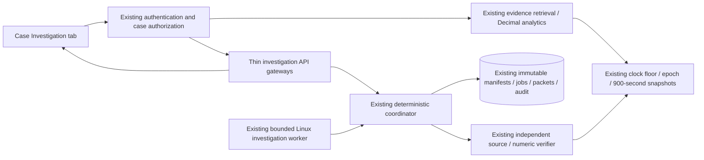

# G2.1 — Analyst investigation workbench

## 1. Scope and acceptance boundary

- Candidate: `codex/project-initialization`, HEAD `a3b2ba49cd92c4aa0401842fa4999897fdc28713` plus the uncommitted G2.1 changes listed below. No commit, push, deployment or live migration is authorized.
- The user explicitly deferred independent native Linux acceptance. Local Docker/WSL results do **not** establish clock stability or release acceptance; G0/G1 clock blockers remain.
- This is a deterministic, evidence-only analyst workspace, **not** a completed AI investigator. No LLM, provider credentials, regulatory publication or autonomous disposition is activated.
- Original G1 cohort remains 16 connected cases, 6 completed assessments, 10 pending jobs and 4 stored packets. G2.1 does not force these jobs to complete or claim these historical packets are currently time-valid.

## 2. Screens and navigation

| View | Supported interactions |
|---|---|
| Existing dashboard / case overview | Authorized case navigation, case state, assigned analyst/identifier; explicit unassigned message |
| Existing assessment workflow / case detail | Actual durable RF request, stored score, policy, SHAP, provenance and assessment history |
| **Investigation** case tab: Customer & accounts | Authorized KYC observations, missing versus observed-zero income, linked account/relationship handles, conflict indicators, bounded cursor pages, source/version hashes and coverage |
| Transactions & analytics | Explicit UTC `[start,end)` window and one currency; 25-row cursor pages; server Decimal totals, observed velocity buckets, concentration, reversal treatment and limitations |
| Verified packets | Explicit asynchronous request, Pending/Running/Succeeded/Abstained/Failed/Invalidated states; verified facts/references, questions, gaps, conflicts, abstention and own-request history |

Routes are `/#/cases/{case_id}`, `/assessment` and `/investigation`. Selecting a stored assessment binds that identity; selecting evidence-only does not invent a score. Existing SHAP visualization is reused. Financial observations are distinct from model signals and human decisions.

## 3. Backend gateways and reuse

| Endpoint | Implementation / constraints |
|---|---|
| `POST /api/v1/cases/{case_id}/investigations` | **New** thin gateway; HTTP 202, Location, Retry-After; existing strict `InvestigationRequest`, explicit revisions/assessment selection/window/currencies and Idempotency-Key |
| `GET /api/v1/cases/{case_id}/investigations?limit=10&offset=0` | **New** requester-and-case-scoped history; max 20/page, offset <=1000; metadata only, `stored_not_revalidated` |
| `GET /api/v1/cases/{case_id}/investigations/{run_id}` | **New** gateway to existing coordinator `get`; independent source/numeric verification and stale/authorization fencing before packet publication; <=512 KiB response |
| Existing `/overview`, `/assessments`, `/assessment-jobs` | Unchanged model/assessment operations and authorization |
| Existing `/evidence` and POST `/customers`, `/related`, `/transactions`, `/activity` | Existing authorized retrieval and deterministic analytics; no duplicated financial logic |

The existing evidence error boundary additionally exposes fixed `X-TrueFlag-Reason: clock_uncertainty` (503) and `snapshot_stale` (409). CORS exposes this allowlisted header; no internal error details are returned.



## 4. Contracts and provenance

- Reuses immutable input manifests binding case version, evidence/access revisions, assessment identity, window, currencies, source versions and record hashes. No database migration is added.
- Model score/policy/SHAP are stored model signals, not transaction facts or causal/criminal evidence. Existing model semantics and artifacts are unchanged.
- Decimal monetary strings are displayed directly. JavaScript numbers are used only for visual concentration meters; the browser does not sum financial observations or convert currencies.
- Transaction/analytics retrieval is sequential and abort-aware: one active read per view, matching the existing backend's actor/case locking. A cancelled development StrictMode mount does not dispatch its remaining calculations.
- Packet result is rendered only with a successful/abstained state, evidence-only mode, `provider_used=false` and successful independent verification metadata. Detail retrieval independently revalidates source records through the original coordinator.
- History is deliberately **own-request history**, including for supervisors/admins: existing requester scope is preserved. A stored history state is not a promise of current validity. Opening a run revalidates it.
- Evidence references include immutable record and source-version identifiers/hashes. Regulatory citations remain absent. Hypotheses/questions are predefined templates; no unsupported criminal or SAR conclusion is produced.

## 5. Authorization and resource boundaries

- Existing server-enforced analyst assignment, supervisor/admin scope, active-user checks and source permissions apply to every gateway and evidence read. Unknown, cross-case and cross-requester runs cannot be enumerated.
- Existing shared authenticated rate budget (120/min), four evidence slots and coordinator queue bounds (three active requests per actor, 100 globally) are preserved. POST body <=12 KiB; duplicate JSON keys and additional fields are rejected.
- Context permission/revision rechecks: every 15 seconds, max 30 checks; explicit refresh thereafter. Root current-user/case guards and visibility cleanup remain in place. Revocation is polling-based, not instantaneous push; all subsequent server reads are checked.
- Packet polling: 2-second intervals, max 40 checks, bounded Retry-After handling and explicit manual status refresh. Unmount/logout aborts requests and clears protected views.
- Submission receipts are session-memory-only, bounded to 100 intents, binding case and canonical request body to one UUID idempotency key. Ambiguous network failures reuse the same key; no automatic mutation retry or failed-job reset is introduced.
- Authentication tokens, snapshots and receipt state are not written to browser storage. Raw 27-predictor snapshots, worker tokens and private artifacts are not added to these views or responses.

## 6. Loading, failures and incomplete data

| Condition | UI / server behavior |
|---|---|
| No completed assessment / pending job | Show actual processing state and evidence-only option; no fabricated score |
| Missing transactions / relationships / expected activity | Explicit missing/partial coverage; missing totals are not displayed as zero |
| Unassigned case | Manager-visible assignment requirement; analyst access denied by backend |
| 401 / 403 / 404 | Session expiry or protected-state clearing; no stale case contents |
| Revision change / 409 / invalid or expired snapshot | Clear protected observations and require a fresh context |
| Clock uncertainty / 503 | Clear protected observations; explicit clock-safety message; no guard bypass or expiry extension |
| Worker downtime / failed / invalidated packet | Bounded waiting, explicit status check, manual-review or stale warning; no forced completion |
| Incomplete/conflicting evidence | Render verifier-approved limitations/questions/abstention rather than a conclusive narrative |

## 7. Verification environment and commands

- Disposable G2 database cloned from the isolated G1 database, on the existing owned PostgreSQL 17.11 rehearsal cluster; source/demo cluster identity is explicitly forbidden. Existing schema `0016_snapshot_clock` checked before use.
- Tests use per-test disposable schemas; browser fixtures use a new ephemeral schema. The source G1 database, original cohort, backups, demo schema `0012_evidence_foundation`, roles, credentials and `.env` are outside the write target.
- Linux runtime: existing pinned verification images, read-only application/model mounts, <=2 CPUs, 3 GiB and 128 PIDs per container. Offline scientific replay uses `--network none`.
- Browser fixture uses normal production token issuance (`strict_auth=true`), not the legacy test-only timestamp backdating. It joins a separate disposable UI bridge for Windows loopback `18010`; PostgreSQL remains internal with no published port. No provider is enabled and no external provider call is made. This UI bridge does not constitute an egress firewall.
- First browser attempt: 0 passed/5 failed because the internal Docker bridge did not forward its published API port to Windows (`ECONNREFUSED`). Test-only ingress and per-run control-file isolation were corrected; results below supersede this harness failure without erasing it.

```powershell
.venv\Scripts\python.exe -B scripts/build_release_manifest.py
.venv\Scripts\python.exe -B runtime/g2-1/run.py --mode gateway --label gateway-first
.venv\Scripts\python.exe -B runtime/g2-1/run.py --mode gateway --label gateway-real-binding
.venv\Scripts\python.exe -B runtime/g2-1/run.py --mode full --label backend-full
.venv\Scripts\python.exe -B scripts/run_investigation_e2e.py
.venv\Scripts\python.exe -B scripts/run_ml_verification.py --check tests
.venv\Scripts\python.exe -B scripts/run_ml_verification.py --check scoring
.venv\Scripts\python.exe -B scripts/run_ml_verification.py --check policy
.venv\Scripts\python.exe -B scripts/run_ml_verification.py --check shap
.venv\Scripts\ruff.exe check backend scripts
.venv\Scripts\ruff.exe format --check backend scripts
.venv\Scripts\python.exe -B scripts/check_publication.py
# In frontend:
npm.cmd test
npm.cmd run lint
npm.cmd run format:check
npm.cmd run build
```

`runtime/g2-1/run.py` and private state are ignored local runners, not deployable release configuration. `scripts/run_investigation_e2e.py` fails without the owned G2 marker/database, passes secrets privately and leaves the demo untouched.

| Check | Passed | Failed | Skipped | Evidence / limitations |
|---|---:|---:|---:|---|
| New real Linux/PostgreSQL gateway tests, expanded | 15 | 0 | 0 | Initial 13 plus actual RF/SHAP-bound sequential/concurrent transaction and analytics reads; async worker/packet/history, idempotency, cross-case, revocation, invalid inputs, clock denial and capacity |
| React component/API tests | 65 | 0 | 0 | Includes 11 workbench tests, including bounded read/cancellation; timer-fixture shadowing corrected before final runs |
| Pinned offline ML tests | 178 | 0 | 0 | Actual staged artifacts |
| Frozen RF replay | 4,000 | 0 | 0 | Max absolute score error 0; unchanged 1e-12 tolerance |
| Frozen policy replay | 12,000 | 0 | 0 | Zero route/trace/count differences; Coverage overrides 456 |
| Frozen SHAP replay | 4,000 | 0 | 0 | Model/encoded/grouped/base differences 0; maximum reconstruction residual 3.1086244689504383e-15, unchanged 1e-6 bound; 87 missing/22 zero-income rows |
| Full Linux/PostgreSQL | 1,012 | 6 | 0 | 1,018 collected; 1,038.78 seconds; all six failures have direct one-second clock-regression observations |
| Controlled clock/snapshot/release focus | 54 | 0 | 0 | Expiry/replay, epoch/floor persistence, tamper and readiness checks |
| Worker authentication/handshake/crash recovery | 12 | 0 | 0 | Original worker patterns unchanged |
| Chromium real workflow before final presentation/history correction | 5 | 0 | 0 | 45.5 seconds; real RF/SHAP/analytics/packet/history, idempotency, revocation, logout and controlled real-503 check; axe scan passed |
| Chromium after final presentation/history correction | 5 | 0 | 0 | 44.8 seconds; history refreshes to Succeeded; real services, no response mocks, axe scan passed |
| Python lint / formatting | PASS | | | 197 files checked; no unrelated reformatting |
| React lint / formatting / TypeScript / Vite build | PASS | | | Final reviewed files; 39 modules, JS 300.79 kB / gzip 91.17 kB, CSS 20.61 kB |
| Publication boundaries | PASS | | | 325 source candidates; private/secret ignore boundaries verified |

Counts are distinct runs with overlap, not an additive release pass total. PostgreSQL unit fixtures reuse the existing two-second synthetic JWT backdating helper; the new browser run explicitly does not. Unit UI contract fixtures are not represented as actual scientific acceptance results.

### Full-suite failure classification

All six failures record `unsafe=true`, epoch 2 and `now=high_water-1` in the existing guard diagnostics. Five surface directly as `ClockUnavailable`; the gateway positive-worker assertion fails after the same guard denial. No assertion was relaxed.

| Test (under `backend/tests/`) | Interrupted stage |
|---|---|
| `test_evidence_read.py::test_filters_status_missing_time_and_kyc_limits` | Transaction retrieval |
| `test_evidence_read.py::test_legacy_aggregate_case_is_explicitly_insufficient` | Context creation |
| `test_investigation_api.py::test_revocation_invalidates_packet_without_data[assignment]` | Positive worker completion before the revocation assertion |
| `test_investigation_coordinator.py::test_independent_validation_rejects_tampered_worker_output[context]` | Initial packet assembly/model retrieval |
| `test_investigation_coordinator.py::test_run_id_cannot_be_reused_under_another_authorized_case` | Context creation |
| `test_investigation_drafts.py::test_provider_failures_are_bounded_and_manual_review[timeout]` | Existing mocked-provider fixture's evidence retrieval; no live provider was activated |

The full run recorded 70 process wall-clock backsteps. This is local guest-clock evidence, not a host synchronization diagnosis. It also contains intentionally rejected negative tests; raw SQL-error counts must not be interpreted as application incidents. The backend application files were unchanged after full collection; two extra actual-model HTTP read tests and final frontend refinements were verified separately.

### Browser investigation and corrections

- Transport setup: published port on an internal Docker bridge was unreachable from Windows. Added an owned disposable API-only UI bridge; the database remains internal. Each attempt receives a fresh protected control directory.
- Login test fixture: hash-only `page.goto` retains the memory session; tests now explicitly reload before asserting a new login. This changes the test, not authentication.
- Earlier real-browser runs encountered a generic analytics 503 with other in-flight reads cancelled. Four direct scored-context reads, both sequential and concurrent, passed in PostgreSQL tests. The original browser exception was not captured, so its root cause remains **unconfirmed**; do not label it a proven clock or SQL-lock defect.
- The view now serializes the four reads because the actual service serializes actor/case access. The subsequent five-test run passed and fixture-only SQL/read exception diagnostics were empty. This verifies the bounded workflow, not a production concurrency guarantee or proof of the historical 503 cause.
- One later strict-auth attempt returned token 200 followed by current-user 401, leaving the login screen. The exact rejection cause was not instrumented; clock instability is not presented as a confirmed cause for this event. No backdating, leeway or automatic login retry was introduced to hide it.
- Visual review found history remained at its initial Pending state after detail succeeded. History now refreshes on job-state changes. Verified fact headings identify their calculation; concentration detail displays the server's stored shares. Scoped panel spacing was corrected without changing existing branding files.
- Final browser screenshot: ignored `runtime/g2-1/workbench.png`, synthetic records only. API/database fixtures were torn down after each run; the original cohort was not replaced by browser fixtures.

## 8. Files and preservation

| New G2.1 files | Responsibility |
|---|---|
| `backend/app/api/investigations.py`, `schemas/investigation_api.py`, `services/investigation_api.py` | Thin protected gateways, allowlisted responses, bounded audited history |
| `backend/tests/test_investigation_api.py` | Real PostgreSQL gateway/security tests |
| `frontend/src/investigation-api.ts`, `investigation.tsx`, `investigation.css` | Typed clients and evidence/analytics/packet workspace using existing design tokens |
| `frontend/src/investigation.test.tsx`, `frontend/e2e/investigation.spec.ts` | Component and real-browser checks |
| `scripts/run_investigation_e2e.py` | Guarded isolated browser fixture launcher |

Modified existing files only for G2.1: `backend/app/main.py` (router/header exposure), `backend/app/api/evidence.py` (fixed safe error headers), `frontend/src/api.ts` (header allowlist), `App.tsx` (session-scoped integration), `workbench.tsx` (case tab/assignment display), `scripts/serve_frontend_acceptance.py` (opt-in isolated connected fixtures/strict auth/private negative-test controls). Existing branding CSS/logo and unrelated G0/G1 dirty files are preserved. Generated ignored build identities reflect the dirty candidate, not a new Git release.

Final candidate build identity: `224744254e670158734b9989af8e0f38c4662ec5999c2e888d9ee6cf2e102286`; source digest `9579a58a205eefea64b90d115bdaa59a67a3a7d9f43cb58bbc6b6bfceb7ac492`; image digest unknown. This is an uncommitted working-tree identity, not a release tag.

Preservation verification: 346 pre-existing files/private inputs checked, only the six intended existing source files and two ignored generated identity files changed. `.env`, original scientific assets and both original backups matched their initial digests. Original G1 and cloned G2 public-schema row/catalog fingerprints matched their baselines; all disposable schemas were removed. PostgreSQL integrity: 111 foreign keys checked, zero orphan rows, invalid constraints or invalid indexes. Live cluster identity/schema remained `0012_evidence_foundation`; no live migration or deployment occurred. The owned isolated PostgreSQL cluster is stopped after verification, retaining all volumes, backups and cohort records; live demo services remain running.

## 9. Known limitations and remaining G2 work

- Independent clock-stable Linux release acceptance remains deferred; fail-closed clock denials can prevent valid local workflows. A passing rerun would not resolve host clock health.
- No production worker deployment, public demo migration or UI deployment is performed. Current live demo does not automatically acquire this new view.
- No analyst directory/editor, shared team packet history, human dispositions, narrative drafting or LLM investigator is introduced. Assignment still uses the existing authorized API.
- Workspace assessment dropdown uses the existing bounded recent-history page; full assessment history remains in the existing case view. Packet history is limited to the first 1,020 own requests. Analytics are single-currency and source-bounded, with no FX conversion or inferred settlement.
- Refresh/log-out clears the memory session and requires login. Uncertain packet submissions can be recovered through own-request history after login; idempotency receipts are not retained across browser restart.
- Existing evidence/worker bounds can reject larger manifests; the UI exposes these failures rather than truncating facts into a misleading result.

## 10. Acceptance decision and next subphase

**G2.1 implemented and locally workflow-verified; full release acceptance remains blocked by clock instability.** Final browser, focused security and scientific checks passed, but the six failed full-suite tests remain failed acceptance evidence. Do not treat the original 16-case cohort as fully accepted or begin later phases automatically.

Recommended G2.2 discussion: analyst workflow acceptance and assignment/navigation improvements on this evidence-only foundation, after reviewing the actual G2.1 browser/security results and resolving or explicitly retaining the clock-stable runner blocker. External LLM/RAG activation remains a separate authorization and acceptance gate.
