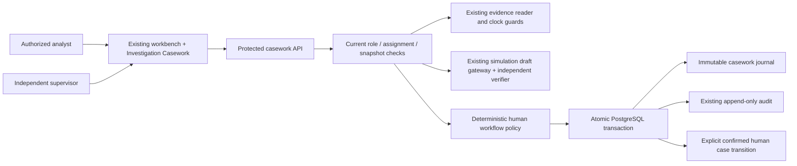

# G3.1 — Human investigation casework

## Scope

- Human-controlled notes/addenda, information requests/responses, finding reviews, escalation, independent supervisor response and confirmed internal resolution.
- Reuses G2 authorization/assignment/activity, G4.3A simulated drafts, the source-bound evidence reader, numeric verifier, transaction/audit infrastructure and design tokens. No duplicate investigation engine or new worker queue.
- No provider calls, regulatory publication, SAR action, model changes or autonomous disposition. Submitted human rationale is analyst-authored text, not independently verified financial fact.

## Workflow and project policy

| Stage | Implemented behavior |
| --- | --- |
| Investigation Notes | Submitted plain text, current source links, server author/time. Own-note corrections append a new note with parent identity. No edit/delete endpoint or stored draft state. Unsaved forms stay in memory only. |
| Additional Information Requested | Five typed categories, assigned-analyst/supervisor responsible role, optional calendar due date. Internal tracking only; no delivery integration. |
| Request response | Resolve with at least one currently authorized supporting record, or explicitly cancel with rationale. Responses preserve the original request. Supervisor-owned requests require a manager response. |
| Review Findings | Requester's current verified offline draft; exact content hash and claim UUID. Accept for consideration/reject/defer/further investigation are separate human records. Neither acceptance nor rejection changes the original finding or final disposition. |
| Supervisor Review | One pending escalation per case; manager queue with bounded identifiers and attribution. Another active supervisor/admin responds. Self-approval is forbidden, including admin. Return-for-investigation preserves unresolved work; approval requires prerequisites below. |
| Case Resolution | Explicit confirmation by the approving supervisor, different from escalating actor. Requires that approval remain the latest journal revision and match current case/evidence/access versions and selected outcome. New work requires renewed approval. |

**Approval/finalization prerequisites:** current submitted note; at least one current verified finding review; latest review for each currently relevant draft/claim is accept-for-consideration or reject; no open information requests. Existing independent draft/source/numeric verification is rerun. Reviews from earlier case/evidence/access revisions remain history and cannot satisfy current approval. A new verified review is required after an interim outcome changes the case version. Rejected findings remain stored unchanged. Missing evidence does not become zero activity. Incomplete work can be documented/escalated/returned but cannot bypass these gates. A stale escalation may be returned for fresh investigation; approval of that stale escalation is denied.

| Configured internal outcome | Case effect after explicit human confirmation |
| --- | --- |
| Additional Review Required | `in_review`, no legacy disposition |
| Escalated for Compliance Review | `in_review`, no external compliance/filing action |
| No Further Action Recommended | `closed`, legacy `disposition=close` |
| Investigation Completed | `closed`, legacy `disposition=close` |

The full project-specific outcome remains in the immutable journal; legacy disposition is only a compatibility projection. Configuration `casework_allowed_resolutions` can restrict the four outcomes, but cannot disable separation of duties, verification, confirmation or prerequisites. Closed cases remain readable; reopening/post-resolution addenda are outside G3.1.

## Architecture and files

| Files | Responsibility |
| --- | --- |
| `backend/app/models/casework.py`, `backend/alembic/versions/0018_human_casework.py` | Immutable journal, scoped parents, revision/key uniqueness, DB audit envelope. |
| `backend/app/schemas/casework.py`, `backend/app/services/casework.py`, `backend/app/api/casework.py` | Strict commands, current proof, project policy, protected reads/writes/queue. |
| `backend/app/core/config.py`, `backend/app/core/schema.py`, `backend/app/main.py`, `backend/app/models/__init__.py` | Outcome allowlist, candidate schema compatibility, registration. |
| `backend/app/schemas/draft_api.py`, `backend/app/services/draft_api.py` | Add original immutable draft content hash to existing verified simulation projection. |
| `backend/app/services/case_workflows.py` | Case-bound audit action allowlist for existing Activity History. |
| `frontend/src/human-casework-api.ts`, `human-casework.tsx`, `human-casework.css` | Casework client/forms/history/confirmation/evidence inspector/supervisor queue. |
| `frontend/src/App.tsx`, `workbench.tsx`, `case-workflows.tsx`, `draft-api.ts` | Existing navigation, case view, activity labels and additive draft contract. |
| `backend/tests/test_human_casework.py`, `frontend/src/human-casework.test.tsx`, `frontend/e2e/human.spec.ts` | PostgreSQL security/atomicity, UI and actual browser acceptance. |
| `scripts/run_investigation_e2e.py`, `scripts/serve_frontend_acceptance.py` | Guarded isolated browser launch; value-free clock diagnostics. |

## Database and operational boundaries

- Migration **0018** is additive and requires coordinated candidate API/worker schema identity. Original demo is not a migration target. Disposable acceptance schemas upgrade through Alembic; a populated journal refuses downgrade to prevent silent history loss.
- One bounded journal: maximum 1,000 entries/case, 4,000 rationale characters, ten exact supporting references/command, 20 history items/page. Existing 12 KiB JSON body, shared request-rate limit, four read slots and short DB timeouts apply.
- Existing coordinator advisory gate precedes actor/case locks. This serializes short writes and prevents the lock inversion reproduced/fixed in G4.3A. It is a scalability boundary, not measured enterprise capacity.
- No email, attachments, real banking integrations, note exports, editable submitted history, custom assignment directories, regulatory review or reopening workflow was added.

See [decision/audit contract](G3_1_CASE_DECISION_AND_AUDIT_CONTRACT.md) and [actual test/visual QA](G3_1_FRONTEND_FUNCTIONAL_QA.md). Stable-runner release acceptance, the earlier analytics 503 investigation, live-provider quality/privacy approval and regulatory source approval remain separate gates. G3.1 provides internal synthetic casework, not a regulatory certification or completed production case-management system.
