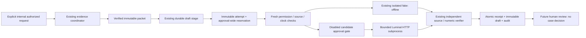

# G4.1 — Real provider adapter, disabled candidate

## 1. Scope and implementation plan

- Development branch `codex/project-initialization`, HEAD `a3b2ba49cd92c4aa0401842fa4999897fdc28713` plus existing uncommitted work. No commit, push, deployment, live migration or G4.2/G4.3 activation.
- Plan executed: inspect existing draft/coordinator boundaries; add fixed-host candidate transport and strict selection contract; reuse durable attempts/verifier/persistence; test offline HTTP, PostgreSQL recovery and scientific parity; document approval/evaluation gates.
- **No live inference request was authorized or executed.** Mock transport acceptance does not verify Luminal model availability, schema support, quality, privacy or billing.

## 2. Reused versus new

| Layer / actual file under `backend/` | Responsibility |
|---|---|
| Existing `app/services/investigation_coordinator.py`, `investigation_verifier.py`, `evidence_read.py` | Unchanged case/source/assessment context, independently recomputed records/calculations, 900-second snapshots, floors/epochs and publication fencing. |
| Existing `app/services/investigation_drafts.py` | Extended provider selection/activation checks; existing atomic parent/child admission, idempotency, leases, immutable attempts/receipts/results and audits. No duplicate coordinator or financial engine. |
| Existing `app/services/investigation_draft_verifier.py` | Existing exact reference/numeric verifier reused; adds typed AI-section membership, gap/limitation preservation and classification checks. |
| `app/services/luminal_provider.py` | New `propose(packet, config)` adapter behind existing provider protocol; fixed HTTPS chat endpoint, bounded streamed response and strict parsing. |
| `app/services/live_provider_runner.py`, `app/workers/live_provider_process.py` | New explicit dispatch to existing simulation runner or constrained Linux candidate child. Clean environment, bounded stdin/stdout/resources/deadline/cancellation, no inherited DB/JWT credentials. |
| `app/schemas/provider_live.py` | New candidate config, versioned AI selection/projection schema and prompt hash. Existing fake configuration/prompt remains available. |
| `alembic/versions/0017_live_provider.py` | Replaces only the draft-envelope function to admit the registered candidate identity. Existing immutable-history/budget/publication triggers remain. No new tables. Candidate expected schema becomes `0017_live_provider`; original demo remains unchanged. |
| `app/core/config.py`, `app/schemas/investigation_drafts.py`, `app/workers/investigation_draft_worker.py` | Server-only approval/key/rates, typed reported usage, accurate candidate/simulation worker labels. HTTPX was already locked at 0.28.1; now an explicit runtime dependency. |

## 3. API verification evidence

Public documentation inspected for this task; no authenticated `/models`, inference or billing request made.

| Candidate behavior | Evidence / exact status |
|---|---|
| Endpoint host and chat-completions family | [Luminal terms](https://dash.luminal.com/terms), effective October 21, 2026, identify the text host and chat-completions compatibility. Specific request/envelope fields below are **candidate assumptions tested offline**, not live-verified. |
| `deepseek-ai/DeepSeek-V4.1-Flash` | Listed on [official pricing](https://www.luminal.com/pricing). Listing is not authenticated availability or a pinned model-snapshot attestation. |
| POST `/v1/chat/completions`, bearer auth, `messages`, `max_tokens`, nonstreaming single choice | Implemented OpenAI-compatible candidate contract; tested using HTTPX `MockTransport`. No OpenAI service/SDK used. |
| `response_format=json_schema`, strict schema | **Unverified on Luminal.** Public endpoint documentation/OpenAPI could not be retrieved. Unsupported-format HTTP 400/422 is terminal; no silent JSON/text downgrade. |
| `choices[0].message.content`, `finish_reason`, exact returned model ID, usage counters | Strict candidate parser tested offline. Alias differences, missing/invalid usage, tool calls, malformed/oversized envelopes fail closed. |
| Privacy/retention and backup routing | Terms disclose fallback providers; privacy page could not be retrieved reliably. Detailed retention, training, regions and subprocessors remain unverified and require human review. |

## 4. Execution and reliability

- Existing authenticated internal request freezes parent case/evidence/access/assessment identities. Candidate config binds approval ID, terms digest, provider/model, fixed endpoint, prompt/output contract, synthetic-only scope and token/rate/cost limits.
- `prepare` revalidates the source-backed packet, commits a unique attempt and token reservation. `recheck_dispatch` repeats permission/source/clock and minimized-input hash checks immediately before adapter execution. Publication independently revalidates current source records and stored model outputs.
- Per-request deadline 1–10 seconds (default 8), request <=96 KiB, response <=64 KiB, content <=16 KiB, output <=16,384 tokens, <=3 durable attempts (default 1). No SDK/transport auto-retries.
- Explicit 429 rejection may schedule bounded 2–30 second backoff, within immutable attempt/token/spend limits. Auth rejection, unsupported format, ambiguous network/timeout/5xx, malformed content and incomplete/refused results do not automatically repeat candidate calls.
- Crash after a candidate attempt reservation fails for manual review on recovery; uncertain paid requests are never automatically redispatched. Simulated existing retry behavior is retained.
- Approval-wide advisory locking sums retained conservative reservations across runs; failed/unknown outcomes do not automatically refund budget. Usage includes reported tokens, configured-rate estimate and monotonic processing latency. It is not an independently verified invoice or a tokenizer-derived hard billing guarantee; see activation document.

## 5. Verification ledger

| Command from repository root | Actual result |
|---|---|
| `.venv/Scripts/python.exe -B runtime/g4-1/run.py --mode unit --label unit-first` | 42 passed, 0 failed, 0 skipped on initial adapter. Later integration runs also include added child-process and approval tests. |
| Same runner `--mode focus --label focus-first` | 171 passed, 4 failed, 0 skipped. New source-revocation test used an incorrect method name (corrected). Three existing tests recorded one-second DB-clock regressions and `ClockUnavailable`. |
| Same runner `--mode focus --label focus-second` | 175 passed, 4 failed, 0 skipped. All new candidate tests passed. Four existing draft/coordinator tests directly recorded one-second high-water regressions; guards retained. |
| Same runner `--mode clock --label clock-final` | **54 passed, 0 failed, 0 skipped**: clock, snapshot, expiry/replay and release compatibility. |
| Same runner `--mode focus --label focus-final` | **176 passed, 3 failed, 0 skipped** (179 total, before final rollback-test addition). Failures: existing `[unavailable]` abstention, `[timezone_unknown]` coordinator and `[case]` stale-publication tests, all directly recording one-second high-water regressions. No unconditional integrated PASS claimed. |
| Same runner `--mode provider --label provider-final` | 58 passed, 1 failed, 0 skipped. Migration roundtrip preserved stored digest; subsequent authorized read correctly denied a one-second clock regression. |
| Same runner `--mode provider --label provider-acceptance` | **59 passed, 1 failed, 0 skipped** (60 total): final new HTTP/child-process/PostgreSQL tests including atomic publication rollback. Failure: `test_withdrawn_provider_authorization_cannot_dispatch`, during parent setup, observed now 1794795861 below high-water 1794795862; no dispatch occurred. The withdrawal assertion passed in the broader run. |
| Same runner `--mode unit --label unit-final` | **43 passed, 0 failed, 0 skipped** on final candidate; adapter, mock contract, strict schema, authorization, failures, actual mocked child entrypoint and child cancellation/deadline tests. These overlap the provider/focus runs; do not sum them as unique tests. |
| `.venv/Scripts/python.exe -B scripts/run_ml_verification.py --check tests` | **178 passed**, pinned Linux ML runtime, network disabled. |
| Same script `--check scoring` | **4,000 matched**, max absolute error **0**, zero mismatches; tolerance `1e-12`. |
| Same script `--check policy` | **12,000 matched routes**, zero route/trace/retained-total differences; original scores also replayed. |
| Same script `--check shap` | **4,000 verified**, zero encoded/grouped/base reference differences, max score difference **0**; reconstruction residual **3.1086244689504383e-15**, original reconstruction tolerance `1e-6`. Missing-income 87 and zero-income 22 preserved. |
| `cd frontend; npm.cmd test` | **85 passed, 0 failed, 0 skipped**. No frontend feature changes. |
| Frontend `npm.cmd run lint`, `npm.cmd run build`, `npm.cmd run format:check` | Passed; TypeScript and production build included. No G4.1 browser/live-provider UI acceptance claimed. |
| `.venv/Scripts/ruff.exe check backend scripts`, `ruff.exe format --check backend scripts` | Passed; **208** Python files formatted. |
| `.venv/Scripts/python.exe -B scripts/check_publication.py` | Passed; **355** source candidates, private/secret ignore boundaries verified. |
| `.venv/Scripts/python.exe -B runtime/g4-1/finalize.py --stop` | **PASS**: 376 baseline files, original cohorts/backups/scientific files and `.env` preserved; disposable schemas removed; 111 foreign keys checked, zero orphan/invalid constraints/indexes. Only the owned rehearsal DB stopped. |

The isolated Docker/WSL environment is not an independently clock-stable native Linux release runner. Fail-closed denials remain genuine failures in suites expecting healthy time; they are not relabeled as passes. Full backend-suite or production-capacity acceptance is not claimed.

## 6. Next gates

- **Adapter development implemented; integrated acceptance remains qualified by clock failures.** No new unresolved application defect identified in final tests; no fully green integrated or release acceptance is claimed. Live-provider acceptance remains **not authorized / unverified**.
- G4.2: independent semantic labels and held-out scenarios; evidence support, unsupported allegations, contradiction/abstention, injection, context completeness, latency, token/reasoning behavior, cost reconciliation and failure recovery with a separately authorized real model.
- G4.3: protected request/status/history/detail APIs and human review UI. No new AI action or live-investigator claim is enabled here.
- Cross-links: [security/activation](G4_1_PROVIDER_SECURITY_AND_ACTIVATION.md), [output contract](G4_1_AI_OUTPUT_CONTRACT.md).

## 7. Candidate identity and boundaries

- Final public-source digest `e1a17a03a01856d500a16bee339bd106fd8656f8ad506211f822951f34db4d68`; build ID `f001291fdfd59d46e840e16e28a6af27626f8479fc2cf9701dd1fb13617ac040`; image digest unknown. Schema expectation `0017_live_provider` applies to this candidate, not the untouched demo.
- New tests exercise auth/key rejection, disabled approval/rate/spend gates, redirects, unsupported schema, malformed JSON, duplicate keys, tool calls, oversized responses, timeout/network interruption, unknown references, unsupported numbers/prose, source revocation, clock denial, idempotency, retained grant reservations, lease/crash recovery, atomic DB rollback and migration roundtrip/downgrade retention.
- Final local configuration check returned `complete_live_activation_present=false` without printing any environment value or credential. No frontend AI activation or live model result exists.
- Clock evidence and exact private test reports remain in ignored, owner-only `runtime/g4-1`; original failure records are retained. Upstream host/guest clock cause is not newly established here.
- Preservation confirmed original G1/G2 public-schema fingerprints and the live demo cluster/schema (`0012_evidence_foundation`) unchanged. All volumes, demo records and backups retained. No live DB-role/credential change. Existing G2.3 intermittent analytics-503 cause is not declared resolved by this phase.
- Branch/HEAD unchanged; G4.1 files remain uncommitted. No push, deployment, live API call, regulatory source publication or later-phase implementation.
- G4.2 offline evaluation/rubric preparation can be separately authorized. **Live G4.2 evaluation is blocked** until explicit provider/data-transfer/retention/spending authorization and a controlled compatibility probe; release still requires the independent stable-runner gate. No G4.2/G4.3 work begins automatically.
