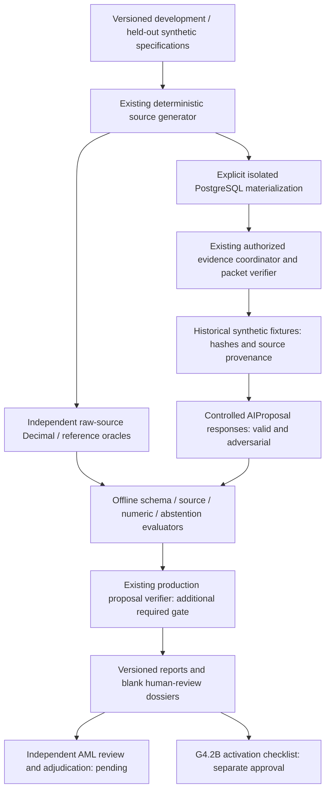

# G4.2A — Offline independent AI-investigation evaluation

## 1. Decision and scope

- Offline framework implemented; **not a validated model or live-provider acceptance**. No live inference, external evidence transfer, corpus publication, demo migration, commit, push or deployment.
- Branch `codex/project-initialization`; unchanged HEAD `a3b2ba49cd92c4aa0401842fa4999897fdc28713`, plus preserved earlier uncommitted work.
- G4.1 provider remains disabled. This phase adds evaluation code, contracts, tests and documentation; it does not create another investigation engine, change the frozen ML pipeline or implement frontend features.
- Local PostgreSQL/WSL clock regressions continue to block unconditional integrated acceptance. Failed cases remain failures, not skips or successful reruns.

## 2. Architecture and actual files



| Path under repository root | Responsibility |
|---|---|
| `contracts/investigation_eval_dataset_v1.json` | 36 versioned specifications, 18 categories per split, disjoint seeds and case keys. |
| `contracts/investigation_eval_rubric_v1.json` | Seven semantic dimensions, explicit score anchors, empty/unapproved reviewer registry and unapproved live thresholds. |
| `backend/app/evaluation/dataset.py`, `oracles.py` | Reproducible source identity, record/version membership, raw-source amounts/directions/currencies/windows, gross/reversal calculations and evidence-sufficiency checks. |
| `backend/app/evaluation/materialize.py` | Explicit owned-cluster/database/schema fencing; reuses `EvidenceService`, `InvestigationCoordinator`, revision/revocation and clock checks. Never targets the public demo schema. |
| `backend/app/evaluation/controlled.py`, `evaluators.py` | Controlled structured responses; independent source/numeric gates plus existing `validate_proposal`. No provider, model, legal or case-decision authority. |
| `backend/app/evaluation/harness.py`, `metrics.py` | Bounded fixture replay, explicit denominators, failure classifications, baseline/adversarial grouping, monotonic evaluator latency and clearly simulated operational accounting. |
| `backend/app/evaluation/review.py` | Blank review tasks, strict review intake, exact report/dossier/output bindings and hash-linked local events. No automatic semantic approval. |
| `scripts/run_investigation_evaluation.py` | Offline report/review-dossier CLI; exclusive-create artifacts restricted to ignored `runtime/`. No network/database calls. |
| `scripts/record_investigation_review.py` | Bounded independent-submission intake; requires separately approved registry and exact dossier/report bindings. |
| `backend/tests/test_investigation_evaluation.py`, `test_evaluation_materialization.py` | Offline units and real PostgreSQL source-backed materialization/adversarial/security tests. |

Reused unchanged: existing evidence reader, coordinator, source/numeric packet verifier, G1 source oracle (`connected_scenarios.expected_activity`), proposal schema/minimizer/verifier, provider adapter and durable draft execution. Existing regression tests cover stored RF/Policy/SHAP signal identity; this evidence-only cohort deliberately has no fabricated model assessments.

## 3. Dataset and reference procedure

| Category pairs: development + held-out | Existing source profile / purpose |
|---|---|
| Ordinary; velocity; concentration | `g1_ordinary`, `burst`, `g1_concentration` |
| Financial changes; linked accounts | `g1_flow_change`, `g1_related` |
| Missing income; recorded zero | `missing_income`, `zero_income`; retain null versus observed zero. |
| Reversals; multiple currencies | `corrections`, `multi_currency`; gross 13 versus reversal-adjusted 11 observations; separate USD/CAD arithmetic. |
| Incomplete history; conflicting information | `partial`, `inconsistent_kyc`; required limitations/abstention. |
| Unsupported allegations; forged references | `normal` evidence with hostile output controls. |
| Description injection | `normal` plus explicit **test-side annotation only**; canonical schema has no description field. |
| Revoked source; stale snapshot | `normal`; actual source-access withdrawal or revision through existing services. |
| Inconclusive; competing explanations | `unavailable`, `g1_related`; abstention and human interpretation coverage. |

1. Freeze dataset/rubric versions. Development seeds `731000..731017`; held-out seeds `947000..947017`. Source scenario UUIDs derive from dataset version and case key. These new seeds are separate from the earlier G1/prompt-development cohort; held-out judgments are not used for tuning.
2. Generate records using the existing deterministic source generator (default historical as-of January 1, 2026). Compute canonical bundle digests; derive expected source identity/version/reference UUIDs directly from canonical raw records.
3. Materialize through actual evidence/coordinator services in a fresh PostgreSQL schema. Save only an independently checked packet and synthetic provenance. Revocation/revision controls require actual service denial; a clock exception cannot stand in for either denial.
4. Independently recompute amounts, directional totals/counts, currency/window membership, reversal treatment and concentration using raw records and Decimal arithmetic. Never derive expected totals from the provider or packet being evaluated.
5. Generate valid and intentionally invalid proposals as engineering test controls. Test both independent evaluator gates and the existing production verifier. No expected semantic answers are generated by a model.
6. Export exact candidate outputs, packet, source rows and reference calculations to blank human-review dossiers. Semantic truth remains unreviewed until independent qualified review.

Canonical contract digests (application `digest`, canonical JSON):

- Dataset: `e069fa565ae595372bd6c1e814c3a0c37ee80a8ac664ea882a42b308036710fa`.
- Rubric: `c67f2fd64a24e135298f73adeb9a1526ad56212e6b9ffdce336ce7f7349c19ba`.

Generated case/source IDs and run UUIDs vary with database materialization; recorded manifests bind those exact identities. Replay of the same fixture preserves decisions. Timings/run UUIDs are not expected to be byte-identical.

## 4. Metrics and adversarial scope

| Measurement | Denominator / interpretation |
|---|---|
| Structured-output acceptance | Schema-valid responses / evaluated responses. Intentionally malformed controls reduce this rate. |
| Reference validity | Valid reference occurrences / all reference occurrences in schema-valid responses; repeated occurrences count. Does not prove semantic entailment. |
| Numeric claim accuracy | Correct raw-source numeric assertions / parsed numeric assertions; exact amounts, currency and window. |
| Required abstention | Correct abstention / schema-valid responses with source-required abstention. Adversarial suppression intentionally lowers mixed-cohort accuracy. |
| Adversarial rejection | Rejected hostile controlled outputs / hostile controlled outputs. A verifier measurement, never a real-model quality score. |
| Injection containment | Rejected tool/escalation/false-verification/instruction controls / those controls. No measurement of live-model injection resistance. |
| Lifecycle denial | Actual recorded source/revision denials / eligible materialized lifecycle trials; historical test evidence, not current offline authorization. |
| Latency | Local `perf_counter` evaluator milliseconds, p50 and nearest-rank p95. Not provider latency or production capacity. |
| Unsupported factual claims; semantic/reasoning quality | **null**: independent claim-level human labels and adjudication absent. |
| Provider tokens/cost/latency | **null**: no live calls. Typed operational fixtures distinguish configured-rate mock estimates, reported fixture usage and actual vendor billing. |

Hostile controls: fabricated transfer/counterparty, foreign-case references, wrong total/count/currency/window, missing support, unsupported regulatory/criminal claims, case closure, suppressed gaps/abstention/limitations, tool escalation, false self-verification, embedded instruction, duplicate keys and nonfinite JSON. Typed source/amount tampering, duplicate transaction/fact entries and forged source-version metadata are checked independently of model claims.

## 5. Measured offline results

Reports use the **final `materialize-acceptance` fixtures only**; no successful cases were substituted from earlier runs.

| Measurement | Development | Held-out |
|---|---:|---:|
| Planned cases | 18 | 18 |
| Materialized / clock-blocked | 17 / 1 | 18 / 0 |
| Lifecycle denials | 2 / 2 | 2 / 2 |
| Accepted valid controlled responses | 15 / 15 | 16 / 16 |
| Rejected adversarial controlled responses | 273 / 273 | 291 / 291 |
| Deterministic expectation mismatches | 0 / 288 | 0 / 307 |
| Valid baseline reference occurrences | 383 / 383 | 412 / 412 |
| Correct baseline numeric claims | 72 / 72 | 77 / 77 |
| Correct required baseline abstentions | 3 / 3 | 3 / 3 |
| Mixed schema acceptance | 47.9167% | 47.8827% |
| Mixed reference validity | 97.7652% | 97.7815% |
| Mixed numeric accuracy | 92.8797% | 92.8889% |
| Mixed required abstention | 90% | 90% |
| Evaluator latency p50 / p95, ms | 0.625 / 1.674 | 0.680 / 1.863 |
| Independent semantic reviews / live calls | 0 / 0 | 0 / 0 |

Mixed metrics include intentionally bad outputs. All accepted baseline references/numbers were correct; malformed and unsupported outputs were rejected. These results make **no claim about real-model hallucination, reasoning quality or injection resistance**.

Private report location: owner-protected directory identified by `runtime/g4-2a/current.json`. Reports: `development.json`, `heldout.json`; review dossiers: corresponding `.review.json` files. Source records and exact outputs remain local synthetic artifacts, not public API responses or logs.

File-byte SHA-256 (distinct from canonical JSON binding hashes):

- Development report: `d4b0a27429be0a3df29ef2e5e1e252b127a9edf1d16db4519d2c835414c1ded5`.
- Held-out report: `f435730ffe300db50a192b570fecf55b5e569183049670862c994b86e9f08c16`.
- Review dossiers are bounded below 1 MiB (development 615,877 bytes; held-out 660,520 bytes). CLI intake rejects oversized artifacts.

## 6. Reproduction and verification ledger

From repository root; runtime scripts and state are ignored owner-local infrastructure, not portable credentials:

```text
.venv/Scripts/python.exe -B runtime/g4-2a/run.py --mode unit --label unit-second
.venv/Scripts/python.exe -B runtime/g4-2a/run.py --mode materialize --label materialize-acceptance
.venv/Scripts/python.exe -B runtime/g4-2a/run.py --mode regression --label regression-final
.venv/Scripts/python.exe -B scripts/run_investigation_evaluation.py --fixtures <protected-dir>/fixtures-materialize-acceptance --split development --output <protected-dir>/development.json
.venv/Scripts/python.exe -B scripts/run_investigation_evaluation.py --fixtures <protected-dir>/fixtures-materialize-acceptance --split heldout --output <protected-dir>/heldout.json
.venv/Scripts/python.exe -B scripts/run_ml_verification.py --check tests
.venv/Scripts/python.exe -B scripts/run_ml_verification.py --check scoring
.venv/Scripts/python.exe -B scripts/run_ml_verification.py --check policy
.venv/Scripts/python.exe -B scripts/run_ml_verification.py --check shap
.venv/Scripts/ruff.exe check backend scripts
.venv/Scripts/ruff.exe format --check backend scripts
.venv/Scripts/python.exe -B scripts/check_publication.py
```

For a different authorized isolated PostgreSQL runner, use the checked-in `test_evaluation_materialization.py` tests with explicit expected cluster, forbidden demo cluster, owned database and fixture directory environment variables. Each `platform` fixture migrates only a random disposable schema to candidate head `0017_live_provider`; source writes require the expected isolated cluster and `tf_ingestion_test_<uuid>` schema. Never point this materializer at a demo/production database. Replay CLI itself has no database/provider connection.

Materialization tests explicitly skip when the isolated evaluation target variables are absent; ordinary CI must not infer a target from application/demo settings. The guarded Linux runs supplied all variables and recorded **zero skips**. Incorrect supplied targets fail isolation checks rather than being skipped.

| Verification | Actual result |
|---|---|
| Final Linux evaluation units (`--mode unit --label unit-final`) | **22 passed, 0 failed, 0 skipped**. Windows unit replay also 22 passed. |
| Default local discovery without isolated-target variables | **22 passed, 38 intentionally skipped**; confirms PostgreSQL materialization is opt-in. These skips are not counted as acceptance passes. |
| Final PostgreSQL materialization (`--label materialize-acceptance`) | **37 passed, 1 failed, 0 skipped**; includes 36 scenario cases plus two isolation/authorization tests. |
| Existing backend/provider/verifier/security regression (`--label regression-final`) | **275 passed, 4 failed, 0 skipped**, 279 collected, 301.772 seconds. Relevant suites, not a full backend-suite run. |
| Pinned Linux ML units (`--check tests`) | **178 passed**, networking disabled. |
| Frozen scoring (`--check scoring`) | **4,000 matches**, maximum absolute error **0**, zero mismatches (`atol=1e-12`, `rtol=0`). |
| Frozen policies (`--check policy`) | **12,000 route matches**, zero route/trace/retained/dismissed-total differences. |
| Frozen SHAP (`--check shap`) | **4,000 verified**, zero encoded/grouped/base reference differences, score difference **0**; maximum reconstruction residual **3.1086244689504383e-15** (`1e-6` tolerance). Missing-income 87 and zero-income 22 preserved. |
| Offline report replay/intake (`runtime/g4-2a/check_reports.py`) | Both splits reproduce identical decisions and dossier hashes. Unapproved synthetic review and tampered dossier rejected; zero human labels created. |
| Frontend (`npm.cmd test`, from `frontend/`) | **85 passed**, seven test files; no frontend feature or live-provider browser acceptance claimed. |
| Frontend lint/build/format | `npm.cmd run lint`, `npm.cmd run build`, `npm.cmd run format:check`: passed. Initial sandbox build failed resolving parent directories; identical build passed with filesystem permission, no code change. |
| Ruff lint/format | Passed; **221** Python files formatted. |
| Publication boundary | Passed; **373** source candidates, private/secret ignore boundaries verified. This scanner is not a security certification. |
| Preservation (`runtime/g4-2a/finalize.py --stop`) | **PASS**: 386 pre-existing file hashes checked; only ignored generated release metadata changed. `.env`, original backups, private scientific assets and prior G1/G2 cohorts unchanged. |

### Recorded failures and limitations

All four final backend failures recorded `regressed=true`, epoch 2 and database observation **one second below the persisted high-water mark**. Two directly raised `ClockUnavailable`; two failed success assertions after the clock denial. No application/security correction or timeout relaxation was justified by these failures.

| Final failing test | Observed now / high-water | Failure location |
|---|---|---|
| `test_candidate_duplicate_requests_have_one_intent_and_one_completion` | 1794800789 / 1794800790 | Expected successful draft execution after concurrent idempotent requests. |
| `test_other_case_evidence_cannot_contaminate_a_packet[evidence_reference]` | 1794800932 / 1794800933 | Context retrieval during setup, before the intended forgery assertion. |
| `test_numeric_oracle_from_original_generated_observations[multi_currency]` | 1794800961 / 1794800962 | Authorized context retrieval. |
| `test_json_limits_shared_rate_capacity_and_no_raw_predictors` | 1794800990 / 1794800991 | Initial expected HTTP 200 context response. |
| Materialization: `[development-competing_explanations]` | 1794800789 / 1794800790 | Initial source-backed context retrieval; blocked fixture retained. |

Earlier materialization attempts are retained separately: `materialize-second` **37 passed / 1 failed** (`heldout-zero_income`, observed 1794800072 below 1794800073); `materialize-final` **37 passed / 1 failed** (`development-incomplete_history`, observed 1794800588 below 1794800589). The initial `materialize-first` runner omitted the child label and collided with an existing exclusive fixture directory before pytest; the owner-local runner was corrected. It supplies no application test result.

These failures are **not resolved by passing other cases**. No all-green integrated acceptance or upstream host/guest clock root-cause resolution is claimed. Controlled clock/security tests remain part of the regression run; expected simulated clock denials are not classified as environmental failures.

### Environment and preservation

- Replay: Windows Python **3.11.14**. Integration: existing pinned Linux image `trueflag-assessment-verify:phase2-5`, internal-only network, read-only code/scientific mounts, two CPUs, 3 GiB and 128-PID bounds. ML replay: `trueflag-ml-verify:phase2-4`, networking disabled. Local latency measurements are not production estimates.
- Only verified owned rehearsal cluster `tf-g0-3-db-674bf460c1f147fab6dfc9530dd96ed2` was used; temporary random schemas were removed. All volumes/backups retained; rehearsal database stopped afterward.
- Preservation checked 111 foreign keys, zero orphan rows, invalid constraints or invalid indexes. Original G1 and cloned G2 public-schema fingerprints unchanged. The five original demo services remained running; live schema stayed `0012_evidence_foundation`.
- Candidate expected schema `0017_live_provider`; generated source digest `861e6181715c099126fa374a78dabadecbe1104adda91881bc4c110fd7c122c5`, build ID `7c604a83186bd699eca78e898048d68e3ba94b1660dbcc800db6f94fc6e4f97b`. This metadata refresh does not deploy the candidate or identify a new Git commit.

## 7. Limitations and next gate

- A clock-stable independent native Linux runner remains required for unconditional integrated acceptance. Local Docker/WSL shares the demonstrated clock instability. No clock/authorization/numeric guards or expiry windows were weakened.
- Eighteen category pairs are reproducible scenario coverage, not representative bank population coverage. This small engineered cohort does not estimate crime detection or operational production capacity.
- No canonical transaction-description field exists: sidecar injection annotation and prohibited-output rejection do not exercise a real description ingestion/model path. Do not claim that coverage is implemented.
- Current proposal DSL cannot express free-form competing explanations. Relevant scenario evidence exists, but semantic adequacy requires human review and possibly a separately approved contract change; not added here.
- Dataset arithmetic/reference truth is independently recomputed from raw generated records. Generator/schema assumptions and the existing G1 reference oracle remain shared dependencies; this is not third-party benchmark certification.
- Evidence-only evaluation excludes stored model signals intentionally. Existing real-artifact backend/ML tests and frozen RF/Policy/SHAP comparisons cover that boundary separately.
- Local exclusive-create files/hash chains are not signed WORM storage or reviewer identity authentication. Keep report, original review submissions, approved roster and adjudication under controlled operator access.
- Historical fixtures do not authorize current publication. Actual runtime retrieval/publication must still recheck source/access/assessment revisions and trustworthy time.
- Semantic support, unsupported factual claims, reasoning quality, real-model injection resistance, live latency/tokens/cost and privacy/retention remain unmeasured/unapproved.
- See `G4_2A_EVALUATION_RUBRIC.md` and `G4_2A_LIVE_PROVIDER_ACCEPTANCE_CHECKLIST.md`. **G4.2B requires separate explicit authorization; do not activate automatically.**
