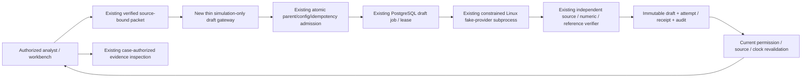

# G4.3A — Offline simulated investigation findings

## 1. Scope and provenance

- Analyst-facing draft workflow over the **existing** deterministic evidence coordinator, simulation provider, PostgreSQL draft queue, worker, independent verifier and immutable storage. No second investigator, new queue, model training or schema migration.
- New **AI-Assisted Findings** button in the existing Case Investigation workspace. Existing Supporting Evidence, Transaction Activity Analysis, Investigation Summary, assessment and casework views remain available.
- Every draft action/result is labeled **OFFLINE SIMULATION** or **Simulated draft · Review required**. This is deterministic selection of supplied facts, not live LLM analysis. No semantic quality, criminal conclusion or human approval is inferred from successful numeric/reference checks.
- No live provider calls, regulatory publication, autonomous case closure or SAR action. No `.env`, production credential, database-role, frozen scientific-asset or original-demo modification. No commit, push or deployment.

## 2. Analyst workflow

1. Sign in and open an assigned/permitted synthetic case → Investigation → **AI-Assisted Findings**.
2. Generate or open an existing **verified Investigation Summary** for the selected period/assessment. The draft button stays disabled without a verified, source-bound parent.
3. Select **Generate Simulated Investigation Draft**. Server freezes the existing verified parent/config identity; HTTP 202 returns a durable job. UI uses a stable parent-bound idempotency key, guards double clicks and never automatically repeats a consequential POST.
4. Monitor Pending / Processing / Completed / Abstained / Failed / Invalidated. Poll at bounded intervals for at most 40 checks; manual refresh and requester-scoped history remain available. Repeating a terminal failed request does not force a new run.
5. Review **Investigation Overview**, **Financial Observations**, **Areas Requiring Review**, **Additional Information Needed**, **Investigation Limitations** and **Activity History**. Observed facts, deterministic calculations, stored RF signals and unconfirmed hypotheses remain distinct.
6. Expand claim-specific supporting references or choose an authorized customer/account/transaction record. Each inspection uses the existing snapshot-bound evidence APIs, checks exact record/source-version/hash membership and restores keyboard focus on close.
7. Reopen a historical draft without generating another one. Retrieval rechecks source/access/assessment revisions and independent source/numeric verification. Stale or revoked results are withheld.

No human adoption/approval/disposition mutation is added: the draft explicitly remains **pending human review**. The simulation has no live-model interpretation. Missing/contradictory evidence and supported abstention remain visible; unavailable observations never become zero values.

## 3. Architecture

## 4. New and reused files

| Path | Responsibility |
|---|---|
| `backend/app/api/investigation_drafts.py` | New protected 202 request/history/detail gateways; existing reader admission, body limits, slots and sanitized errors. |
| `backend/app/schemas/draft_api.py` | New explicit simulation DTOs, typed finding summaries, bounded history and allowlisted provenance; no arbitrary provider/usage/config dictionary. |
| `backend/app/services/draft_api.py` | New thin projection/admission service; delegates existing coordinator/draft transactions and verifier, enforces requester ownership and simulation-only configuration. |
| `backend/app/main.py` | Registers the new router; existing APIs unchanged. |
| `frontend/src/draft-api.ts`, `drafts.tsx`, `drafts.css` | Typed projections, workflow/polling/history/record inspection and localized shared-token styling. |
| `frontend/src/investigation-api.ts`, `investigation.tsx`, `api.ts` | Extend existing authenticated no-store client/workspace; distinguish disabled simulation from clock/source errors. |
| `backend/tests/test_draft_api.py`, `frontend/src/drafts.test.tsx`, `frontend/e2e/drafts.spec.ts` | Real PostgreSQL gateway/concurrency/security tests, component/transport tests and real Chromium workflow/captures. |
| `scripts/serve_frontend_acceptance.py`, `run_investigation_e2e.py` | Extend existing isolated fixture/launcher with explicit simulation mode, deterministic additional synthetic cases, actual draft worker and optional focused test selection. |

Reused unchanged: `investigation_drafts.py`, coordinator/provider/verifier/worker implementations, source retrieval, models/migrations, RF/Policy/SHAP, authentication, case authorization and design-system tokens. The only deadlock correction is in the **new** gateway's acquisition order.

## 5. API contract

All paths are under `/api/v1/cases/{case_id}/investigation-drafts`:

| Method | Request / response |
|---|---|
| POST base | `Idempotency-Key` (8–128 restricted characters); JSON **only** `investigation_run_id` and `expected_packet_sha256`. Returns 202, Location, Retry-After and `DraftStatus`. No client scores/features/prompts/provider config. |
| GET base | `limit` 1–20, `offset` 0–1000; requester-scoped history. Recorded status is explicitly `stored_not_revalidated`; no findings returned by listing. |
| GET `/{run_id}` | Current authorized, independently revalidated result or sanitized status/failure; invalidated/failed work returns no publishable draft. |

- Existing actor/case locks, schema gate, 12 KiB body limit, four read slots, shared request budget, queue capacities and PostgreSQL transaction limits remain authoritative. Response <=512 KiB; <=20 findings; <=200 supporting records; fixed simulation provenance and no worker secrets, raw predictors or vendor usage.
- Simulation must be explicitly enabled server-side and external execution disabled. This phase configures only the disposable fixture; `.env` is unchanged. Disabled mode returns sanitized 503 with `X-TrueFlag-Reason: simulation_unavailable`; the UI retains an otherwise valid evidence summary.
- Anonymous 401; hidden inaccessible case/foreign requester 404; conflict/stale 409; oversized 413; unsupported media 415; malformed 422; capacity/rate 429; sanitized service/clock 503. A clock denial hides protected content; it is never treated as successful revocation testing.

## 6. Presentation and evidence integrity

- Reuses G2.2 system fonts, restrained blue/gray tokens, native controls/details, existing line icons, focus states and responsive panels. No external fonts, assets or design library.
- Source amounts stay decimal strings, including scale; missing income remains unavailable and observed zero remains zero. Dates are explicitly UTC. No new financial or risk scoring logic runs in React.
- Record inspector follows at most ten bounded evidence pages (20/page) using the current signed snapshot. It never invents a reference, falls back to another case or silently substitutes a missing source.
- Advanced provenance contains immutable run/manifest/packet/prompt identity. Engineering evaluation metrics and provider status are not presented as financial-risk indicators.
- Regulatory section explicitly states **validated regulatory guidance is unavailable**. The G5.1 source/review gate remains closed; no research-only source or fabricated citation is shown.

## 7. Activation and remaining boundaries

- Public DTOs and gateway configuration are deliberately simulation-only; setting an external-provider flag does not turn these endpoints into live inference. A future evaluated-live workflow needs separate explicit activation, compatible versioned projections and approved provider/data-transfer/privacy/spend controls.
- G4.2B model evaluation/independent semantic review and G1 stable-runner acceptance remain unresolved. These UI checks do not certify model quality, legal correctness, enterprise throughput or clock stability.
- Future G5 integration requires approved exact source/release manifests, grants, independently adjudicated labels, applicability/temporal review, current citation revalidation and a separately authorized investigator adapter. No such connection is activated here.
- Development/browser/schema status, actual failures and screenshot evidence are in `G4_3A_FUNCTIONAL_AND_VISUAL_QA.md`; endpoint/capability coverage is in `G4_3A_FRONTEND_BACKEND_COVERAGE.md`.
