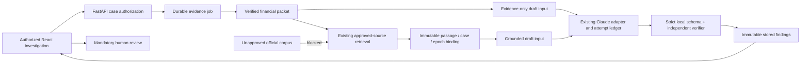

# Live Claude + Regulatory RAG integration

Date: November 22, 2026. **Acceptance: BLOCKED. No live provider request dispatched by this task.**

Follow-up: [Final integration gate](FINAL_INTEGRATION_DEMO_GATE.md) records the subsequently implemented candidate-0023 durable retrieval handoff and native-runner dependency. The historical test results below do not validate that later candidate.

## 1. Existing pipeline and actual boundaries

| Component | Actual implementation / limit |
|---|---|
| `backend/app/services/investigation_coordinator.py` | Existing durable evidence job; source-backed calculations, immutable manifests, leases and clock/permission checks |
| `backend/app/services/regulatory_investigation.py` | Existing approved passage selection and 900-second binding; source/grant/revision/epoch revalidation; no publication authority |
| `backend/app/services/investigation_drafts.py` | Existing child jobs, immutable attempts, independent completion verification, protected history and stored citations |
| `backend/app/services/claude_provider.py` | Existing fixed-host HTTPS transport, bounded input/output/time, no automatic paid retries, usage and sanitized rejection diagnostics |
| `backend/app/services/draft_api.py` | Existing atomic parent/child admission for evidence-only starts; approved grounding currently requires a selected completed parent packet |
| `frontend/src/investigation.tsx`, `drafts.tsx`, `regulatory-guidance.tsx` | Existing action, polling/history, simulation/live distinction and authorized citation opening |

**Historical orchestration gap:** the initial `/investigation-drafts/start` could not queue a regulatory query alongside a pending parent. Follow-up candidate 0023 now implements that handoff in source, but has not been migrated or accepted on a stable runner. The separate legacy grounded-request path remains available for selected verified parent packets. No live orchestration acceptance is claimed.

## 2. Implemented correction

The compact `flat_selection_v2` wire previously rejected all grounded input. The change reuses the existing adapter rather than introducing a provider or RAG framework:

| File | Change |
|---|---|
| `backend/app/services/claude_wire_v2.py` | Adds compact regulatory binding/citation fields; projects through the unchanged strict financial contract into `GroundedAIProposal` |
| `backend/app/services/claude_contract.py` | Builds compact grounded schemas, constrains binding and citation IDs to the supplied context, parses and diagnoses grounded responses |
| `backend/app/schemas/provider_live.py` | Allows the compact format for explicitly grounded investigation configurations; preserves existing reservation, purpose and token checks. Ordinary ungrounded activation is not widened |
| `backend/app/services/claude_provider.py` | Checks the selected grounded wire-schema digest using the existing activation gate; retains independent live-compatibility and source requirements |
| `backend/tests/test_claude_grounded_compact.py`, `test_regulatory_investigation.py` | Adds compact contract, transport, financial-scope, forged/duplicate citation and binding tests |

This capability is **not selected automatically** by the analyst API, deployed, or marked live-compatible. A newly identified grounded request requires its own exact-payload review, applicable source permissions and live/evaluation approval. No claim-to-law semantic certification is added: regulatory text is retrieved context and cannot establish an obligation or customer violation. Independent reference identity checks and qualified claim-support review are separate requirements.

The saved evidence-only v2 request remains exactly **11,540 bytes**, SHA-256 `45cf3308e79f6bb86c932dba0e528cdba6b47b1c6b6f5c06d50c0880dcf935a9`. Its owner decision remains pending. Its development approval does not authorize regulatory grounding or general analyst inference.

## 3. Claude contract review

Reviewed public documentation on November 22, 2026:

- [Sonnet 5.5 migration](https://platform.claude.com/docs/en/models/sonnet-5-5/migration-guide): model `claude-sonnet-5-5`, `between_tools` with high effort; omit unsupported sampling parameters.
- [Structured outputs](https://platform.claude.com/docs/en/build-with-claude/structured-outputs): `output_config.format`, closed objects and schema limitations. The compact format avoids references, unions and unsupported constraints. Local validation retains financial and reference restrictions.
- [API versioning](https://platform.claude.com/docs/en/api/versioning): newer version exists; adapter retains documented historical `2023-06-01`. No unsupported claim that changing that header resolves the earlier HTTP 400.
- [Model specifications](https://platform.claude.com/docs/en/models/sonnet-5-5/overview): published standard rates $2/M input and $10/M output. Actual usage/invoice is unavailable without a genuine authorized response.

The adapter uses `https://api.anthropic.com/v1/messages`, a server-only key, 4,096 maximum output tokens and a 20-second candidate deadline. Schema compilation can add first-request latency; no timeout extension was made. Public documentation and offline transport tests do not prove authenticated model availability. The prior complete HTTP-400 body was not retained; its precise cause remains unknown.

## 4. Regulatory source status

`scripts/verify_reference_proposals.py` passed against retained official bytes. No current source was substituted for the historical corpus.

| Source | Exact retained identity | Status |
|---|---|---|
| eCFR Part 1020, §§ 1020.210 / 1020.320 | Historical snapshot/as-of **2026-11-02**; raw SHA-256 `2588950c5c16efb45a2a78369e08bda2174bf9a8be5afd634235a406f51924bb` | Hash/section integrity verified; qualified applicability, effective-date/exception/provenance review still pending |
| § 1020.210 | Text SHA-256 `38d435ad12a6a106c079ffe64512b5a429c569aa149c3c8b166ed1a9965342c9` | Unapproved |
| § 1020.320 | Text SHA-256 `5b0da52152092d3cf083a89c92c47a1b6dcb55249e53061dcca7d3472d9c4c26` | Unapproved |
| FinCEN SAR FAQs | Original retained proposal verified separately | Historical validity unverified; excluded from publication |

Canonical retained source: [dated eCFR Part 1020 XML](https://www.ecfr.gov/api/versioner/v1/full/2026-11-02/title-31.xml?chapter=X&part=1020). Acquisition is recorded as November 4; composite publication/effective dates are not invented. Detailed reviewer actions and amendment/exception gaps remain in [the source checklist](PHASE3_4_SOURCE_APPROVAL_CHECKLIST.md).

`assets/local/regulatory/reviews/` is absent; the reviewer registry remains unapproved/empty. The existing research API explicitly exposes **metadata only**, not unapproved passage text or AI eligibility. Therefore the request's conditional research/demo exception does not authorize sending this corpus to Claude under the current design. Candidate retrieval was exercised privately against real official text; it was not published as guidance.

## 5. Operational / activation blockers

- Repeated guest/database clock regression. Authorized Windows Time start/resync succeeded, but 8 Linux / 7 PostgreSQL backsteps persisted in the next 120-second window. The separately authorized temporary WSL time-service stop still produced 4 / 4 backsteps and was restored. No WSL/Docker restart or peer/clock-floor reset was performed. Exact recovery evidence is tracked in the test report.
- No independently clock-stable runner identified. Existing CI runs on GitHub-hosted Linux only on push/PR; the dirty candidate/private assets have not been uploaded and no workflow or remote environment was launched.
- Exact v2 owner approval remains pending; it is evidence-only. A grounded request is different bytes and needs new approval after source review.
- Current application runtime is schema `0019_upload_sessions`, simulation-only, with no provider key mounted. Candidate probe schema `0022` is isolated and is not the UI database. No running database was migrated.
- Compact grounded compatibility, real-model evaluation, ongoing operating authorization and durable RAG start orchestration remain incomplete.

No `.env`, original demo, frozen RF/policy/SHAP artifacts, source approvals or historical attempts were changed. No commit, push or deployment.
