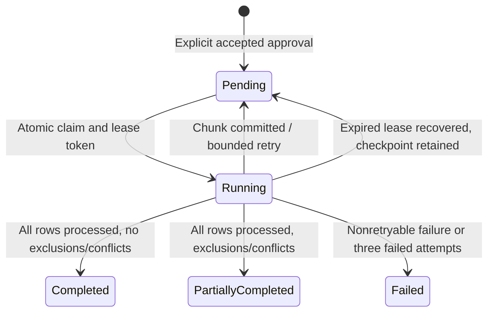

# Phase 2.10.3 - Approved durable CSV import

## Scope and verified reuse

- Starts from `97c0507` on `codex/project-initialization`; existing branding/startup edits are preserved separately. No teammate files, approved models, policy thresholds or feature semantics change.
- `backend/app/services/ingestion.py` now exposes `ingest_alert_in_transaction`. It contains the original alert/case/audit/receipt statements without a commit. The existing `ingest_alert` wrapper retains its commit/rollback, unique-race retry and single-alert response contract. Chunk workers own the outer transaction; they never call a function that commits each row independently.
- Reuses private file verification, current admin/owner checks, exact CSV conversion, canonical Pydantic contract, ingestion fingerprints, unique source identity, case scope and the PostgreSQL lease/fencing patterns. Import workers have a **separate** non-login registry/token, not assessment-worker privileges.
- No scoring, assessment jobs, frontend, export, model fitting, automatic dismissal/closure or SAR action. Uploaded CSV remains unscanned; approval is not malware clearance.

## API contracts

Active admin plus upload ownership is required. Analysts/supervisors have no bulk-import permission. Foreign imports and mismatched resources return concealed 404; row links additionally enforce current case visibility.

| Method / route | Behavior |
|---|---|
| POST `/api/v1/batch-uploads/{upload_id}/validations/{validation_id}/imports` | Explicit approval JSON + `Idempotency-Key` (16..128 ASCII permitted characters); HTTP **202**, stable import receipt, `Location` |
| GET `/api/v1/batch-imports/{import_id}` | Owned sanitized provenance, state and complete progress counters; works after source-byte expiry |
| GET `/api/v1/batch-imports/{import_id}/rows` | `offset=0..10000`, `limit=1..100` (default 50), optional `status=created|reused|invalid|conflict`; only committed row receipts |

```json
{
  "approve_valid_rows": true,
  "upload_sha256": "<exact SHA from preview>",
  "mapping_sha256": "<exact SHA from preview>",
  "mapping_version": "trueflag.csv-mapping.v1",
  "validator_version": "trueflag.csv-validation.v1",
  "validation_version": 1,
  "units": "baseline_source_units"
}
```

- All approval fields are required. Boolean `true` must be a JSON boolean, not `1` or a string. Reject duplicate JSON keys, extras, unsupported media, stale hashes/versions/units, zero-valid-row previews and mismatched upload/preview IDs. Existing JSON body cap is 64 KiB.
- One import per completed preview. Same actor/key/approval returns the same import even after completion or byte expiry, subject to current authorization. Changed approval with the same key, or another key for an already approved preview, returns 409. Reapproval is never an implicit retry of a terminal failed job; a new staged/validated intent is required, with canonical source receipts preventing duplicates.
- Before first acceptance: verify private file size/SHA/TTL, complete mapping identity, contract/validator versions, preview counts and diagnostic totals. Bind a server-computed `validation_sha256` to the full mapping, units, identities and counts. PostgreSQL guards freeze approved preview/diagnostics, source identity and import envelope; execution compares the binding again.
- HTTP failures: 401 unauthenticated; 403 current permission/case scope; 404 concealed resource; 409 identity conflict; 410 expired source for a new approval; 413 size; 415 media; 422 invalid approval/no valid rows; 429 capacity (`Retry-After: 60`); 503 storage/database/admission unavailable. Errors never expose rows, filenames, raw SQL or stack traces.

## State, counters and receipts



Wire states are `pending`, `running`, `completed`, `partially_completed`, `failed`. Each lease covers **one bounded chunk**, not the entire file. Pending between successful chunks is normal.

| Counter / row status | Meaning |
|---|---|
| `total_rows`, `valid_rows`, `invalid_rows` | Frozen full-file preview counts; invalid rows are known before import starts |
| `processed_rows` | Number of logical data rows with committed import receipts; durable checkpoint, excludes the header |
| `created_rows` / `created` | New canonical alert and unassigned open case created through original ingestion logic |
| `reused_rows` / `reused` | Identical source/feature-contract/classification already exists; original alert/case reused, never changed |
| `conflict_rows` / `conflict` | Existing source has different content; no write/overwrite, fixed `source_conflict` reason, no foreign case IDs |
| `excluded_rows` / `invalid` | Processed preview-invalid rows; `preview_invalid` plus original value-free diagnostic codes |
| `unprocessed_rows` | Total minus checkpoint; remains explicit after failure, including any not-yet-visited invalid rows |

- `created + reused + conflicts + excluded = processed <= total`. At successful end, `excluded = invalid`. Completed with exclusions or conflicts is PartiallyCompleted. Failed can retain earlier committed successes; failure never rolls back history or closes any case.
- Row responses contain logical row number (header = 1), status/reason, authorized alert/case IDs for successes, and canonical field/error/warning codes. No raw source IDs or feature cells. Diagnostics remain available from retained metadata after private-byte expiry. Institutional metadata/audit retention is a deployment decision.
- Missing income is `None`; observed zero stays numeric zero. Numeric parsing and original 27 fields are unchanged. Unknown state categories are preserved; no feature imputation, unit conversion or stronger invented numeric domains. Baseline units remain an operator assertion, not proof of currency/scale.

## Transactions and failure recovery

- Migration `0010_csv_imports` adds `csv_imports`, `csv_import_rows`, `csv_import_workers` (**21 domain tables**). Unique actor/key, one import/preview, composite import/logical-row key, source uniqueness and original ingestion receipts remain authoritative.
- Transaction advisory admission lock enforces queue cap across processes; existing actor lock enforces per-actor capacity and serializes role changes. Claims use `FOR UPDATE SKIP LOCKED`, database clock, fresh service identity and random fencing token. Processing locks the approving actor/upload, current worker and claimed import in consistent order.
- Every chunk rechecks active admin ownership, file digest/size/expiry, approved binding, worker credential and live lease. The file is read-only. Preview-invalid rows are excluded; valid rows are independently decoded/validated again. Conflicts use per-row savepoints; unexpected DB errors roll back the **entire incomplete chunk**.
- Chunk transaction includes canonical alerts/cases/ingestion receipts, row receipts, counter/checkpoint changes, conflict/chunk/completion audits and next state. Only its commit makes progress visible. A crash before commit leaves no partial rows. A crash/lost acknowledgement after commit retains checkpoint/receipts; next claim continues from it, without duplicating cases.
- Each chunk is reread from the file beginning up to the logical checkpoint, using a streaming CSV reader. Memory is bounded by the configured chunk/file/cell caps, not a whole-file dataframe. SHA verification and prefix replay cost roughly file-size times chunk-count; this deliberate bounded-MVP bottleneck should be replaced by a verified indexed/chunk storage design before larger dataset limits.
- Default **50 rows/chunk** (1..200), **100 active imports globally** (1..1000), **3 per actor** (1..20), **60-second lease** (30..120), **10-second cooperative chunk budget** (1..15), existing 2-second SQL lock/5-second statement limits. Final lease/time checks fence stale commits; no heartbeat is needed between chunks. Cooperative budget is not a hard OS thread kill.
- Recover at most 50 expired leases/pass. Up to three failed attempts **per current checkpoint**, bounded exponential backoff (2/4 seconds before retry); successful chunk resets attempts. Current authorization loss, source expiry or changed validation fail terminally. Database/storage interruption retries; if failure publication is unavailable, lease recovery remains authoritative.
- File retention is **not extended** by approval. Queue downtime may consume the remaining TTL; expiration blocks further rows and preserves prior chunks/explicit remaining counts. A terminal failure requires operator review/new approved intent, not silent replay of changed bytes. Progress and identical approval receipts do not require expired bytes.
- Guards protect import envelope/terminal records, row receipts, approved previews/diagnostics/source identity and import audits from update/delete; PostgreSQL truncate guards protect history. Privileged SQL owners and least-privilege deployment-role separation remain governance limitations, not a tamper-proof certification. Downgrade refuses retained imports.

## Dedicated worker setup

- `backend/app/workers/csv_import_worker.py` runs only on Linux, using the ordinary API dependency image; no NumPy/private artifacts or ML-token permissions are required. `--once` processes at most one chunk; continuous mode polls/reconciles with sanitized status/correlation output. Graceful stop finishes its current bounded chunk; forced death uses lease recovery.
- Compose profile **`csv-import-worker`** mounts the private CSV volume read-only and only its own `csv_import_worker_token` secret. Non-root UID 10001, read-only root filesystem, dropped capabilities, no-new-privileges, 512-MiB/one-CPU/64-PID limits. No public listener.
- Trusted local operator creates a cryptographically random 64-hex token in ignored `runtime/csv-import-access/worker_token`, with Linux 0700 directory/0600 file or a protected Windows service-user/SYSTEM DACL. Never print/paste/commit the token. Existing private-directory helper can apply the same ACL used for staged files.
- Provision through the trusted service interface `CSVImportService.register_worker(admin_id, name, token)` or controlled Linux CLI `--register --admin-id <active-admin-UUID> --name csv-import-local`. This is operator/database access, not a public API accepting a claimed admin ID. Workers cannot approve imports or use human HTTP endpoints.
- Start after provisioning: `docker compose --profile csv-import-worker up -d --build csv-import-worker`. CLI reads the token from `/run/secrets/csv_import_worker_token`; credentials never appear in Docker argv. Revoke through trusted `revoke_worker`; executing chunks serialize with current principal locks and no later chunk can run with a revoked token. Rotation requires a new registry identity/token.

## Acceptance and stop boundary

- `backend/tests/test_csv_imports.py`: explicit approval/identity/body limits, exact values/null-zero, all counters, invalid rows, source reuse/conflict, closed-case preservation, concurrent intents/claims/imports, actor/case/worker revocation, quotas/backoff, source expiry/tampering, DB guards, deadlines/fencing, partial transaction rollback and actual own-connection PostgreSQL termination.
- Linux tests execute the real worker plus real process death before and after chunk commit, followed by lease recovery/restart. Existing backend/scientific tests use the real Linux/PostgreSQL and approved pinned ML runtime. Actual counts are in [implementation status](IMPLEMENTATION_STATUS.md).
- No malware scanner, production-data approval, frontend, batch ML dispatch or production-capacity claim. Next **2.10.4 Bounded Batch Assessment Dispatch & Progress**, only after a new request.
