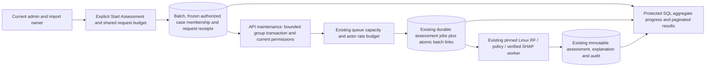

# Phase 2.10.4 - Explicit bounded batch ML assessment

## Scope and reuse

- Starts from `292c0d5` on `codex/project-initialization`. Unrelated branding/startup edits remain separate. No teammate sources, RF/preprocessing, frozen thresholds, SHAP mathematics or scientific reference files change.
- Reuses `AssessmentJobService`, protected case snapshots, shared assessment API budgets, queue admission, existing Linux worker leases/recovery, RF/policy/SHAP verification, immutable assessment persistence and public result projection. `enqueue_in_transaction` contains the original queue admission/creation statements; the existing single-case wrapper retains its transaction and unique-race behavior.
- The API's optional maintenance dispatcher writes bounded groups of ordinary jobs. It performs **no inference**. No new broker, ML service, worker credential or private model upload is introduced. CSV import alone never starts assessment.



## Protected APIs

Only current active admins may start/read owned import batches; no new importer role or team hierarchy is invented. Every endpoint uses the existing shared authenticated assessment request budget. Foreign imports/batches and hidden cases return concealed 404; anonymous users get 401, unauthorized roles 403.

| Method / route | Contract |
|---|---|
| POST `/api/v1/batch-imports/{import_id}/assessments` | Explicit JSON below and `Idempotency-Key` (16..128 allowed ASCII characters); **202**, stable batch ID, `Location`, `Retry-After: 2` |
| GET `/api/v1/batch-assessments/{batch_id}` | Current owner/case authorization, frozen provenance and aggregate live progress; active response has Retry-After |
| GET `/api/v1/batch-assessments/{batch_id}/results` | `offset=0..10000`, `limit=1..25` (default 10); bounded redacted case/job outcomes and verified existing AssessmentDetail projections |

```json
{
  "start_assessment": true,
  "import_validation_sha256": "<exact validation_sha256 from the import receipt>",
  "policy": "Coverage"
}
```

- Require a terminal `completed` or `partially_completed` import with its full row checkpoint. Failed/running imports are not eligible, even if earlier chunks committed. Match the expected import identity. Only created/reused, authorized case links enter membership; invalid/conflicting rows never enter the ML queue.
- Deduplicate case IDs; retain logical source row, alert identity and case version. Closed cases are recorded as skipped and never dispatched. Case/alert identity or version changes before dispatch also skip that member. No client score, features, model path, threshold, SHAP or case list is accepted.
- Strict boolean `true`, exact policy enum, SHA syntax, duplicate-key rejection, extra-field rejection and the existing 64-KiB JSON cap. Stale intent/state returns 409; invalid request 422; unsupported media 415; capacity/rate limit 429; sanitized DB/storage/admission failures 503.

## Idempotency and reuse

- One batch per import + selected policy + approved model/policy artifact identity. Same key/content returns the same batch; same key/different content conflicts. A different key for the same intent is recorded as another immutable request receipt pointing to the same batch, not another reassessment.
- Each new member has one stable run ID/key. Dispatch first reuses a verified compatible assessment (same case version/input/model/policy), otherwise adopts a compatible active job, otherwise queues one new job. Existing case locks serialize these checks with other batch/single-case queue writers. Active-job lookup is capped at 25 candidates; incompatible/stale jobs are not credited.
- Reimported identical sources can therefore reuse the same case results. A different policy is a distinct explicit request. No force/reassessment flag exists here; intentional single-case reassessment remains the existing separate human action.
- Adopted jobs retain their original request authority. A direct job is not retroactively made dependent on the observing batch. Jobs **originating** in a batch additionally check its current owner/admin permission, active state and approved artifact versions during preparation and final publication. Demotion to supervisor still revokes bulk authority, even though that role can read ordinary workspace cases.

## Progress and result semantics

| Field | Meaning |
|---|---|
| `total_cases` | Distinct authorized successful-import case members, including explicitly skipped closed cases |
| `total_eligible_cases` | Frozen subset not closed when membership was captured; later case changes can still skip them |
| `pending_dispatch` | Members not yet linked to a job or skipped/failed |
| `queued` / `running` | Current persisted job Pending / Running states, including queue retries |
| `succeeded` | Job succeeded with its immutable assessment |
| `failed_manual_review` | Terminal Failed jobs or member failures without a fabricated score |
| `skipped` | Closed/changed cases or verified already-assessed members |
| `already_assessed` | Subset of skipped; verified existing result is available in results |
| `retrying` | Subset of queued: pending job with attempts > 0; not a terminal failure |

- In one aggregate SQL statement: `total_cases = pending_dispatch + queued + running + succeeded + failed_manual_review + skipped`. No increment-only cached job counters. Status and results are snapshots at read time; workers may advance between separate requests.
- Active wire states are `dispatching` or `processing`; terminal states `completed`, `partially_completed`, `failed`, `stopped`. A batch completes only when no ready/queued/running member remains. Skips are explicit, failures keep cases available for manual review. Completion audit is persisted by maintenance or an authorized status/results read.
- Results contain case ID, source row number, job ID/outcome, sanitized reason, attempts/retry flag and optional verified AssessmentDetail (RF score, policy trace, SHAP, model/input provenance). Reuse the existing `_read` integrity check and `_detail` allowlist, not a new scoring/projection implementation. No predictor cells, raw source identifiers, worker tokens, private artifact paths or stack traces.
- Current ownership and **all member-case visibility** are rechecked before aggregate/results exposure; each result also uses the existing locked case-read check. No counts or result links leak for a hidden member. Current admin scope is the existing whole workspace, not invented tenancy.

## Durability, limits and recovery

- Migration `0011_batch_assessments` adds `batch_assessments`, `batch_assessment_items`, `batch_assessment_requests` (**24 domain tables**). Immutable intent/membership/request history, unique intent/key/member/row/run, one originating membership per job and FK/state constraints. Terminal batch records and terminal member links are protected from updates/deletes; audits and PostgreSQL truncation guards protect history. Privileged SQL owners remain outside a tamper-proof claim.
- Defaults: **10 cases/group** (1..25), **20 active batches** globally (1..100), **3 per actor** (1..20), **2-second interval** (1..30), at most **3 groups/tick** (1..10). Default dispatcher is off outside Compose; Compose explicitly enables it. Queue capacity and shared authenticated budget remain the existing `ASSESSMENT_QUEUE_CAPACITY` / `ASSESSMENT_API_*` settings.
- Each new-job attempt uses the shared actor budget; polling/start requests consume it too. Queue saturation or rate exhaustion pauses remaining members with Retry-After/backoff and an audited reason; no thousands-of-jobs burst. Ready members are not discarded. Reused results/jobs do not create new model executions.
- Short PostgreSQL transaction locks coordinate multiple API replicas: actor -> batch -> case -> existing queue admission. One transaction commits new jobs, member links, request audits and group progress; incomplete groups roll back together. No separate long-lived dispatcher lease is needed because no expensive ML spans this transaction. Process death releases DB locks; after-commit retry sees durable links/run IDs instead of duplicating jobs.
- The existing ML worker's leases, heartbeats, timeouts, three-attempt backoff, crash recovery and fencing remain authoritative for inference. Batch counters join those exact records. Terminal failures are not automatically re-enqueued by another batch request.
- Permissions and provenance are checked again during dispatch and origin-job publication. Revocation or model/policy identity drift stops remaining dispatch, marks unstarted members for manual review and fences originating queued work. Assignment changes invalidate captured case versions/snapshots. Already committed results remain historical records; no automatic case closure, dismissal or SAR action.
- The dispatcher is an API lifecycle thread, not an HTTP scoring endpoint. SQL/connect/lock timeouts and bounded groups limit work. Hard API-process death rolls back its open transaction. If APIs are down, committed inference jobs can continue, while remaining dispatch resumes when an enabled API starts. Global gateway quotas, production SLO/soak/fairness, independent scheduling and institutional retention remain deployment work, not local-capacity claims.
- Rebuild API **and existing ML worker** together for the new batch-origin permission check. No scientific dependency upgrades/retraining are required. CSV import worker remains separate. Canonical DB snapshots, not retained CSV bytes, feed ML; file expiry does not erase imported features/results.

## Verification and stop boundary

- `scripts/run_assessment_verification.py --batch-only`: targeted real Linux/PostgreSQL tests; `--full-backend`: existing plus new acceptance. Native Windows skips scientific/OS-worker tests; the pinned Linux runtime supplies actual RF/SHAP verification.
- Tests cover explicit/duplicate/conflicting requests, alias keys, completed/partial imports, direct-result reuse, active-job adoption, exact full RF/policy/SHAP parity across all three policies with missing/zero income, group/capacity/rate limits, pagination/counters, job retries/expired leases, cross-owner/case denial, role/assignment/provenance revocation, atomic rollback and own-connection PG termination.
- Real Linux tests kill dispatcher processes before/after group commit, kill an ML child and restart the real worker, and revoke authority after real computation before publication. Full 4000-score / 12000-policy / 4000-SHAP scientific replay remains unchanged. Actual executed counts and limits are in [implementation status](IMPLEMENTATION_STATUS.md).
- Uploaded files remain **unscanned**; this adds no malware-safety claim. No frontend, LLM/RAG, export, model training or teammate changes. Next **2.10.5 Batch Frontend Workflow & Safe Export**, only after a new request.
