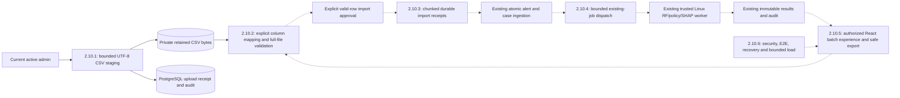

# Phase 2.10 - Secure CSV batch onboarding

## Verified starting point and scope

- Branch inspected at `3d0e83b` (`codex/project-initialization`). Phase 2.9 APIs/worker are present; branding and the Compose tmpfs fix were already uncommitted. Those existing edits are preserved separately.
- Canonical source: `backend/app/schemas/alerts.py`, not research column guesses. JSON ingestion remains admin-only, synthetic-only and exactly 27 predictors. No importer role, upload service or reusable object store existed.
- The existing request guard buffers JSON bodies up to 64 KiB; a CSV-specific authenticated streaming path is necessary. Other routes keep their prior limits. No multipart dependency or generic public file server is introduced.
- The 10,000-row historical synthetic dataset represents aggregate alert snapshots, not transaction streams or a transaction graph. No training, model/policy change, automatic dismissal/closure or SAR filing is authorized.

## Phased architecture

Solid edges are implemented in 2.10.1-2.10.2. Dashed edges are interfaces/plans, not shipped functionality.

| Subphase | Responsibility / acceptance boundary | Status |
|---|---|---|
| 2.10.1 | Generated CSV contract/template, private bounded staging, owner scope, idempotency, retention and audit | Implemented; evidence in implementation status |
| 2.10.2 | Explicit mapping to existing metadata/27 fields; inspect every logical record; bounded error summaries; strict parsing; no implicit missing-value or category changes | Implemented; [preview contract](PHASE2_10_2_VALIDATION_PREVIEW.md) |
| 2.10.3 | Explicit approval, versioned mapping/file identity, chunk checkpoints, row/source/idempotency conflicts and restart-safe import through existing semantics | Not implemented |
| 2.10.4 | Authorized bounded dispatch through existing durable queue; progress, quotas and retries; no synchronous model work in HTTP | Not implemented |
| 2.10.5 | Upload/preview/approval/progress/results screens; authorized bounded export with spreadsheet-formula protections | Not implemented |
| 2.10.6 | Real-model/browser/load/recovery acceptance for the complete batch workflow, separated from original scientific replay | Not implemented |

## Reuse and decisions

- Reuse `AlertIngestionInput`, `AlertFeatures`, source identity/fingerprints, transactional case/audit logic, case authorization, existing queue and immutable result DTOs. Keep the approved RF/preprocessor/thresholds/SHAP behavior unchanged.
- CSV staging receipts identify actor intent separately from bytes. Identical bytes with different keys or actors remain distinct uploads; later duplicate source IDs in one file fail preview; existing-database conflicts remain an import-phase concern.
- `require_batch_uploader` is a dedicated permission boundary currently mapped to the existing admin role. Analyst/supervisor staging is denied. A future importer capability requires an explicit authorization design and migration; no role is invented now.
- A staged receipt is not proof of valid row values, source classification, model compatibility or successful import. File bytes are untrusted, even after structural acceptance.
- Use the API's private named volume and three PostgreSQL staging/preview tables, not a new broker, object-storage service or LLM. Model workers do not mount upload storage.
- Strict CSV restrictions are compensating controls, not antivirus scanning. Antivirus, enterprise storage encryption/key management, global ingress quotas and institutional production-data authorization remain explicit deployment gaps.

## Next design gate

2.10.2 implements owned, verified, versioned full-file preview without row values in diagnostics. Next, after a new request: **2.10.3 durable chunked idempotent alert/case import**, with explicit approval bound to the validated mapping/file/contract, fresh permissions, source conflicts and restart recovery. No import, batch ML, batch frontend/export or Phase 3 work is implemented.
