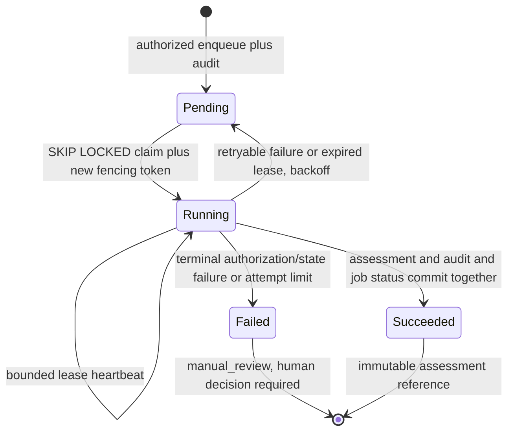

# Phase 2.6 - Durable assessment jobs

## Implemented boundary

| Component | Actual implementation |
|---|---|
| Queue | `backend/app/services/assessment_jobs.py`; PostgreSQL only, no Redis/Kafka/outbox dependency |
| Tables | `assessment_jobs`, `assessment_workers`; migration `0005_assessment_jobs`, 13 domain tables |
| Supervisor | `backend/app/workers/assessment_worker.py`; one isolated child per claimed job |
| Scientific producer | `backend/app/workers/assessment_child.py`; unchanged approved RF, policy and exact verified SHAP services |
| Atomic writer | Existing `AssessmentService`, with its unchanged write body extracted into caller-owned `_persist_in_session` |
| Operator provisioning | `backend/app/workers/provision.py`; current administrator/password required, generated 256-bit service token saved only in ignored runtime file |
| Deployment | Opt-in Compose `assessment-worker` profile and `backend/Dockerfile.ml-worker`; no new HTTP endpoint or automatic ingestion hook |

Internal enqueue accepts the same trusted principal/case/version/run/key/policy envelope as Phase 2.5. Assigned active analysts and workspace supervisors/admins retain their existing scope. Worker credentials grant **assessment execution only**, are separate from login/JWT identities, and cannot replace the requesting user's case authorization. Service credentials are checked on claim, recovery, prepare, heartbeat, publication and failure updates.

## States and data flow



1. Enqueue validates current actor/case/alert, exact stored feature contract and both ingestion/explanation fingerprints. The job stores IDs, immutable metadata/fingerprints and policy, **not a second customer-feature snapshot**.
2. Actor-scoped hashed key and globally unique run ID prevent duplicate jobs. Conflicting key/run/content is rejected. Matching retries reauthorize before returning the original job; existing matching verified assessments can be linked without recomputation.
3. A service-authenticated worker first recovers up to 100 expired jobs, then claims one ready Pending row using `SELECT ... FOR UPDATE SKIP LOCKED`. Claim and audit commit together; no lock spans scientific computation.
4. Each claim increments the attempt and rotates its UUID fencing token. Child and parent recheck worker credentials, current actor/case scope, queued case version/status/disposition/assignment, source/input fingerprints and frozen model/policy request identity.
5. The child loads the approved fitted pipeline, scores, applies the frozen selected policy, generates verified SHAP and emits bounded JSON over a private pipe. It does not publish assessments or job state. No pickle/model objects cross IPC.
6. The parent validates the existing result contract, reacquires current service/user/case/job authority and calls the original assessment writer inside its own transaction. Score, recommendation, explanation, completion audit, Succeeded status/reference and job-success audit either commit together or all roll back.
7. Any expired/replaced generation cannot heartbeat, prepare or publish. A still-current generation may **abort only** after its deadline; recovery/reclaim rotates or clears its token, preventing further changes from that old claim.

## Reliability controls

| Control | Implemented rule |
|---|---|
| Attempts | Maximum 3 claims per job; no reset or automatic retry of terminal history |
| Backoff | Durable `available_at`: 5 seconds after attempt 1, 10 after attempt 2; third failed attempt becomes Failed |
| Time authority | PostgreSQL `clock_timestamp()` for leases/readiness/deadlines; monotonic supervisor watchdog for execution |
| Default bounds | Lease 30 seconds, heartbeat 5 seconds, execution 120 seconds; server-configured bounds checked; maximum execution 300 seconds |
| Recovery | Recover expired Running leases/deadlines under `SKIP LOCKED`; retry or mark Failed/manual review with audit |
| Fencing | Job ID + active worker identity + per-claim random token + Running state + live lease/deadline required for publication |
| Hard execution stop | Independent watchdog kills the child process group even while heartbeat I/O is blocked; parent reaps child; DB publication rechecks deadline |
| Supervisor death | Linux parent-death SIGKILL armed before reading credentials, with parent-PID race check |
| Shutdown | SIGTERM/SIGINT cancellation kills active child and schedules bounded retry where DB/credentials remain available |
| DB bounds | Queue transactions: 2-second lock/5-second statement limits. Child connections also bound statement/lock/idle-transaction duration, including existing SHAP ACL callbacks |
| Output/resource limits | 256 KiB JSON output; child 3 GiB address-space cap, CPU limit and core dumps disabled; one native numerical thread |
| DB outage | No partial success; failed acknowledgement may leave Running until lease recovery. Unknown commit outcome resolves from durable status/run/receipt, not duplicate insertion |

At-least-once computation is allowed; completed assessments remain unique. Recovery after a partition may briefly overlap old computation with a replacement until the old supervisor detects fencing loss/timeout, but stale publication is forbidden. Transient outage recovery requires a healthy PostgreSQL instance and an active worker; it is not a claim of distributed exactly-once execution.

## Security and human control

- Dedicated token hashes only in DB; raw tokens are never placed in job rows, logs, audit events, subprocess argv or image layers. Child credentials use stdin and a restricted environment; stderr is discarded and errors become fixed reason codes.
- Reassignment, role revocation, case-state/input changes and worker revocation prevent publication. Authorization/state failures produce terminal manual-review jobs; unverifiable scientific results never become successful assessments.
- Failed jobs contain `fallback_route=manual_review` and `human_decision_required=true`; they do not create a fabricated score/explanation or modify case status, disposition, assignment, SAR labels or filing state.
- Job envelopes and terminal jobs reject UPDATE/DELETE; job audit events are immutable. PostgreSQL TRUNCATE of jobs is blocked. Downgrade refuses retained job history. DB owners can bypass these controls; least-privilege SQL runtime roles and independent retention remain deployment work.
- Compose worker has no published ports, runs non-root/read-only with dropped capabilities, no-new-privileges, bounded CPU/memory/PIDs and temporary storage. Only model/contracts/approved serialized-source directories mount read-only; saved datasets and explanation references are not mounted into the operational worker.
- SHAP remains a non-causal model attribution, not criminal evidence. No RF retraining, untrusted uploads, teammate edits, automatic dismissal/closure or public inference API is added.

## Operator workflow - opt-in local operation

```powershell
docker compose up -d db
.\.venv\Scripts\alembic.exe -c backend/alembic.ini upgrade head
.\.venv\Scripts\python.exe -m app.workers.provision --admin-username admin --name local-worker
docker compose --profile assessment-worker up --build -d assessment-worker
```

- Provisioning prompts for the current administrator password and refuses to overwrite an existing token file. No service credential is provisioned automatically by migrations or tests.
- The default secret file is ignored `runtime/assessment_worker_token`; verify its host ACL and readability for container UID 10001. File-backed Compose secrets inherit host permission behavior; secret-manager integration and production identity are pending.
- Revoke using the same CLI with `--revoke <worker UUID>`; an active admin is rechecked. Rotation provisions a new uniquely named worker/token after revocation; never restore a revoked token from source control.
- This task verifies a local worker image and isolated test executions. It does not enable the optional long-running profile against existing cases or publish an image.

## Acceptance and reproduction

```powershell
.\.venv\Scripts\python.exe -B scripts/run_assessment_verification.py --full-backend
.\.venv\Scripts\python.exe -B scripts/run_assessment_verification.py --jobs-only
.\.venv\Scripts\python.exe -B scripts/run_ml_verification.py --check tests
.\.venv\Scripts\python.exe -B scripts/run_ml_verification.py --check policy
.\.venv\Scripts\python.exe -B scripts/run_ml_verification.py --check shap
```

- Synthetic queue tests explicitly isolate persistence logic; actual Linux child tests score previously unseen records with unknown state and both missing/zero income using the real approved model and SHAP.
- Real PostgreSQL tests cover duplicate/conflicting enqueue, concurrent claim, lease renewal/recovery, stale fencing, bounded retries/manual review, worker/actor permissions and audit-trigger rollback at enqueue/claim/completion.
- Real OS tests cover timeout, oversized/malformed output, child crash, suppressed stderr, cancellation, revocation, blocked-heartbeat watchdog and supervisor-death SIGKILL/reaping.
- Initial full Linux runs exposed existing fixture `ImmatureSignatureError` under guest-clock rollback. Only synthetic fixture tokens are now re-signed with an issued-at time 2 seconds earlier; production JWT validation is unchanged and a future-issued-token rejection test was added. Temporary diagnostics recorded exception classes only and were removed.
- Final actual counts, regression metrics and schema checks are recorded in [implementation status](IMPLEMENTATION_STATUS.md). No passing result is inferred from configured CI.

## Remaining boundary

No HTTP submission/retrieval or analyst-workbench integration, automatic enqueue, queue admission quotas/retention, production alerts/metrics, priority fairness guarantees, enterprise service identity or operational SLA is claimed. Next proposed subphase requires a new request: approve and implement protected job submission/status/result APIs using these existing queue and case-authorization services.
