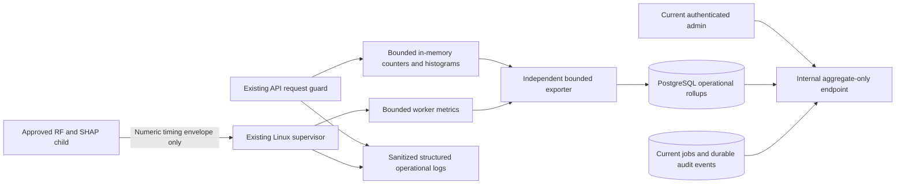

# Phase 2.8 - Operational monitoring and reliability

## Implemented components

| Component | Implementation / boundary |
|---|---|
| Bounded collection | `backend/app/core/telemetry.py`: fixed names/labels, streaming histograms, no customer context; 256 series/minute, current/previous minute only |
| Durable export | `services/monitoring.py`: cumulative per-instance/minute snapshots in `operational_metrics`, monotonic idempotent upsert, five-second asynchronous export |
| Monitoring API | Admin-only `GET /api/v1/internal/metrics?minutes=15`; window 1-60 minutes, max 10000 stored rows, explicit truncation/invalid/drop coverage |
| API instrumentation | Existing request guard records route alias/method/status category and monotonic response duration; counts 401/403, concealed-or-missing 404, 429, 503 and error rates |
| Admission instrumentation | Queue saturation and advisory-lock contention are distinct counters, not inferred from every 503 |
| Worker instrumentation | Execution duration/outcome, recovery scans/recovered jobs and initialization/RF/SHAP timing; service CLI starts the same exporter |
| Authoritative gauges | Current Pending/Running/Succeeded/Failed counts, oldest Pending enqueue age, expired leases/deadlines; durable claim/success/retry/failure audit counts |
| Structured logs | Allowlisted JSON fields with request, worker-attempt and exporter correlation IDs; timing/outcome only; no business UUIDs, feature values, bodies, tokens or private paths |
| Schema | `0007_operations`, one aggregate table and minute index; **15 domain tables**. No change to feature/model/result schema |



## Metric interpretation

- Latencies use 18 fixed upper bounds from 1 ms to 600000 ms plus overflow. API/worker/stage p50/p95/p99 are **histogram upper-bound estimates**; null means no sample or overflow. Exact benchmark quantiles use linear interpolation of the bounded measured sample list.
- API rates distinguish 4xx/client, 5xx/server, combined errors, authorization denials, hidden-or-missing lookups, throttling and unavailability. Expected 409/429/503 fault/backpressure responses are still counted; they are not unexpected benchmark failures.
- `model.scoring` measures the explicit approved RF `score_one` call. `model.shap` measures the existing explanation service, including its internal scoring/verification; it is **not pure TreeSHAP kernel time**. Initialization measures verified pipelines/explainer setup. Outer verification/policy/DB/startup cost remains in worker wall time.
- Stage label `observed` does not mean successful case publication. A valid computation later rejected for authorization can still have timing samples. Killed children may produce no stage samples; no zero duration is fabricated.
- Worker executions count attempts, not unique cases. Throughput from durable success audits is a rolling-window rate; benchmark throughput is separately measured over its steady segment. Scans include empty recovery polls; recovered counter counts handled expired jobs.
- Oldest Pending age is age since original enqueue, including retry wait; it is not solely time since becoming ready. Monitoring read does not claim a transactionally consistent distributed snapshot.

## Monitoring failure isolation and privacy

- Request instrumentation performs no database I/O. Export uses a separate one-connection pool, one-second connect timeout, 500 ms statement limit and 200 ms lock limit. Export errors cannot roll back or reject domain requests.
- Re-export replaces the same cumulative snapshot; an older snapshot cannot decrease its count. Unknown commit outcomes therefore do not double counts. Local export retries remain bounded in memory.
- Rollups have best-effort **120-minute retention**. Local buffering covers two minutes; crashes, longer DB outages or cardinality overflow can lose telemetry. Durable jobs/assessments/audits remain authoritative and are unaffected. This is not a zero-loss telemetry service.
- Current API samples override their own persisted copies during collection to prevent duplicate counting. Other processes appear after export delay. One-minute aggregation and row caps are reported explicitly; no cluster-wide completeness is inferred when truncated.
- Labels are fixed route aliases, method/status categories and outcome/component enums. Query strings, request paths, client IPs, user/case/job/run IDs, raw features, explanations and credentials are never labels or operational-log fields.
- Opaque exporter instance IDs are internal rollup keys and are not returned. Correlation IDs are generated independently for requests/worker attempts/exporters; this is scoped correlation, not a distributed business trace.
- Existing active-admin permission is checked from current DB state and locked again for collection. Anonymous/analyst/supervisor requests are denied. “Internal” is role restriction; production TLS, network perimeter and dedicated operator identity remain deployment gates.
- Scientific/model-loading/policy/SHAP source and frozen artifacts remain unchanged. Three timing scopes wrap the existing internal producer; numeric timings cross IPC separately from the immutable verified assessment payload.

## Repeatable resource-bounded benchmark

```powershell
docker compose up -d db
.\.venv\Scripts\python.exe -B scripts/run_assessment_verification.py --benchmark
.\.venv\Scripts\python.exe -B scripts/run_assessment_verification.py --full-backend
.\.venv\Scripts\python.exe -B scripts/run_ml_verification.py --check tests
.\.venv\Scripts\python.exe -B scripts/run_ml_verification.py --check policy
.\.venv\Scripts\python.exe -B scripts/run_ml_verification.py --check shap
```

- Benchmark runs a real Uvicorn/TCP API, JWT authorization, local PostgreSQL and isolated approved RF/SHAP child processes. No successful-model mocks or saved prediction features substitute for live computation.
- Runner: existing non-root read-only Linux verification image, 2 CPUs, 3 GiB memory, 128 PIDs, bounded temporary storage; 180-second benchmark watchdog. Credentials enter over stdin, never Docker argv or mounted `.env`.
- Each run creates/removes only a generated `tf_operations_benchmark_*` PostgreSQL schema. It does not restart the shared DB or operate on development cases. One fault terminates only its own identified test transaction's backend connection.
- 16 new synthetic cases, all exact 27 predictors, unknown state and alternating missing/zero income. Steady segment: 12 unique jobs, 3 waves, 4 concurrent submissions, 2 worker supervisors, capacity 4. Each child initializes the model afresh.
- Same-key admission-contention retries honor the two-second hint; explicit saturation is asserted separately. Worker driver polls until durable active-job count is zero, not until one transient `SKIP LOCKED` idle result. Backoff recovery polls actual readiness within a bound, not a guessed sleep.
- Other scenarios: abrupt service-process exit after a committed claim; deterministic lease-expiry injection and stale fencing; real in-flight PG connection termination after partial result writes followed by same-claim retry; assignment revocation after real computation/before publication; three missing-approved-artifact failures to terminal manual review; actual 429 handling.

## Recorded local results

Authoritative aggregate artifact: [PHASE2_8_BENCHMARK.json](PHASE2_8_BENCHMARK.json). Python **3.11.18**, PostgreSQL **17.11**, pinned existing scientific requirements. One final recorded run; descriptive observations, **no production capacity or SLA claim**.

| Measurement | Actual result |
|---|---:|
| Steady completion | 12 jobs / 22.248 s = **0.5394 jobs/s** |
| Accepted unique submission p50 / p95 / p99 | **47.474 / 2081.868 / 2086.470 ms**, including admission retry waits |
| Worker wall p50 / p95 / p99 | **2496.296 / 3135.003 / 3136.122 ms** |
| Admission contention / explicit saturation | **4 retries / 1 final 503**; no capacity overshoot |
| Peak active queue / oldest Pending age observed | **4 / 2.231 s** |
| Peak container memory / configured limit | **739504128 bytes / 3221225472 bytes** (~705.25 MiB / 3 GiB) |
| Whole benchmark process+reaped-child CPU | **33.234 CPU-seconds**; shared PostgreSQL resources excluded |
| Committed jobs / succeeded / terminal manual review | **16 / 14 / 2** |
| Completed assessments / duplicates / lost jobs | **14 / 0 / 0** |
| Unauthorized successful reads / automatic case actions | **0 / 0** |
| Durable claims / retries / successes / failures | **19 / 3 / 14 / 2** |

The 15 final steady 202 responses include 3 original-job replays; 3 deliberate 409s and one explicit capacity 503 were expected. Four additional transient contention 503s occurred before successful same-key retries. Local API server histogram p95 was <=50 ms, distinct from client submission p95 that includes retry waiting. Partial-stage/attempt counts differ from durable completed-job counts by design.

## Acceptance and remaining limits

- Existing Linux/PostgreSQL suite covers worker timeout/SIGKILL, parent-death reaping, blocked-heartbeat watchdog, lease fencing, audit/DB rollback, duplicates, revocation, unauthorized access and manual-review fallback. New tests cover metric cardinality/privacy, admin authorization/revocation, export idempotency, outage isolation and recovery.
- Initial benchmark-driver assumptions about a single idle poll and fixed backoff waits were corrected; no queue/scoring semantics were changed to force success. Final benchmark invariants and recorded failure injections passed; no critical failure remains unresolved in the bounded local scope.
- Actual final test counts and unchanged 4000-score/12000-route/4000-SHAP replay results are in [implementation status](IMPLEMENTATION_STATUS.md). All private artifacts remain ignored and unchanged.
- Bottlenecks observed: cold scientific process initialization and advisory-admission contention dominate this small run. Caching/wait policy changes require separate evaluation; no new broker or mandatory service is justified by these measurements.
- No load SLO, long-duration soak, institutional data/performance claim, production HA/failover, external alerting/SIEM, enterprise SQL roles or retention/backup certification is supplied. Frontend, LLM/RAG and retraining are not implemented. Next work requires a new request.
