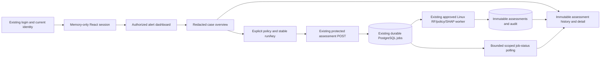

# Phase 2.9 - Risk intelligence workbench

## Implemented interfaces

| Screen / file | Responsibilities |
|---|---|
| Session shell - `frontend/src/App.tsx` | Existing token/me authentication, memory-only session, hash navigation, current-role heartbeat, visibility gating, sign-out/denial cleanup |
| Dashboard - `src/workbench.tsx` | Real scoped alerts/cases, priority, human case state, latest job status, server search/filter/sort and bounded pagination |
| Case details - `src/workbench.tsx` | Assessment versions, RF score/model identity, recommendation separated from disposition, signed grouped SHAP and expandable provenance |
| Assessment workflow - `src/workbench.tsx` | Explicit policy selection, stable run/key retries, asynchronous request, four job states, bounded polling, manual-review failure and explicit reassessment |
| API transport - `src/api.ts` | Same-origin bearer requests, no-store, no ambient cookies, 10-second timeout plus cancellation, neutral status errors and Retry-After |
| Uncertain request receipts - `src/receipts.ts` | Session-only run/key/body map across view changes; no model inputs, persistence or browser storage |
| Safe case projection - `backend/app/services/cases.py` | Scoped SQL scalar projection, frozen KYC priority grouping, latest-job metadata, literal parameterized search; no scientific invocation |



## Backend compatibility

- `GET /api/v1/cases` preserves original fields and pagination; adds `source_id`, derived `priority`, `assessment_status`, `latest_job_id`. Status means the latest requested job, not a human decision or guaranteed freshness of an older assessment.
- New `GET /api/v1/cases/{case_id}/overview` returns the same safe summary; fresh active role/assignment in the data query, concealed/missing 404, `case.overview_read` audit committed before disclosure. Existing full case-detail and assignment contracts are preserved.
- Added bounded `search` (128 characters), priority and assessment-status filters. Search is a literal, case-insensitive substring of source/case/alert IDs within caller scope; SQL wildcard characters are escaped. Hyphenated and compact UUID storage behave consistently.
- Priority uses existing validated KYC mapping: 0/1/2 Standard, 3/4/5/6 High. No new predictor, scoring or policy semantics. List/overview do not select raw feature JSON into application results.
- No schema migration, new inference endpoint, new service, frontend assignment editor, human disposition editor or automatic action is introduced. The browser never calls the original raw-feature case-detail endpoint.

## Session and retry behavior

- Tokens, result payloads and uncertain submission receipts remain in memory. No browser storage, cookies, service worker cache, URL token or third-party analytics. Refresh signs out; an accepted durable job is recovered through the current authorized overview after sign-in.
- Each view cancels outstanding requests and timers on navigation/unmount. Sequence checks prevent older assessment-selection responses from replacing a newer choice. Sign-out aborts session requests and unmounts all protected views; 401 signs out, 403/404 remove case/results immediately on the next response.
- Current identity and visible case/dashboard authorization refresh every 10 seconds. Hidden-tab views unmount; returning requires fresh checks. Backend permissions are authoritative on every call; **revocation detection has a polling/network delay**, not instant push invalidation. Access-check failure hides protected content.
- POST contains only expected case version, a generated run UUID and a frozen policy. Retry of a timeout/network/503 uncertainty uses the same run/key/body across view changes within that session. Conflicts require explicit case reload; terminal reassessment uses a new run/key. Matching backend receipts prevent duplicate publication.
- Polling is sequential, at least two seconds apart, with at most 60 reads or five minutes per observation window. Retry hints up to 60 seconds extend intervals; larger hints pause polling. Resume honors cooldown. Navigation/sign-out aborts polling, not the durable backend job.
- Worker downtime remains Pending; terminal failure displays manual review and sanitized reason. RF scores are SAR-positive model outputs, not criminal probabilities. SHAP is attribution, not causality or proof of money laundering.
- Histories contain ten versions/page; case lists use twenty rows/page. Dashboard and history do not fan out into per-row model requests. Existing single-workspace supervisor/admin scope remains unchanged.

## Repeatable verification

```powershell
cd frontend
npm.cmd ci
npm.cmd run lint
npm.cmd run format:check
npm.cmd test
npm.cmd run build
npx.cmd playwright install chromium
cd ..
docker compose up -d db
.\.venv\Scripts\python.exe -B scripts/run_frontend_e2e.py
.\.venv\Scripts\python.exe -B scripts/run_assessment_verification.py --full-backend
.\.venv\Scripts\python.exe -B scripts/run_ml_verification.py --check tests
.\.venv\Scripts\python.exe -B scripts/run_ml_verification.py --check policy
.\.venv\Scripts\python.exe -B scripts/run_ml_verification.py --check shap
```

- Component/API tests deliberately use synthetic UI fixtures and injected failures; they are not model-verification evidence. They cover loading/empty/errors, role-dependent controls, pagination/filter requests, verification display, idempotent retries across remounts, conflict/throttle handling, polling limits and cleanup.
- Chromium uses actual login, HTTP API, PostgreSQL and approved Linux RF/SHAP child execution. Screens display newly computed scores, not saved prediction fixtures. Tests cover analyst isolation, supervisor/admin scope, async result display, v1/v2 history, stopped-worker Pending/recovery, injected terminal failure, reassignment denial, logout/refresh and mobile keyboard use.
- Backend fixture has 24 validated synthetic alerts with correct input fingerprints. Missing/zero income alternate; KYC groups vary. Successes invoke the approved producer; terminal failure is an explicit queue fault injection, never a mock successful score.
- The fixture owns one generated `tf_frontend_acceptance_*` schema and a loopback-only API port 18010; worker controls use generated ignored files, not HTTP routes. Linux runtime: existing pinned image, read-only source/artifacts, 2 CPUs, 3 GiB, 128 PIDs. Existing verification image must be available; create it with `run_assessment_verification.py --build` when absent.
- Ephemeral test credentials are captured only in an ignored generated runtime fixture and removed after the run. Browser traces/video and automatic screenshots are disabled. Explicit review screenshots contain synthetic UI only and remain ignored. Production passwords/tokens and private feature/artifact files are not committed or printed.
- The many independent test logins share one loopback client; fixture-only login budget is 100. Production default stays ten per minute. The existing Docker guest-clock rollback also occurred during browser acceptance; only this isolated synthetic fixture re-signs real password-login tokens with issued-at 60 seconds earlier. Production issuer/validation and future-token rejection are unchanged. Initial fixture budget/clock/file-control issues and accessibility defects were corrected before final acceptance.
- Automated axe checks cover WCAG 2 A/AA and 2.1 AA on the exercised login/dashboard/detail/workflow states. Signed text accompanies contribution colors and the scrollable list is keyboard-focusable. Automated checks do not certify complete accessibility.
- Actual final counts and unchanged full ML reference parity: [implementation status](IMPLEMENTATION_STATUS.md).

## Final acceptance

| Check | Actual result |
|---|---|
| React/API component tests | 29 passed; 0 failed/skipped |
| Real Chromium/Linux/PostgreSQL/worker | 6 passed; 0 failed/skipped; 37.7 seconds |
| Backend Linux/PostgreSQL | 332 passed; 0 failed/skipped |
| Backend Windows/PostgreSQL | 310 passed; 22 Linux-only skips |
| Backend SQLite | 212 passed; 120 PostgreSQL/Linux-only skips |
| Pinned ML suite | 178 passed; 0 failed/skipped |
| Full saved RF / policy / SHAP replays | 4000 / 12000 / 4000; zero mismatches; score/reference deltas 0.0 |
| Exercised automated accessibility | Zero violations after contrast/keyboard fixes; not certification |
| Schema / rollback | 0007_operations, 15 tables, no drift, zero retained probes |

Final browser source is held stable during execution. Unique sequence-numbered control files avoid Windows/Docker open-file replacement races; these fixture controls do not alter production services or model behavior. The terminal-failure scenario is deliberately injected; successful predictions/explanations are real. Screenshots and test credentials remain outside Git.

## Remaining scope

- No LLM/RAG, regulatory evidence integration, notes/approval/filing state machine, production identity/tenancy, assignment UI, notifications, bulk processing or deployment certification.
- UI sessions clear locally; existing bearer tokens expire server-side rather than being centrally revoked on browser sign-out. TLS, enterprise session revocation and recipient/production browser qualification remain deployment gates.
- Native Windows SHAP remains blocked; scientific acceptance uses the verified pinned Linux runtime. Phase 2.9 ends after local verification/commit, without a push or later-phase implementation.
