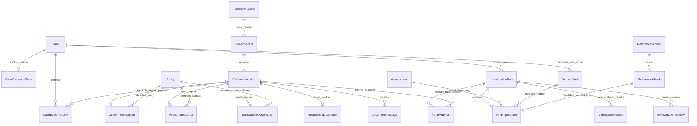

# Phase 3.1 — Proposed evidence model and data strategy

> Historical Phase 3.1 design snapshot. The minimum local synthetic evidence foundation is now implemented in [Phase 3.2](PHASE3_2_EVIDENCE_FOUNDATION.md); case-authorized retrieval/analytics is implemented in [Phase 3.3](PHASE3_3_RETRIEVAL_ANALYTICS.md). Corpus, investigator and provider proposals remain unimplemented.

**Proposal only.** No tables, migrations, data generation, imports or historical case enrichment are implemented. See [architecture and approval gates](PHASE3_1_INVESTIGATION_ARCHITECTURE.md).

## 1. Information classes and authority

| Class | Example | Permitted interpretation |
|---|---|---|
| Source observation | Timestamped transaction, dated KYC declaration, supplied document | What the identified source reported; integrity/authenticity checks do not prove real-world truth |
| Deterministic derived fact | Sum/count/concentration for an explicit event window and currency | Reproducible calculation over identified source versions, subject to coverage/quality limits |
| Model signal | Stored RF score, route, SHAP contribution, supplied aggregate predictor | Behavior of the frozen model and its input snapshot; not an observed transaction, causal explanation or legal finding |
| Reference material | Regulation, supervisory guidance, approved institutional policy | Context within explicit applicability/version/date; not proof that a customer breached it |
| AI interpretation | Hypothesis, supported narrative, questions and uncertainty | Generated interpretation with typed evidence references and independent verification; never source evidence |
| Human assertion/review | Analyst note, source validation, reviewer conclusion | Attributed and dated human judgment; distinguish from independently observed facts |
| Synthetic evaluation annotation | Scenario oracle/typology label | Test-only ground truth, excluded from retrieval/provider inputs; never model labels or evidence for real cases |

Every representation carries `data_classification` and `origin_kind`. A generated transaction is a **synthetic observation**, not a recovered historical transaction. Missing, unknown, not applicable, observed zero, partial coverage and contradictory sources are distinct states.

## 2. Common version/provenance envelope

- Internal primary keys: UUIDs. External source identifiers are source-namespaced, never globally equated or used directly as authorization. Retain original sensitive identifiers only in a protected source object; hashes of low-entropy PII are not adequate de-identification.
- `source_id`, `source_version_id`, `source_record_key`, `schema_version`, `ingestion_batch_id`, exact `raw_sha256`, extracted/normalized hashes, parser/generator version and ingestion actor/service. A correction creates a new version with `supersedes_version_id`; no silent overwrite.
- Preserve `event_at`, original timestamp/offset, `source_observed_at`, `recorded_at` and `[valid_from, valid_to)` separately. Unknown event time stays unknown; ingestion time is not a substitute. Unknown timezone/units blocks time/amount-sensitive claims. Distinguish when something was effective from when TrueFlag knew it.
- Quality fields: validation status/codes, provenance verification state, coverage window, completeness/sampling declarations, missing fields, conflicting-source links and reconciliation state. Any numeric source confidence requires a defined method; omit uncalibrated confidence percentages.
- Access metadata: classification, purpose, source-access-policy version, institution-context identifier and current allowed case links. Current TrueFlag is a **single workspace**: context labels are not enterprise tenant isolation. Full multi-institution tenancy remains a separate design/migration gate.
- Source bytes/version payload immutable; access revocation, review decisions and retention/withdrawal events append separate records. Content hash verifies integrity, not publisher authority or factual accuracy.

## 3. Proposed relational model

The table names below are logical schema proposals. Phase 3.2 must approve a minimum migration plan; it need not introduce later corpus/investigation tables at once. No new column is added to the frozen 27-feature schema.

| Logical record | Primary key / relationships | Essential fields and invariants | Initial boundary |
|---|---|---|---|
| `evidence_sources` | `source_id` | Stable source namespace/owner/type and access-policy identity | Foundation; approved synthetic fixture sources initially |
| `evidence_source_versions` | `source_version_id`; FK source | Source release/schema/rights/permission reference, acquisition method, effective/recorded times, coverage and immutable manifest hash; unique source/release identity | Foundation; evidence versions reference exact admitted source release |
| `evidence_items` | `evidence_id`; FK source | Stable identity; unique `(source_id, source_record_key, kind)`; kind fixed as KYC/account/transaction/relationship/document/assertion | Foundation; corrections preserve logical identity |
| `evidence_versions` | `evidence_version_id`; FK evidence item, source version, optional superseded version | Monotonic item version; exact hashes, schema/parser version, private object key, temporal/quality envelope; no arbitrary client URI dereferencing | Foundation; unique `(evidence_id, version)`; typed payload required |
| `case_evidence_state` | `case_id` PK/FK existing Case | Monotonic `evidence_revision` and evidence-access revision; approved institution/jurisdiction context with provenance | Foundation; Case.version still governs current assignment/state |
| `case_evidence_links` | `(case_id, evidence_version_id)` composite key/FKs | Explicit link purpose/source authority, actor/time, active access state; immutable grant/revoke audit; source/case context match | Foundation; link to exact version, not mutable latest |
| `entities` | `entity_id`; FK source | Source-scoped party/account identity, kind, pseudonymous display alias; no automatic cross-source fuzzy merge | Foundation for typed snapshots; identifiers are not permissions |
| `customer_snapshots` | `evidence_version_id` PK/FK; FK customer entity | Person/organization type, declared business/occupation, dated KYC status, declared expected activity/currency/window, protected PII reference and missingness | Typed immutable source snapshot; supplied RF KYC/PEP predictors are not verification of identity/PEP status |
| `account_snapshots` | `evidence_version_id` PK/FK; FK account entity | Source account identity, declared account type/currency/open/close times and quality; ownership through explicit relationship evidence | Typed snapshots; do not infer holdings from another customer's metadata |
| `transaction_observations` | `evidence_version_id` PK/FK; FK subject account and optional counterparty entities | Source event identity, event/booking times, amount magnitude, direction/status/channel, original currency/unit/scale, source reference; optional FK reversing transaction version | Positive/missing monetary amount rules explicit; reversals are events, corrections are new versions |
| `relationship_assertions` | `evidence_version_id` PK/FK; subject/object entity FKs | Typed relationship, valid interval, source/method, observed/declared/inferred status; inferred links never promoted to observed ownership | Bounded one-hop relationships; defer sophisticated entity resolution/graph inference |
| `document_passages` | `passage_id`; FK exact document evidence version | Safe extracted text hash, parser/OCR version, page/section/block, UTF-8 byte offsets and quality; private raw object reference | Curated text first; arbitrary binary documents require separate intake/scanner/sandbox approval |
| `derived_facts` | `fact_id`; FK case, evidence-set manifest | Calculation name/version, typed result/unit/window, exact input version IDs/parameters/coverage, content hash | Phase 3.3 deterministic computation; input membership referentially checked |
| `case_assessment_links` | `(case_id, assessment_id)`; FKs existing immutable assessment | Existing assessment/case relationship verified; model/input/policy identities resolved from stored record, not caller fields | Consume existing assessment history; never relabel it observed evidence |
| `reference_documents`, `reference_versions`, `reference_chunks` | Stable document ID, version UUID, chunk UUID; exact version FKs | Jurisdiction/institution/source class/effective intervals, approved corpus release, bytes/extract/section hashes and locators | Phase 3.4; detailed [RAG contract](PHASE3_1_RETRIEVAL_RAG_CONTRACTS.md) |
| `investigation_jobs`, `investigation_runs`, `run_evidence`, `provider_attempts` | Job/run/attempt UUIDs; FKs case, exact evidence/fact/assessment/reference versions | Fenced mutable execution state separated from immutable final manifest/result; unique run/key intent and per-attempt cost/response identity | Phase 3.5; no raw customer context in queue/log fields |
| `investigation_findings` | `finding_id`; FK run; unique run/ordinal | Claim kind, protected narrative/typed-fact binding, missingness/uncertainty and output fingerprint | Immutable findings; no new criminal-risk score |
| `finding_support`, `verification_records`, `investigation_reviews` | Support/verification/review UUIDs; FKs finding/run, source references, reviewer | Support row targets exactly one typed evidence/fact/model/reference version; factual/context role validated; independent checks and human decisions/version/time | Append-only history, separate from Case.disposition; approvals do not execute case/SAR actions |

For typed evidence, a version must have exactly one matching payload type; enforce this and same-source/scope FKs in the later migration/service design. JSON metadata cannot replace relational IDs, money types, authorization predicates or validation constraints. Source/version manifests can be consolidated if reviewed FK/history requirements remain enforceable.

### Relationship diagram — all new records proposed

## 4. Money, time, analytics and privacy rules

- Use decimal/numeric storage, not binary floating point, for transaction money. Proposed `NUMERIC(24,8)` must be checked against approved source magnitude/precision; reject NaN/infinity, booleans, overflow and unsupported scale. Typed tool DTOs carry canonical decimal strings plus currency/scale rather than lossy JSON floats. Preserve currency, declared unit and original scale. No FX aggregation without an explicit dated approved FX source and conversion fact.
- Account/counterparty amount flows are source observations; fees/reversals/booking-versus-event time make naive debit-credit equality unsafe. Reconcile only under declared ledger semantics. Unknown counterparties remain unknown; a shared token is not ownership proof.
- Each calculation binds case, exact versions, time window/closure semantics, included statuses/directions, currency, exclusions and coverage. Counts, velocity, concentration, pass-through candidates and expected-versus-observed activity are deterministic measures. A measure/red flag is not intent, a typology conviction or an obligation to file.
- Distinguish `complete_declared_window`, `partial`, `sampled`, `unavailable` and `unknown`. Zero returned transactions in an incomplete feed means insufficient data, not no activity. Store conflicting observations side by side; no LLM-selected silent winner.
- Keep raw PII in private governed source objects/limited typed fields. Retrieval exposes run-local aliases and only necessary attributes/amounts/time granularity. Render raw identity/document access only through separate authorized human views, never general LLM context by default.
- A relationship is returned only when its evidence and required endpoint snapshots are allowed for the current case. An entity shared by two cases does not grant access to the other case, its counts or its evidence.

## 5. Dataset strategy — do not reconstruct history from aggregates

| Option | Treatment | Recommendation |
|---|---|---|
| Existing alert/reference dataset | Keep unchanged; show aggregate/model signals and explicit missing transaction/KYC/account/document evidence | Mandatory legacy mode; never attach fabricated history as recovered source facts |
| New deterministic synthetic scenarios | Generate independent customers/accounts/time-stamped events/KYC documents with a versioned manifest, then explicitly link new scenario cases | Recommended development strategy after approval; label every record synthetic |
| Supplementary public/synthetic dataset | Evaluate source rights, actual fields, temporal semantics and identifiers; retain its own namespace | Optional, not selected/downloaded here; no join to existing cases by similar amounts/state/feature vector |
| Authorized institution evidence | Source-authenticated identity link, case purpose, privacy/rights approval and reconciliation | Future; absent today, no production data authorization inferred |

### Proposed forward generator specification

1. Fix `scenario_id`, seed, generator/schema version, parameters, simulated as-of timestamp/timezone, currency conventions and source manifest. Seed is not sufficient reproducibility without code/config/version hashes. Use fictional non-real identities; keep evaluation oracle in a separate restricted dataset.
2. Generate dated customer declarations, source-scoped accounts/relationships and transaction/servicing events. Include benign controls and challenge scenarios: missing feeds, observed zero versus missing income, out-of-order timestamps, reversals, duplicate/corrected events, multiple currencies, shared counterparties, inconsistent KYC and incomplete coverage. Suspicious-looking patterns remain synthetic test scenarios, not allegations.
3. Reuse the private staged `contracts/data_dictionary.csv`: metadata inspection confirms documented definition/unit/source-reference fields and uncertainty notes for all 27 predictors. Do not claim that this dictionary is missing. Keep credit/portal/KYC/servicing inputs distinct from transaction-derived aggregates. Bind those definitions to the new event schema through a reviewed per-feature derivation registry: exact inclusion/window/unit/missingness rules, source fields, uncertainty and reconciliation tests. The existing dictionary is not an implemented generator or recovered raw transaction provenance.
4. Create RF inputs only when all mandatory fields have an approved explicit source/derivation or declared synthetic scenario input. No zero-fill, missing-transaction inference, changed model semantics or altered preprocessing. Preserve `income=null` versus `income=0`. Mark partial reconciliation explicitly; block any claim that unreconciled inputs were derived from supplied transaction history.
5. If a mandatory definition/input is unresolved, keep the fixture/evidence separate and mark the ML case-generation step blocked; do not manufacture a fully reconciled scored case. Initial 3.2 work can establish evidence fixtures and insufficient-evidence behavior while definitions are reviewed. Existing Case requires an Alert: evidence-only case creation would require a separate approved schema change, not an implicit bypass.
6. For an approved complete bundle, ingest a **new** explicit synthetic alert through existing ingestion semantics, record scenario/source/row-to-alert-to-case identity and bind the evidence links. Compute real RF/SHAP through the existing separate explicit assessment workflow. Do not rewrite scientific replay records or use reference predictions as generated outputs.
7. Accept only if deterministic regeneration/hashes, FK/source mapping, money/time reconciliation, missingness and all declared feature derivations pass. Test held-out seeds/scenarios separately from tuning. Report reconciliation coverage and missing definitions; synthetic evidence does not establish real-world model generalization.

Existing 4000 saved RF predictions/12000 routes/4000 SHAP outputs remain scientific regression fixtures, not a transaction-evidence corpus or evaluation truth for AI claims.

## 6. Legacy Evidence table and migration boundary

- Existing `Evidence(id, case_id, source_uri, content_sha256, source_kind, metadata_json)` remains intact during design. No evidence API or versioning is implemented by its presence.
- Prefer additive records for typed/versioned sources. A future explicit `legacy_evidence_id → evidence_id/version_id` mapping may preserve references only after source bytes, hash, ownership and provenance are verified. Unresolvable legacy pointers remain unavailable/unverified, not silently imported or deleted.
- Proposed access uses existing Case authorization plus active explicit evidence links and source restrictions. Increment evidence/access revisions and append audits atomically on admission, correction or revocation. Long provider calls hold no case/actor DB locks.
- Read immutable historical runs only under current access to the case **and all disclosed sources**. Withdrawn content gets a restricted/tombstone state; retention/legal hold and privacy erasure need an approved policy. Immutability is not a promise to retain PII indefinitely or resist a privileged DB owner.
- No fixed statutory retention period, multi-tenant guarantee, external source connection, new generator or new table exists after Phase 3.1. Review the migration minimum, event-to-feature reconciliation gaps and [open decisions](PHASE3_1_INVESTIGATION_ARCHITECTURE.md#6-decisions-requiring-review--no-approval-inferred) before 3.2.
