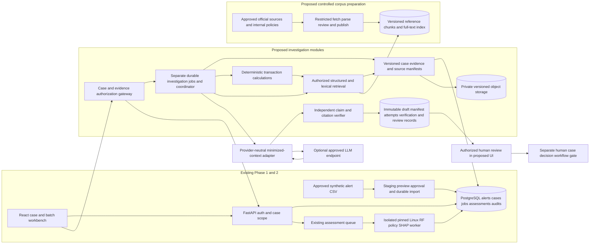
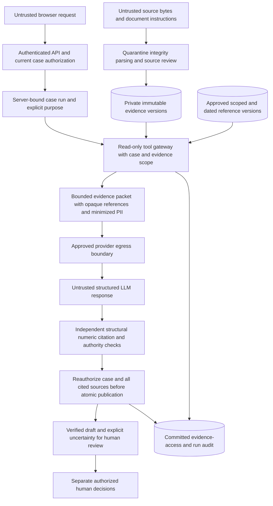
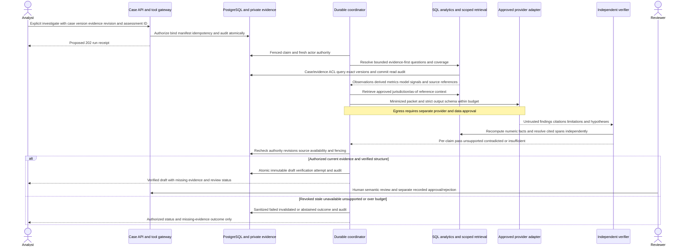

# Phase 3.1 — Investigation architecture and evidence design

> Historical Phase 3.1 design snapshot. The minimum local synthetic evidence foundation is now implemented in [Phase 3.2](PHASE3_2_EVIDENCE_FOUNDATION.md); broader retrieval, corpus, investigator and provider proposals remain unimplemented.

**Design only; proposed, pending review.** Inspected branch `codex/project-initialization` at `c3bd6e3`, 2026-11-03. No LLM, retrieval service, endpoint, migration, generator or additional worker is implemented here. Phase 3.2 is not started.

| Design document | Contents |
|---|---|
| [Evidence model](PHASE3_1_EVIDENCE_MODEL.md) | Entities, keys, versions, provenance, access, missingness and synthetic strategy |
| [Retrieval/RAG contracts](PHASE3_1_RETRIEVAL_RAG_CONTRACTS.md) | Proposed tool/API/output contracts, corpus registry, temporal retrieval and citations |
| [Security/evaluation](PHASE3_1_SECURITY_EVALUATION.md) | Threats, controls, independent verification, retention and acceptance gates |

## 1. Confirmed AS-IS and reuse

Actual PostgreSQL metadata was inspected without reading case contents: head **0011_batch_assessments**. Model/schema inspection confirms the following boundaries; presence of a table/protocol does not establish an implemented workflow.

| Confirmed component / actual path | Reuse | Gap for investigation |
|---|---|---|
| [`models/domain.py`](../backend/app/models/domain.py): Alert, Case | Stable alert/case IDs; immutable source features/fingerprint; assignment/version | No customer/account/transaction identity or transaction-time records; `Case.version` is not an evidence-set revision |
| [`schemas/alerts.py`](../backend/app/schemas/alerts.py) | Exact 27-field contract; synthetic-only transport; null income differs from observed zero | Aggregate 90-day predictors cannot reconstruct event histories, ownership, source of funds or chronology |
| Private staged `assets/local/baseline/contracts/data_dictionary.csv` (metadata inspected, contents not copied) | All 27 predictors have documented definition/unit/source-reference metadata and uncertainty notes | Reuse these definitions; no implemented event-to-feature generator/reconciliation or raw transaction provenance is established by the dictionary |
| [`trueflag_ml`](../backend/trueflag_ml): loader, scoring, policy, explainability and independent verification | SHA-verified fitted RF, full-precision SAR-positive output, frozen recommendations, verified grouped SHAP | Model outputs are derived signals, not source evidence, legal conclusions or causal explanations |
| [`services/assessments.py`](../backend/app/services/assessments.py), [`assessment_api.py`](../backend/app/services/assessment_api.py) | Immutable assessment/explanation/audit links, input provenance, scoped integrity-checked projections | Select an explicit assessment version for a run; never silently replace it with latest |
| [`security/auth.py`](../backend/app/security/auth.py), [`services/cases.py`](../backend/app/services/cases.py) | Fresh active-user role, analyst assignment, manager scope, hidden-resource 404, optimistic case version | Current scope is one workspace; no enterprise tenancy, evidence-level classifications or review permissions yet |
| [`services/assessment_jobs.py`](../backend/app/services/assessment_jobs.py), [`workers/assessment_worker.py`](../backend/app/workers/assessment_worker.py) | PostgreSQL claim/lease/fencing/retry patterns; atomic publication/audit | New investigation jobs require their own payload/state/budget/authority; do not put LLM traffic in the frozen ML queue/runtime |
| [`services/csv_staging.py`](../backend/app/services/csv_staging.py), [`csv_imports.py`](../backend/app/services/csv_imports.py) | Private object identity, quota, approval, chunking and provenance patterns | Current CSV is the 30-column alert transport, not a transaction or investigation-document importer; no malware scanner |
| [`models/domain.py`](../backend/app/models/domain.py): Evidence; [`0001_foundation.py`](../backend/alembic/versions/0001_foundation.py) | Existing case-linked source URI/hash/kind/metadata anchor | No implemented evidence ingestion/retrieval/version/ACL workflow; do not assume rows are empty, approved or trustworthy |
| [`services/investigation.py`](../backend/app/services/investigation.py) | Provider-neutral Protocol as a compatibility starting point | Only evidence ID/hash/text and summary/citation IDs/limitations; lacks run context, passage locators, claim verification, budgets and provider implementation |
| [`frontend/src/workbench.tsx`](../frontend/src/workbench.tsx), [`App.tsx`](../frontend/src/App.tsx) | Case/SHAP/history components; memory-only sessions, abort/denial and visibility guards | Evidence browser, findings/review states and investigation actions are proposed only |
| [`services/monitoring.py`](../backend/app/services/monitoring.py), [`security/logging.py`](../backend/app/security/logging.py) | Fixed-label telemetry, sanitized failures/correlation | Add investigation token/cost/tool/outcome metrics without prompt, evidence or business-ID labels |

Preserve all Phase 2 scientific/artifact/API contracts. Existing Efficiency/Balanced/Coverage are **model routing policies**, not AML law or internal institutional policy. Existing `decisions` rows contain model recommendations, separate from human case dispositions.

## 2. Recommended modular architecture

- One application codebase and PostgreSQL database. New investigation modules share authentication/authorization/transaction utilities; an optional separately running general-purpose investigation worker isolates provider/network/parse workload from the pinned ML worker.
- One deterministic state-machine coordinator with bounded optional LLM planning/synthesis. SQL/decimal services compute facts; retrieval applies permissions and scope; independent verification checks findings; humans own conclusions/actions.
- Start with structured SQL plus PostgreSQL full-text retrieval over an approved small corpus. No new graph database, broker, agent platform or vector service is required. Provider choice and any external egress remain unapproved.

### Full system diagram

Existing components are explicitly marked; every component in the proposed boundary is design only.

`HUMAN` denotes a future case-management permission/approval boundary; current case-disposition transitions/reporting are not implemented. The investigator never receives closure, dismissal, filing, arbitrary database or network tools.

### Data flow and trust boundaries

Source authenticity, content integrity, permission and factual truth are different checks. Retrieved text, provider output and synthetic scenario narratives never become trusted instructions.

## 3. Workflow and independent verification

- Rule-driven questions precede optional LLM suggestions: evidence coverage, activity versus declared profile, concentration/velocity, related authorized entities, counterevidence and missing information. An LLM cannot expand the case universe or invent new tools/SQL.
- Structured transaction analytics run only when actual linked evidence exists. No transaction evidence means no transaction-pattern finding; allow an explicitly limited assessment/context summary, with abstention on behavioral conclusions.
- Independent verification is separate deterministic code reading the cited evidence/calculation inputs, plus human semantic review. It is not a second prompt claiming to have checked the first. An optional later model critic cannot approve publication or actions.
- Partial provider output, stale snapshots or unverifiable claims never appear as verified findings. Human-readable rationale is stored; private chain-of-thought is neither requested nor required for the audit.

## 4. Technology and complexity decisions — proposals

| Decision | Recommended MVP | Why / revisit trigger |
|---|---|---|
| Orchestration | Typed deterministic coordinator in existing FastAPI application modules | Reuse current jobs/fencing/audit patterns; cap questions/tools/attempts; multiple agents need measured benefit first |
| Scientific execution | Existing isolated Linux worker, unchanged | Preserve pins, scientific parity and assessment provenance; investigation consumes stored DTOs |
| Evidence/transactions | PostgreSQL typed relational records, decimal math and private versioned blobs | FK integrity, transactions and exact calculations; JSON metadata is not the primary fact model |
| Text retrieval | PostgreSQL 17 full-text index plus scoped filters/section lookup | Existing infrastructure; evaluate keyword failures before adding embeddings. PostgreSQL provides lexical indexing/ranking; choice is our recommendation ([official docs](https://www.postgresql.org/docs/17/textsearch-intro.html)) |
| Relationships | Source-scoped entity IDs and typed relational edges | Enough for bounded one-hop queries; a shared counterparty is not authority to disclose another case. Dedicated graph analytics is expansion |
| Provider | Application Protocol with approved adapter and structured result validation | Reuse the existing stub concept; select vendor/model only after privacy, structured-output, cost and held-out evaluation gates |
| Verification | Independent deterministic checks and human semantic review | Citation existence does not prove entailment or legal applicability; no automatic consequential tool |
| Deployment | Compose and same application image with optional separate worker process/profile | No immediate Kubernetes/Kafka/vector service. Enforce an investigation queue/cost budget separate from RF capacity |
| Evidence documents | Curated text/HTML or manually transcribed synthetic documents initially | No arbitrary PDF/Office execution/OCR/upload promises; scanner/sandbox/safe preview must precede untrusted binary intake |

## 5. Proposed implementation subphases and gates

These labels expand the existing seven-phase roadmap; they do not claim that the historical Phase 4/5 investigation/review work is complete or add a new delivery schedule.

| Subphase | Narrow scope | Acceptance before next step |
|---|---|---|
| **3.1 — this task** | Architecture/evidence/tool/RAG/threat/evaluation designs | Documentation/source/scope verification; stakeholder review pending; no runtime implementation |
| **3.2 — evidence foundation** | Approved minimum additive evidence/version/source/case-link schema and deterministic synthetic scenario generator; local internal services only | Fresh/upgrade/rollback PostgreSQL tests; FK/provenance/immutable history, exact decimal/time/missingness, cross-case isolation, source correction and revocation; zero invented backfill; no LLM/corpus/API work |
| 3.3 — authorized retrieval and analytics | Case-bound tools, evidence read audits, deterministic calculations and bounded read API | Current authorization at reads, pagination/count privacy, missing/partial data, injection/DoS tests; numeric facts reproducible; no provider calls |
| 3.4 — approved regulatory corpus | Restricted ingestion/review, temporal lexical retrieval and citations | Licensed source/version provenance, legal-versus-guidance classification, jurisdiction/institution/date tests, retrieval held-out relevance and poisoning cases; no live provider required |
| 3.5 — bounded investigator | Approved provider adapter, separate jobs/attempt budgets, structured drafts and independent verifier | Real approved provider evaluation where permitted; outage/expiry/retry/cost/PII tests; no mock success substituted; unsupported findings blocked/abstained |
| 3.6 — human workbench integration | Evidence coverage/findings/citation display, revision history and independent human review | Browser role/revocation/logout, missing/stale evidence, citation drill-down, distinct reviewer attribution; no automatic closure/SAR tools |
| 3.7 — integrated evaluation/release gate | Adversarial, factual, retrieval, cost/latency and recovery evaluation | Frozen scientific regressions, real PG/worker/browser tests, accepted labeled results and documented residual risk; no production certification claim |

**Exact first proposed 3.2 task:** review and freeze the minimum source/evidence-version/case-link/typed customer-account-transaction model and generator specification in the evidence document, then author a migration plan with explicit preservation/rollback tests. Implementation requires a new request and the relevant approvals below.

## 6. Decisions requiring review — no approval inferred

| ID | Concrete recommendation | Approval / unresolved input |
|---|---|---|
| D3-01 | New deterministic synthetic scenarios; leave historical cases aggregate-only unless genuine provenance is supplied | Approve generator strategy, event-to-feature alignment against the staged dictionary, coverage scenarios and linkage rules |
| D3-02 | One jurisdiction and institution type initially; design supports either US federal banking or Canadian financial-entity corpus | Choose jurisdiction, reporting-entity type, historical/current as-of mode and eligible official documents; SAR vocabulary/state predictor does not establish legal scope |
| D3-03 | SQL/lexical retrieval first, no embeddings or graph service | Approve minimal retrieval approach and evaluation gate for expansion |
| D3-04 | Provider-neutral adapter; synthetic/pseudonymized context only after approval | Choose hosted approved endpoint versus local model, model/version, region/retention/no-training contract, spend cap and cancellation behavior |
| D3-05 | Analysts request on assigned cases; managers within existing workspace scope; curator capability separate; independent human review before adopting conclusions | Approve role/capability mapping and distinct-requester/reviewer policy; do not silently widen admin-only bulk ingestion |
| D3-06 | Append-only evidence/findings with revocable access, legal-hold-aware content retention | Approve data classes, retention/deletion schedule, storage/key management and who may clear holds; no statutory period assumed |
| D3-07 | Small curated local corpus and synthetic evidence; no arbitrary binary uploads | Approve source rights and parser/scanner boundary before broader intake |

Design readiness means concrete proposals are reviewable. Evidence and provider capabilities remain absent until separately implemented and accepted; Phase 3.2 is not authorized by this document.
