# Phase 3.1 — Proposed authorized retrieval, RAG and investigator contracts

> Historical Phase 3.1 design snapshot. The minimum local synthetic evidence foundation is now implemented in [Phase 3.2](PHASE3_2_EVIDENCE_FOUNDATION.md); case-authorized retrieval/analytics is implemented in [Phase 3.3](PHASE3_3_RETRIEVAL_ANALYTICS.md). Corpus, investigator and provider proposals remain unimplemented.

**Design only. All new interfaces below are proposals, not registered APIs/tools.** Existing case/assessment endpoints remain unchanged. Schemas are contract descriptions, not implementation code. [Architecture](PHASE3_1_INVESTIGATION_ARCHITECTURE.md) and [evidence model](PHASE3_1_EVIDENCE_MODEL.md) define the boundaries.

## 1. Server-bound execution context

- API derives actor from the authenticated principal; server resolves current role, case assignment/version, evidence/access revision, source permissions and approved institution/jurisdiction context. Client/LLM cannot assert its actor, scope, permitted sources or provider credentials.
- Worker receives a purpose-limited service identity and fenced job/run capability bound to the original actor and case. Store IDs/fingerprints, not bearer tokens or raw feature payloads. A new investigation service principal is proposed; do not reuse ML/import-worker credentials.
- Every retrieval checks current actor/service authority and case/source links. Recheck before provider egress, each tool response, draft publication, review and later disclosure. Case/user/evidence denial uses existing hidden-resource semantics; an unauthorized count/cursor/aggregate must not be returned.
- Initial roles: active analysts on assigned cases; supervisors/admins within the existing workspace scope. Ingestion/curation is a distinct proposed capability, mapped to a current admin only after explicit approval. Bulk case investigation is out of the first MVP.
- No SQL, arbitrary object keys/URLs, filesystem reads, network browsing, source admission or consequential writes are available to the model. Tool calls are validated data interpreted by an allowlisted gateway.

## 2. Proposed backend tools

All tools implicitly receive the trusted run context; **the model cannot supply/change case_id, actor_id, institution context or security filters**. Evidence/party handles must come from this run's permitted packet; external IDs cannot broaden it.

| Tool | Model-visible inputs | Authorized projection / bounds | Deterministic enforcement |
|---|---|---|---|
| `get_case_context` | None; optional question-template enum | Redacted overview, declared context, evidence coverage/missing categories, selected assessment ID | Reuse current overview projection; no full `Alert.features`, identity strings or cross-case counts |
| `get_transactions` | Allowed account handle, bounded event window, status/direction enum, scoped cursor | Necessary transaction aliases/time/amount/currency/status/source refs; default 25, maximum 50/page | Exact authorized case-version join, stable `(event_at, version_id)` order; explicit unknown-time bucket; max pages/total rows per run |
| `get_customer_context` | Allowed party handle and allowlisted field group | Dated declared profile/expected activity and quality; aliases, not DOB/identity numbers/full address | Only linked customer snapshot; no arbitrary property selection or entity lookup by name |
| `get_model_assessment` | Run-selected assessment handle, optional top-contribution count 1..10 | Integrity-checked stored score, route, model/policy/input versions, base/contributions/rationale | Existing assessment detail authorization/integrity reused; record model-signal type; never call RF training/inference from the LLM |
| `get_related_evidence` | Existing evidence/entity handle; kind enum; one-hop cursor | Explicitly linked permitted document passages or relationship assertions; default 10/max 20 | Both endpoints/source versions authorized; no global entity graph search or implicit related-case disclosure |
| `calculate_activity` | Approved calculation enum, allowed handles/window/currency | Typed derived fact, exact source version IDs, calculation/version/params and coverage | Backend decimal/SQL calculation; no free SQL/expressions, FX inference, mixed-currency totals or model arithmetic |
| `retrieve_reference_context` | Approved question/topic enum or bounded 256-character search phrase | Up to 5 approved chunks with class, jurisdiction, effective interval and exact locators | Context filters server-bound; ignore/reject model-supplied jurisdiction/date/ACL overrides; no live web access |

Use case/evidence predicate joins **before** ranking, limits, counts and pagination. For a shared source/entity, require an explicit active link for the current case; another case's authorization cannot be inherited. Unsupported queries return a fixed error or insufficient-data status, not a best-effort unscoped answer.

### Retrieval envelope — proposed schema

| Field | Contract |
|---|---|
| `schema_version`, `run_id`, `tool_call_id` | Server-generated/versioned; no credentials |
| `status` | `available`, `partial`, `unavailable`, `invalidated`; unauthorized requests fail separately with concealed resource semantics |
| `snapshot` | Case version, evidence/access revision, source/corpus manifest fingerprints and retrieval/calculation versions |
| `items[]` | Allowlisted typed observations, model signals, derived facts or reference passages; per-item `ref_id` and immutable version/locator/hash |
| `coverage` | Requested/available window, complete/partial/sampled/unknown, exclusions, missing attributes, truncation and unknown event-time/currency flags |
| `next_cursor` | Opaque/MAC-protected, actor/case/snapshot/filter-bound with expiry; not a reusable authorization grant |
| `limits`, `warnings[]` | Effective count/size/scan limits and fixed codes; no raw error values, SQL or private storage keys |

Sensitive read audit records actor/service/run, purpose, source/version IDs or manifest, returned count, revision and time; commit before disclosing results. Large membership lists use a protected manifest reference/hash. Operational logs contain only allowed aggregate labels/correlation, not this business audit payload or text.

## 3. Proposed public API surface — not implemented

| Method/path | Request/response intent | Checks |
|---|---|---|
| `GET /api/v1/cases/{case_id}/evidence` | Bounded metadata/coverage list, kind filter and snapshot-bound cursor | Current case/source permissions; no raw document download or arbitrary source URI |
| `GET /api/v1/cases/{case_id}/evidence/{evidence_version_id}/passages` | Authorized safe text and locators | Parent case + exact active version/link + classification; paginated/bounded, escaped rendering |
| `POST /api/v1/cases/{case_id}/investigations` | Explicit request; proposed HTTP 202 with stable run/job receipt and Location | Required key; strict body below; capacity/rate/spend admission and atomic request audit |
| `GET /api/v1/investigation-jobs/{job_id}` | Sanitized durable execution state/attempt counters | Resolve job's case first; current actor/case authority; no enumeration or prompt/error dump |
| `GET /api/v1/cases/{case_id}/investigations` | Bounded immutable result summaries/history | Current authorization to every disclosed source; metadata may also be sensitive |
| `GET /api/v1/cases/{case_id}/investigations/{run_id}` | Verified draft, cited support, uncertainty and review status | Exact parent/run binding; source withdrawals/revisions; stale/historical label; no raw provider response |
| `POST /api/v1/cases/{case_id}/investigations/{run_id}/reviews` | Attributed human approve/reject/request-evidence record, expected result/review version | Proposed reviewer capability, independent-user gate before adopting conclusions, fresh authority; no closure/filing side effect |

- Proposed request fields: `expected_case_version`, `expected_evidence_revision`, `expected_access_revision`, explicit stored `assessment_id` or null with reason, `investigation_mode` (`evidence_only` or `evidence_and_reference`), `approved_reference_context_id` (required for reference mode; otherwise null), bounded `question_template`, `purpose_code`. Server generates run ID and selects only approved provider/prompt/tool profiles. No caller scores, feature overrides, model path, raw context, arbitrary SQL or budget overrides.
- Strict extra-field/duplicate-key/type/body limits; reuse existing JSON guard, DTO and idempotency patterns. Same actor/key/content returns original receipt; changed content 409. Different key with the same frozen intent reuses the original run. In the first MVP, a new version requires an explicit human request with a changed verified manifest/question template; a same-input regeneration override would need a separately approved contract. Publication uniqueness prevents duplicate results, not duplicate external billing.
- Proposed status/error semantics: 401 anonymous/expired, 403 missing capability, 404 hidden/missing/parent mismatch, 409 stale intent/version/conflict, 413 size, 422 contract, 429 rate/capacity/spend with Retry-After, sanitized 503 transient dependencies. Missing evidence for an authorized case is a typed `unavailable`/abstention, not an invented score or fabricated transaction.
- Proposed job states: Pending, Running, Succeeded, Abstained, Failed, Invalidated. Separate durable per-stage/attempt progress from immutable result/review records. Retries are bounded, backoff/leases/fencing use DB time, and publication + provenance + verification + audit + job transition are one transaction. Do not mutate existing assessment jobs/tables.

## 4. Regulatory corpus design

### Source authority and policy separation

| Namespace/class | Eligible source | Treatment |
|---|---|---|
| `regulation` / statute | Approved official legislation/regulation and amendments for selected jurisdiction/entity type | Versioned provisions; qualified reviewer confirms effective date/applicability; source title alone does not resolve obligations |
| `supervisory_guidance` | Issuing regulator/manual/advisory | Clearly marked guidance; do not silently substitute for binding law or assume it reflects every subsequent amendment |
| `international_standard` | Official FATF recommendations | Context only until local implementation is established; not a jurisdiction-specific filing rule |
| `internal_policy` | Institution-approved controlled policy/version/owner | Institution scope, approval and validity; may be stricter than law; do not represent as legislation |
| `model_routing_policy` | Existing frozen Efficiency/Balanced/Coverage artifact | Read through assessment tool only; excluded from legal/policy authority ranking and regulatory citations |

Candidate sources **reviewed as design references on 2026-11-03, not ingested or approved as a complete corpus**:

- **US option:** [FinCEN legal authorities](https://www.fincen.gov/resources/fincens-legal-authorities) identifies the BSA/Chapter X and Federal Register sources. An approved US corpus could use provision-level CFR snapshots/amendments and separately classified supervisory material; [GovInfo CFR](https://www.govinfo.gov/help/cfr) describes the annual codification. Its edition date is not automatically a provision's effective date.
- **US retrieval source:** [eCFR API documentation](https://www.ecfr.gov/developers/documentation/api/v1) is a candidate acquisition interface, not a claim that this application has ingested/validated current regulations. Archive exact responses and amendment references after source approval; blocked/failed fetches stop publication rather than falling back to third-party copies.
- **Canadian option:** [Justice Canada PCMLTFA](https://laws-lois.justice.gc.ca/eng/acts/P-24.501/) provides legislation/version and coming-into-force context; [FINTRAC guidance](https://fintrac-canafe.canada.ca/guidance-directives/guidance-directives-eng) explicitly distinguishes its guidance from the Act/regulations and legal advice. Choose sector/provision applicability before use; do not mix US SAR and Canadian reporting rules.
- **International context:** [FATF recommendations](https://www.fatf-gafi.org/en/publications/Fatfrecommendations/Fatf-recommendations.html) are an optional separately labeled standards source. Initial jurisdiction/entity type, exact documents/sections, language, rights and temporal coverage still require approval.

No reporting thresholds, deadlines or retention durations are selected in this design. Regulatory search supports investigation context; it cannot certify compliance or determine a filing duty.

### Ingestion/version pipeline — proposed

| Proposed corpus record | Identity / relationships | Required metadata |
|---|---|---|
| Source registry | `reference_source_id` PK | Publisher/authority class, approved hosts/rights/acquisition rules and owner |
| Reference document | `reference_document_id` PK; FK source | Stable source document identity, title/class/jurisdiction/entity applicability |
| Reference version | `reference_version_id` PK; FK document; unique document/source-version | Raw/extract hashes, parser/version, publication/recorded/approval times, supersession/withdrawal events and provision validity metadata |
| Reference chunk | `chunk_id` PK; FK version; unique version/locator | Exact text/locator hash, page/section/UTF-8 span, parent context and effective interval or explicit unknown state |
| Corpus release | `corpus_release_id` PK; release-membership FKs to versions | Immutable admitted version/index manifest, approval actor/time, retrieval configuration; withdrawals remain current access controls |
| Approved reference context | `reference_context_id` PK; FK corpus release and controlled institution-context definition | Jurisdiction/entity type/policy namespace/language/as-of/knowledge cutoff/purpose; review version/actor; case-compatible permitted use |

These records are Phase 3.4 proposals, not additions to 3.2. A reference context is a server-approved record, not a model-selected jurisdiction or a new tenant guarantee.

```mermaid
flowchart LR
  Registry[Approved source registry and acquisition permissions] --> Fetch[Restricted fetch or curated local import]
  Fetch --> Raw[(Immutable private raw version and checksum)]
  Raw --> Parse[Sandboxed extraction with parser and normalization identity]
  Parse --> Scope[Provision hierarchy class jurisdiction entity type effective dates]
  Scope --> Review[Human source and applicability review]
  Review --> Release[(Approved corpus release and chunk manifests)]
  Release --> Index[PostgreSQL full-text and section indexes]
  Question[Case-bound question and approved reference context] --> Filter[Authority class ACL jurisdiction as-of and language filters]
  Index --> Filter --> Rank[Bounded lexical ranking and section lookup]
  Rank --> Packet[Cited exact version passages and scope caveats]
```

- Registry includes publisher/canonical URL, approved hosts/redirect rules, source class/jurisdiction/entity type/language, acquisition rights, document ID and freshness/review owner. Curator fetches cannot reach private IPs, cloud metadata, arbitrary model URLs or user credentials. Refresh is a controlled curation job; investigator has no crawler.
- Raw SHA, normalized text SHA, parser/normalization version, source publication/retrieval/approval times, effective interval and source-version relationships are immutable provenance. Corrections/withdrawals create new validity/release events rather than rewriting cited text. Hash alone does not prove an official publisher.
- Prefer structured HTML/XML sections. Preserve headings, definitions, exceptions, cross-references and parent context. Proposed chunks roughly 300–800 tokens, bounded overlap at section boundaries, exact page/section/UTF-8 byte spans; actual size is evaluation-driven. Table/OCR extraction needs separate quality approval; do not split away conditions/exceptions to improve similarity scores.
- `reference_document_id → version_id → chunk_id`; FK to approved `corpus_release_id`, source class, jurisdiction, entity applicability and valid interval. Freeze chunk text/locator hashes and index configuration/version in each release. Same bytes in a new release do not make the release interchangeable for provenance.
- Start with PostgreSQL 17 full-text (`tsvector`/`tsquery` plus suitable index) and exact section lookup; bind parameters/allowlist parser settings. [PostgreSQL documentation](https://www.postgresql.org/docs/17/textsearch-intro.html) supplies lexical search capability; it does not establish retrieval relevance or legal correctness. No embeddings/pgvector/reranker initially. Add them only if held-out relevance improves under the same authorization/date filters and cost/privacy gates.

### Temporal retrieval and citations

- Approved reference context binds jurisdiction, reporting-entity type, institution-policy namespace, language, legal as-of date and knowledge cutoff. Missing context blocks legal applicability claims; `state`/PEP/SAR model labels do not select a legal regime.
- Require effective interval covering the selected date, published/known-by cutoff, current source access and approved corpus release **before** ranking/limits. Future/draft, withdrawn, unknown-effective or wrong-scope text is excluded from operative answers; optionally expose an explicitly labeled context-only result if approved.
- Historical “rules effective then,” “information known then,” and “current guidance about old events” are different questions. Store both effective and recorded/approved timestamps; do not pretend later-ingested text was historically known. Null end date means open in the reviewed version, not proof no amendment exists. Conflicts/unknown scope return an unresolved-context limitation for human review.
- Reference response contains backend-issued `ref_id`, document/version/chunk IDs, source class/title/publisher, exact section/page/span, immutable excerpt hash, effective interval and canonical approved URL. Provider cannot mint citation URLs. Model output may cite only references actually returned for this run; IDs alone are insufficient without span/hash/snapshot checks.
- Store separate **factual-support** and **regulatory-context** links. A valid regulation citation supports discussion of a rule, not an assertion that a transaction/customer violated it. An authorized citation's existence is not semantic entailment; human review remains required.

## 5. Investigator output schema — proposal

There are two contracts: the untrusted **ProviderDraft** may contain only bounded questions/findings/limitations/unresolved questions and issued support handles; the **InvestigationResult** below is assembled by the server. Case/run identity, snapshot, model values, verification, provider usage/provenance and review fields are resolved from trusted services/response metadata, never accepted from generated text. Unknown/provider-invented verification or authority fields are rejected.

| Field/group | Required contract |
|---|---|
| Identity/status | Server `schema_version`, `run_id`, `case_id`, exact result version; `verified_draft`, `abstained`, `failed` or `invalidated` |
| Frozen manifest | Case/evidence/access revisions, exact source/fact/assessment IDs and hashes, corpus/index/retrieval/calculation versions, reference context and input packet fingerprint |
| `questions[]` | Bounded template IDs, answerability and missing-data reasons; LLM suggestions never expand capabilities |
| `findings[]` | ID, typed claim (`observation_summary`, `derived_pattern`, `model_signal`, `hypothesis`, `missing_evidence`), cautious text, support refs, counterevidence/conflicts, uncertainty/coverage, verification status |
| Support objects | Typed evidence/fact/model refs separate from reference-context refs; exact version/locator/hash and relationship to the claim; no unsupported free-form source IDs |
| `limitations[]`, `unresolved_questions[]` | Missing/partial/contradictory evidence, scope unknown, unverified applicability; no empty-evidence “low risk” conclusion |
| Verification | Independent rule/check versions, per-finding pass/unsupported/contradicted/insufficient, numeric/citation results and human-review requirement |
| Provider/prompt provenance | Adapter/provider/model/revision or returned fingerprint, prompt/template/tool/output schema versions, decoding config, request/attempt/response hash, usage/pricing version/cost status; no chain-of-thought |
| Review | Separate append-only reviewer ID/role/time/verdict/reason and reviewed result/content fingerprint; default unreviewed |

No generated crime probability, unsupported allegation, causal SHAP interpretation or unconstrained numeric “confidence” field. Structured findings are proposed investigation aids, not a new risk-model score or human disposition.

## 6. Provider and bounded orchestration contract

- Evolve the concept of existing `InvestigationProvider.draft` through a versioned adapter design; no SDK/model installed in this subphase. Adapter accepts minimized authorized packet, strict schema, execution/deadline/token/spend budget and cancellation context. It returns typed output plus usage/provider metadata or a fixed failure code. Provider credentials stay inside the server/worker boundary.
- Application owns tool execution. A provider's native tool requests are untrusted proposals passed through the same gateway. No provider-hosted browser, arbitrary code execution, cross-case memory or stored conversation thread. Disable provider persistence/training where contractually available and approved; flags alone do not establish data governance.
- **Proposed initial safety caps, pending approval/calibration:** six questions, 12 total tool calls including verification reads, 200 returned transaction rows across pages, five regulatory chunks, 8,000 context/2,000 output tokens, at most two provider attempts including one repair, 30-second call and 90-second execution deadline. DB reads/calculations get statement/row-scan limits and explicit incomplete coverage. These are design caps, not measured latency targets; tokenizer/window compatibility must be checked for the selected model.
- Cost admission reserves a worst-case approved token/price budget before each attempt; pricing identity and actual/missing usage recorded. Required spend limits remain unset until provider approval. A timeout may still be billed; do not assume zero cost or exactly-once provider execution. Use provider idempotency only when actually supported; DB publication remains independently idempotent/fenced.
- Check actor/evidence authority before sending minimized context. Revocation during an external request can block later tools/publication but cannot retract bytes already delivered to the provider; provider/data approval and minimization are mandatory controls.
- Missing evidence/reference context yields limited facts or abstention. Provider outage/budget exhaustion/invalid output yields a sanitized incomplete outcome, preserving case review. One schema repair may be proposed under the same bounds; no unbounded agent loop, silent provider fallback or auto-retry creating new result versions.
