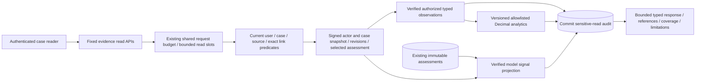

# Phase 3.3 - Authorized evidence retrieval and deterministic analytics

Starts from `c58d134`, branch `codex/project-initialization`. Internal read services and a narrow authenticated API; no new tables, migrations, models, infrastructure, frontend, corpus, provider or agent. Schema remains **0012 / 36 domain tables**. **Local synthetic acceptance: PASS.** Final full Linux/PostgreSQL acceptance passed 656 tests with zero failures/skips; all 14 recovery scenarios passed.

## Implemented boundaries

| Component | Actual file / responsibility |
|---|---|
| Typed contracts | [schemas/evidence_read.py](../backend/app/schemas/evidence_read.py): bounded extra-forbidden requests; source/record/snapshot references, coverage, parameters, typed observations/facts/model signals |
| Read boundary | [services/evidence_read.py](../backend/app/services/evidence_read.py): current case/source authorization, frozen selection, integrity checks, signed snapshots/cursors, projections and atomic sensitive-read audit |
| Arithmetic | [services/evidence_analytics.py](../backend/app/services/evidence_analytics.py): allowlisted Decimal calculations over authorized exact versions only |
| HTTP boundary | [api/evidence.py](../backend/app/api/evidence.py), registered in [main.py](../backend/app/main.py): authenticated fixed routes, shared rate budget, bounded concurrency/body/response handling |
| Existing reuse | `EvidenceService` authorization/transaction/audit/integrity helpers; `AssessmentAPIService` request budget and public projection; immutable assessment `_read`; existing PostgreSQL tables/locks/guards |

## API and internal contracts

| HTTP method/path, under `/api/v1/cases/{case_id}/evidence` | Internal service | Parameters / result |
|---|---|---|
| `GET` base path | `get_case_context` | Optional explicit `assessment_id`; case state, selected stored model signal or null, available/missing categories, account handles and signed snapshot |
| `POST /transactions` | `get_transactions` | Snapshot; optional account/window/currency/direction/event kind/status; stable page of authorized transaction versions |
| `POST /customers` | `get_customer_context` | Snapshot; optional explicit staleness threshold; dated KYC, null/zero income, contradictory observations, missing expectations and paging |
| `POST /related` | `get_related_evidence` | Snapshot; optional authorized account/customer identity handle; explicit one-hop relationships/accounts only |
| `POST /model` | `get_model_assessment` | Snapshot-selected immutable assessment only; verified RF/policy/grouped SHAP and original model/input/policy identities |
| `POST /activity` | `calculate_activity` | Snapshot, calculation enum, explicit window/currency, optional account/direction, reversal treatment and calculation-specific parameters |

- POSTs perform reads and read-audit writes only. Tokens/cursors remain in JSON bodies, not URL query strings. No generic tool dispatcher, arbitrary SQL, fields, evidence paths, URLs or model inputs are accepted.
- Analyst scope is current assignment; supervisors/admins retain the existing single-workspace case scope. A source owner has no read shortcut. Active case-version links and case/source grants are required. Related identities are resolved only from currently linked typed records; a shared alias, counterparty or another case is never an access grant.
- `assessment_id` is explicit and verified against the current parent case; null selects no assessment. No silent latest-model selection or live scoring. Returned recommendations remain model signals, separate from source observations and human dispositions; SHAP is not causation or proof of criminal conduct.
- Public input errors are value-free. Anonymous 401; hidden case/account/model resources 404; invalidated snapshots 409; request/response/scan bounds 413; unsupported filters/tokens/cursors 422; shared rate/capacity 429; sanitized PostgreSQL/integrity/audit failure 503. JSON content type is required; duplicate keys, NaN and extra fields are rejected. No-store/security headers and server-generated log correlation are reused.

## Snapshot, provenance and pagination

1. Lock/recheck the current active actor and case; apply active case/source/version predicates before order, count, projection or analysis. One short PostgreSQL transaction owns each response and its read audit.
2. Freeze all visible linked membership, case version/state/disposition/assignment, evidence/access revisions, role, selected assessment and retrieval version into the snapshot SHA/UUID.
3. Select the **highest authorized linked source release per source** and expose the selection rule/version explicitly. Within that release use only active exact record versions. Never union old and corrected snapshots or substitute an older record within the selected release. If an entire newer release has no remaining authorized links, only still-authorized releases can be selected/listed; the version is explicit and is not a claim of globally current source truth. Hidden releases and counts are not disclosed. Admission of an unlinked release does not change the case snapshot. Linking/revoking/reassignment changes invalidate it.
4. Reuse Phase 3.2 integrity verification for each selected immutable release and typed payload. Historical/unlinked payloads checked for integrity are never projected or included in calculations. Incomplete membership produces partial coverage, without exposing withheld row counts.
5. Snapshot/cursor signatures use a domain-separated HMAC key derived from the existing signing secret, a separate issuer/audience/purpose, and PostgreSQL-clock expiry. They are not authentication credentials or reusable access grants. Every use repeats current authorization and membership checks.
6. Cursors bind actor/case/snapshot/operation/canonical typed filters/page size/expiry and a bounded ordinal. Fixed ordering is `(known time first, event_at UTC, record_version_id)` for transactions, `(observed_at, record_version_id)` for KYC and record-version UUID for related records. Frozen membership plus revision invalidation prevents duplicates/missing rows across pages.
7. Responses contain deterministic server-generated reference UUID/SHA, exact selected record IDs/hashes, source release/generator identities, snapshot identity, typed request parameters, requested/source windows, exclusions, limitations and classification. References hash parameters/snapshot/typed data; signatures and token expiry are excluded from fact identity. Identical facts under the same frozen context reproduce the same reference.
8. Commit an immutable `evidence.retrieval.*` audit before disclosure. Audit stores reference/request/response fingerprints, actor/case, snapshot/revisions/count/version, never raw observations, amounts, income, predictor values or tokens. Audit/database failure rolls back and returns no data. Existing evidence audit guards apply; no extra fact table/cache/queue is introduced.

The client retains the typed packet/parameters to reproduce a result from stored immutable versions. Reference IDs are content identities, not a new unauthenticated lookup API or persistent derived-fact store. Later investigator publication must freeze its own authorized packet. Revocation invalidates future use; it cannot retrieve bytes already disclosed. Read commit is the authorization linearization point, not an atomic network-delivery promise.

## Versioned arithmetic rules

Calculation version: `trueflag.transaction-analytics.v1`. Units: synthetic source **currency major units**, exact Decimal/NUMERIC observations. No RF predictor equation, currency conversion, netting assumption or new AML risk model is introduced.

| Operation | Explicit interpretation |
|---|---|
| `count_totals` / `incoming_outgoing` | Count/sum currently authorized observations in one requested currency/window, with credit/debit subtotals. Count is not a claim of complete financial activity |
| `velocity` | Fixed UTC elapsed-time buckets anchored at requested start; count/total per bucket, including a partial final bucket; no local-DST normalization |
| `concentration` | Per-authorized-counterparty count/sum; share denominator includes all observed selected amount, including unknown counterparties. Unknown count is separate; zero denominator returns null share. Top 10 with an explicit truncation flag |
| `patterns` | Explicit caller-supplied large-amount threshold; repeated `(amount, direction, permitted counterparty)` groups meeting explicit minimum. Top 10 with truncation flag. Descriptive patterns, not structuring/criminal-intent findings |
| `kyc_comparison` | Insufficient comparable declared expectations: current schema has no expected transaction volume/frequency/window fields. Annual income and RF aggregates are never substituted |

- Windows require explicit offset timestamps (numeric epochs, numeric strings and naive dates are rejected), `[start,end)`, maximum 366 days; unknown event times are not imputed or assigned to a window. No-window transaction retrieval keeps unknown times in a separate final ordering bucket. Original offset text remains available alongside normalized timestamps.
- All calculations require a single explicit supported currency. Mixed currencies are filtered and exclusions reported, never added or converted. Arithmetic uses a fixed 50-digit Decimal context; concentration shares alone round to 16 places, half-even. Amounts/totals serialize as decimal strings, not binary floats.
- Default `gross_observations` retains original and reversal events as separate direction-labelled observations. `exclude_verified_reversals` excludes both members only for one explicit authorized same-release pair, matching account/amount/currency/opposite direction and both within the analytical window. Duplicate reversal claims, missing/withdrawn/out-of-window targets, mismatched amounts or unresolved direction make adjusted totals insufficient/null. No inferred match or unsupported netting.
- Source corrections are resolved by exact selected release membership; old record versions remain preserved in storage/provenance history, never summed again. Exclusions report authorized historical versions, filters, unknown times and outside-window records.
- Complete means only **complete declared synthetic coverage** with complete permitted membership and requested window support. Partial/unavailable/unknown feeds cannot establish zero activity. Empty incomplete windows return null monetary totals; partial nonempty results describe observed values only. Legacy aggregate-only cases return explicit insufficient evidence, never reconstructed transactions.

## Limits and explicit unavailable fields

- Shared default rate: existing 120 authenticated assessment/evidence requests per 60 seconds; four evidence read slots per API process. PostgreSQL transaction limits reuse 2-second lock / 5-second statement / 15-second idle timeouts.
- Snapshot validity: 15 minutes; at most 1,000 visible historical versions scanned, 200 selected versions, 10 source headers, 50 transaction or 20 KYC/related items/page, 128 velocity buckets, 12 KiB query bodies and 256 KiB serialized responses. Exceeding bounds fails explicitly; complete evidence is never silently truncated.
- **Settlement status is absent** in Phase 3.2. Only `not_recorded` is a valid status filter; posted/pending/settled are rejected. **Expected activity, sampling metadata and curated documents are absent**. Report unknown/not-recorded, not invented comparability, sampled completeness or document contents.
- Dated KYC shows age at frozen source as-of; a stale flag requires an explicit caller threshold. Conflicting observations remain separate and marked. Source references preserve mismatches between corrected declarations and immutable original RF inputs.
- Existing legacy Evidence URIs are neither trusted nor dereferenced. No regulatory retrieval, provider/network access, document intake/scanning, graph service, global entity search or UI is enabled. Production IAM/SQL roles, tenancy/RLS, retention, independent audit storage, legal/source rights and HA remain separate gates. No production certification or capacity claim.

## Acceptance and repeatability

- Targeted real Linux/PostgreSQL: `python -B scripts/run_assessment_verification.py --retrieval-only`.
- Full real Linux/PostgreSQL/workers/recovery: `python -B scripts/run_assessment_verification.py --full-backend --phase3-report`; new recovery measurements stay in ignored `runtime/phase3-3-recovery.json`, preserving historical Phase 2 reports.
- Native PostgreSQL/SQLite use the existing isolated-schema/file fixtures and unique ignored workspace `--basetemp` paths. SQLite verifies prior compatibility only; evidence read services require PostgreSQL. Actual RF/SHAP success is tested in the pinned Linux runtime.
- Frozen ML: `python -B scripts/run_ml_verification.py --check tests`, then `--check scoring`, `--check policy`, `--check shap`. Private assets are read-only; outputs are aggregate counts/errors only.

Current targeted results: **65 Linux/PostgreSQL passed, 0 failed/skipped**, including one real stored RF/SHAP projection, independent Decimal/source-observation oracles, all API projections, current assignment/source isolation, shared-counterparty/withdrawn links, snapshot/cursor forgery/expiry/revocation, corrections, stable pagination, size/rate/capacity bounds, PostgreSQL disconnection and audit rollback. **178 pinned ML tests**, **4000 scores / 12000 policies / 4000 SHAP** passed with zero mismatches. Native selected evidence/authentication/case/assessment-API/security regressions: **181 passed, 0 failed, 1 actual-Linux-ML skip**. SQLite full regression: **383 passed, 0 failed, 272 PostgreSQL/Linux skips**. Final strict-window/Decimal unit verification: **20 passed** (includes one additional negative-window test added after those platform collections). **Final full Linux/PostgreSQL: 656 passed, 0 failed/skipped; 14 recovery scenarios passed.** Full-suite wall time 494.61 seconds is test execution time, not a production capacity claim. Lint/format, dependency consistency, documentation links, schema drift/rollback and publication boundaries passed. Existing Starlette/httpx deprecation warning remains. No frontend implementation or browser acceptance is claimed.

An initial full Linux run reported 654 passes and one existing batch test failure: an idle worker poll returned None before its next committed job was claimable. The test now polls within a fixed 10-second bound; it still requires two actual successful assessments, exact persisted counts and direct RF/policy/SHAP equality. All three policies passed twice (6/6) before the final full rerun, which passed all 656 tests. Production queue/worker/model behavior is unchanged.

Live handover: backend refreshed with these APIs; readiness/frontend HTTP 200 and unauthenticated evidence access 401 verified. Seven legacy business-table row counts/hashes are unchanged. Existing PostgreSQL, frontend, assessment and import workers remain running; no evidence fixtures were added to public cases.

Phase 3.4 corpus preparation is not started. It still requires jurisdiction/entity/as-of/source-rights/corpus decisions; these reads do not imply corpus approval or external evidence authority.
