# Phase 3.5.1 - Deterministic evidence-only coordinator

Implementation contract frozen before migration on branch `codex/project-initialization`, starting at `e7a954c`. This is **not a validated AI investigator**. No LLM/provider calls, regulatory retrieval, inference/training, frontend, case decisions or SAR action.

- Reuse `EvidenceReadService`, current actor/case/source locks, signed revision-bound snapshots, stored assessment projection and audited Decimal analytics. Request an explicit assessment ID or omission reason, window/currencies and expected case/evidence/access revisions. No automatic latest assessment or invented transaction history.
- Five additive tables: immutable investigation run/input manifest, immutable idempotency bindings, mutable leased job, separate revocable evidence-worker identity and immutable packet/verification. Source/RF/policy/SHAP tables unchanged. Expected head 0014; 51 domain tables.
- Requester-bound MVP runs; active analysts on assigned cases and supervisors/admins within existing workspace scope can request/read their own runs. No new public APIs or permission expansion. A separate purpose-bound worker token is required; no inherited ML/import-worker identity.
- PostgreSQL admission cap 100 pending/running jobs; per-requester cap 3. `SKIP LOCKED` claims, 60-second leases, 45-second execution deadline, at most 3 attempts with bounded backoff. Recovery/fencing, fresh authority and revision checks apply at each step and publication. Audit/packet/job transition commit atomically. Retained history blocks destructive downgrade.
- Bound selected evidence to existing 200-record/10-source service limits, 32 retrieval steps, explicit <=366-day window, <=4 currencies, <=8 financial facts, 128 KiB input manifests and 512 KiB packets. No bearer/snapshot tokens persisted. Never log packet content, feature values or credentials.
- Packets distinguish source transactions, derived gross-observation totals/concentration, optional stored model signals and human case state. Missing/partial/conflicting inputs produce limitations/questions and explicit abstention; no suspiciousness/crime/filing conclusion. Selected model signals retain their original provenance and cannot substitute for facts.
- Independent verifier reloads authorized source records and exact reference membership; independently computes Decimal financial checks, not a call back into the producer's analytics or a model's claimed validation. Permissions/input identity are checked before publication and later disclosure; stale or revoked packets are withheld while immutable history remains.

Phase 3.4 human regulatory approval gates remain closed. Phase 3.5.2 is not started. This subphase's local technical acceptance is recorded below; it grants no legal, provider or AI-investigator approval.

## Actual implementation and interfaces

| Component | Actual path / responsibility |
|---|---|
| Request, manifest, packet contracts | `backend/app/schemas/investigations.py`: strict revisions, explicit model selection/omission, UTC window, currency plan and bounded machine-readable question/limitation codes |
| Durable persistence | `backend/app/models/investigations.py`; migration `0014_investigation_foundation_evidence_coordinator.py` adds five tables and integrity/immutability guards |
| Coordinator | `backend/app/services/investigation_coordinator.py`: admission, requester-bound idempotency, worker identity, claims, retries, recovery, publication and disclosure |
| Packet producer | `backend/app/services/investigation_packets.py`: existing case/transaction/customer/model projections and authorized analytics only |
| Independent verifier | `backend/app/services/investigation_verifier.py`: source-row membership, values, references and separate Decimal arithmetic; never calls the producer's `calculate` function |
| Bounded worker | `backend/app/workers/investigation_worker.py`: Linux CLI, separate token file, 1-20 jobs per invocation; no background daemon deployed |
| Acceptance | `backend/tests/test_investigation_coordinator.py`; `scripts/run_investigation_verification.py` runs pinned Linux/PG on the recovery clone |

Internal service methods accept server-authenticated actor UUIDs. `request(actor, case, key, InvestigationRequest)` returns a durable run receipt. `get(actor, case, run)` returns an authorized packet or a sanitized status with packet withheld. `register_worker`/`revoke_worker` require a current admin. `claim`/`current`/`assemble`/`complete`/`fail`/`recover` require a separately provisioned purpose-bound worker token and fenced claim. There is no new HTTP inference/investigation API, generic tool executor or user-provided score.

```mermaid
flowchart LR
    Request[Explicit authorized evidence-only request] --> Freeze[Current case/source checks and immutable input manifest]
    Freeze --> Queue[(Separate PostgreSQL jobs and idempotency bindings)]
    Queue --> Worker[Purpose-bound worker / fenced bounded execution]
    Worker --> Reads[Existing authorized evidence reads and calculations]
    Reads --> Packet[Source transactions / derived facts / stored model signals / gaps]
    Packet --> Verify[Independent raw-record numeric and reference validation]
    Verify --> Publish[Fresh authority and input check / atomic packet + audit + job]
    Publish --> Result[(Immutable packet and verification)]
    Result --> Disclosure[Current requester/case/source check before disclosure]
```



## Frozen inputs and deterministic output

- Input identity binds actor, case/alert IDs, case state/assignment/role through the existing snapshot SHA, evidence/access revisions, exact source/record versions, retrieval/calculation/coordinator/verifier versions, requested UTC `[start,end)` window/currencies and the selected immutable assessment ID/detail SHA. A separate versioned fingerprint binds alert features without duplicating predictor values. Missing income remains null; observed zero remains zero in existing source/model records and fingerprints.
- Store no access JWT, snapshot JWT, provider key or raw alert predictors. The worker creates a private ephemeral snapshot-signing key and does not require the API JWT signing key; token signatures are not input identities. Restarted workers can regenerate internal snapshots against unchanged manifests.
- Packet transactions include all authorized selected observations; financial facts apply the explicit window/currency plan. They report gross observation counts/totals, incoming/outgoing totals and bounded counterparty concentration. No FX, settlement inference, risk threshold, transaction-to-RF derivation or criminal finding is added.
- Stored RF/Policy/SHAP signals are selected explicitly and integrity-read from existing immutable assessments. The coordinator neither scores nor explains a new alert. Model routes stay recommendations; case state/human disposition is projected separately and never changed.
- Missing categories, unknown times, partial windows, unmatched reversals, omitted currencies, source/input disagreement and contradictory KYC remain explicit. Declared expected activity, sampling, settlement status and curated documents remain unavailable. No source transactions means no invented history and unknown totals remain null.
- Every packet abstains from money-laundering/violation/SAR conclusions. Partial/conflicting/unknown-time/unrequested-currency/absent transaction evidence also causes behavioral abstention. `packet_ready` means deterministic packet assembly only; `source_numeric_reference_checks_passed` is not truth, completeness, legal or AI-investigator validation.

## Transactions, safety and limits

- Same requester/key/intent returns its original receipt; changed intent conflicts. Different keys for the same frozen intent bind the same run; at most 100 aliases/run. A failed terminal intent is not silently regenerated by another key. A new verified intent/version must be requested explicitly.
- PostgreSQL advisory coordination locks plus row locks serialize short request/claim/publication transitions; assembly runs outside that gate. `SKIP LOCKED` and unpredictable lease tokens fence concurrent workers. At most 3 attempts, 2/4-second retry backoff, recovery batches <=20, 100 active jobs globally and 3/requester. Worker death leaves committed jobs recoverable on the next active worker tick.
- DB-clock 60-second leases and 45-second attempt deadlines combine with a monotonic assembly budget, <=32 retrieval steps, 5-second statement/2-second lock limits and bounded source processing. No external/untrusted execution occurs. This is cooperative bounded deterministic execution, not an OS sandbox for arbitrary future provider/plugin code.
- Source services reauthorize and audit each projection. The coordinator checks worker authority and the frozen input before every retrieval, before returning assembly and inside publication. Current actor/case/source locks hold through independent validation and atomic commit. Revocation linearizes against publication; already disclosed authorized bytes cannot be retracted.
- Atomic publication contains packet, source validation report, immutable audit event and terminal job status. Deferred triggers prevent incomplete run/job/request envelopes and completed jobs without packets. Packet/run/key history cannot be updated/deleted/truncated; worker identity is immutable and revocation permanent. Retained investigation rows/audits block downgrade; empty downgrade is verified.
- Disclosure reauthorizes and revalidates the stored packet; changed case/evidence/access/role suppresses the old result. An authorized stale read can mark the run invalidated; an unauthorized actor receives a hidden-resource failure. Immutable packet history remains retained. This MVP does not implement cross-requester supervisory review permissions.
- Failures use allowlisted codes and manual-review status; errors/warnings never include customer values, model features or secrets. No failure dismisses/closes a case or submits a SAR. Corrupt/unsupported/oversized results cannot become verified packets.

## Operation and deployment boundary

```powershell
.venv\Scripts\python.exe -B scripts/run_investigation_verification.py
.venv\Scripts\python.exe -B scripts/run_investigation_verification.py --full
```

These commands use the protected Phase 3.4 recovery clone, disposable schemas and the existing pinned verification image. Historical Phase 3.4 backup/migration commands are version-specific to `e7a954c`; this runner consumes the already verified retained clone. Standard pytest fixtures can also use an explicitly supplied dedicated `TRUEFLAG_TEST_POSTGRES_URL`. They pass credentials in memory/stdin, use read-only code/artifact mounts and 2 CPUs/3 GiB. Migration 0014 is verified in those schemas; the running demo is not migrated/rebuilt automatically.

On a separately prepared Linux environment with schema 0014, a provisioned `investigation.evidence.execute` identity and private token file, invoke `python -B -m app.workers.investigation_worker --max-jobs 1`. Supply database connectivity and that worker's own secret; do not supply/reuse API signing or ML/import-worker tokens. Provision/revoke through trusted admin-bound service calls. No credential is generated/printed or registered in the running demo by this subphase.

## Remaining gates

- No provider adapter, prompts, LLM interpretation, human review/adoption workflow, investigation HTTP API, frontend or regulatory citations are implemented. The existing provider Protocol remains a contract stub. The user's explicit evidence-only request authorizes this foundation while Phase 3.4 regulatory review remains pending.
- Shared coordination locks, repeated source-integrity reads and requester-only disclosure are deliberate local MVP limits; no enterprise throughput, penetration-test, HA or banking certification claim. Worker scheduling, production SQL roles/tenancy, retention/backup policy, independent audit storage and deployment controls remain governed work.
- LLM integration needs a separate request and approved provider/data/egress/retention budget, bounded attempts/schema enforcement, independent factual/semantic evaluation and human review. Regulatory retrieval additionally retains every Phase 3.4 human source/label/publication gate. No later subphase starts automatically.

## Actual acceptance - 2026-11-04

These are distinct, overlapping runs; do not sum them as unique tests.

| Run | Passed | Failed | Skipped | Actual scope |
|---|---:|---:|---:|---|
| Frozen full Linux/PostgreSQL backend | 795 | 0 | 0 | 639.61 seconds; all existing ingestion/ML/evidence/reference/security regressions plus 48 investigation tests |
| Final focused Linux/PostgreSQL investigation | 50 | 0 | 0 | 46.20 seconds; adds final CLI startup-sanitization and actual CLI/no-API-key checks |
| Native Windows/PostgreSQL investigation | 47 | 0 | 2 + 1 | 56.77-second broad run plus final CLI-only skip; Linux SHAP/process-death/CLI cases run successfully above |
| SQLite full compatibility | 441 | 0 | 356 | 263.92 seconds; PostgreSQL constraints/locks and Linux-only execution explicitly skipped |
| Pinned Linux ML tests | 178 | 0 | 0 | Exact pinned runtime and actual approved model assets |
| RF / policy / SHAP replay | 4,000 / 12,000 / 4,000 | 0 mismatches | 0 | RF max absolute error 0; SHAP max reconstruction residual 3.1086244689504383e-15; original encoded/grouped/base deltas 0 |

- New normal synthetic source: 12 transaction observations, 16 selected evidence records, two gross/concentration facts for requested USD, exact source/model provenance and unchanged open case/no disposition. Legacy aggregate-only cases return no invented transactions, null unsupported totals and abstention.
- Partial/unavailable/unknown-time/multicurrency/conflicting-KYC cases retain limitations and abstain where appropriate. Missing/zero income, high-precision Decimal amounts and reversal/correction profiles pass source verification. Real stored Coverage RF/SHAP assessment is projected exactly as a model signal; the coordinator performs no inference.
- Verified duplicate/alias intent reuse, conflicting keys, queue capacity, concurrent requests/claims, worker revocation/recovery, assignment/role/source changes, stale result withholding, three-attempt terminal manual review, expired fencing and actual Linux child kill/restart with one completed packet.
- Numeric producer corruption, altered transactions/totals/context/questions/references and unapproved citations cannot publish. Source validation is separate from producer arithmetic. Database connection termination and audit failures roll back packet/job/run changes; no partial successful packet or lost committed job.
- Publication/revocation race is linearized by current case/source locks: publication may finish before the revocation commit; later access withholds the packet. No instant erasure of already authorized disclosures is claimed.
- Migration 0014: fresh PostgreSQL/SQLite head/readiness, empty 0013 roundtrip, retained-history rollback refusal and PostgreSQL Alembic drift checks passed. Full suite also preserved existing prior-phase DDL/transaction/security tests. No live schema migration or service redeployment occurred.
- Initial harness issues: imported fixture was removed as unused before explicit alias registration; one test used the wrong bundle field. Fixed test setup/assertions, not domain/model behavior. An initial broad run had 793 passed / 1 failed because a spawned worker loaded newer required manifest code while its parent retained the earlier imported version during concurrent edits. With code frozen, the complete rerun passed; no retry/tolerance/permission acceptance was weakened. The final two CLI tests were then verified in the focused suite.
- Ruff lint/format, host/pinned dependency consistency and private/publication boundaries passed. All 25 frozen private artifact identities and seven initial unrelated branding/startup files are unchanged. Stored model projection preserves all 87 missing-income and 22 zero-income scientific replay cases.
- Existing Starlette/httpx deprecation warning remains. No mock model success, source/label self-approval, provider call, regulatory corpus publication, frontend change, teammate-source edit, GitHub push or production certification is claimed.
