# Phase 3.5.2 - Provider-neutral investigation drafts

Starting branch `codex/project-initialization`, HEAD `085a64e`; November 6, 2026 (New York). **Simulation integration only. No live LLM/provider acceptance, legal approval or completed AI-investigator claim.** Regulatory source and independent-label approvals remain closed.

## Implemented boundary

| Layer | Responsibility |
|---|---|
| Existing Phase 3.5.1 coordinator | Case/actor/source authorization, frozen evidence/access/assessment manifest, durable evidence job, deterministic packet and independent raw-record arithmetic/reference verification |
| Draft request/admission | Explicit authenticated internal request and provider configuration; parent admission and child job/key/audit in one PostgreSQL transaction; no public endpoint or frontend |
| Provider contracts | Strict versioned configuration, minimized packet, findings/selectors/numeric assertions, uncertain hypotheses, questions, bounded usage and response envelope |
| Registered transport | Deterministic fake only, explicitly labeled simulation; isolated Linux subprocess with request deadline, byte/resource bounds and no inherited database/API/provider credentials |
| Draft verifier | Reverify current parent source records/calculations/model first; validate run-bound references and exact optional numeric statements; render facts on the server |
| Persistence | Additive migration 0015: six tables for immutable draft intent/keys, child job, immutable attempt reservations, immutable completion/failure receipts and immutable drafts |

Existing RF/Policy/SHAP/evidence behavior is preserved. Phase 3.5.1 `request` delegates to its same transactional admission core so this optional child stage can reuse it atomically. It does not duplicate source retrieval, financial analytics, worker identity or numeric verification.

Actual files: `schemas/investigation_drafts.py`, `models/investigation_drafts.py`, `services/investigation_drafts.py`, `services/investigation_draft_verifier.py`, `services/investigation_provider.py`, `services/investigation_provider_runner.py`, `workers/investigation_draft_worker.py` and `workers/investigation_provider_process.py`, all under `backend/app/`. The old `services/investigation.py` Protocol remains an unused compatibility contract; it does not register a second provider or expose its legacy raw-text/case-ID signature to this new path.

```mermaid
flowchart LR
    Request[Explicit authorized simulation request] --> Admit[Atomic parent + child admission]
    Admit --> PacketJob[Existing evidence coordinator/worker]
    PacketJob --> Packet[(Verified immutable evidence packet)]
    Packet --> Child[Bounded draft job / worker fence]
    Child --> Reserve[(Durable attempt/token reservation)]
    Reserve --> Min[Minimized structured packet]
    Min --> Fake[Isolated deterministic fake provider]
    Fake --> Verify[Fresh authority + raw-source parent verification + proposal checks]
    Verify --> Store[(Atomic receipt + immutable draft + audit + terminal job)]
    Store --> Human[Reauthorized disclosure / human semantic review required]
```



## Configuration and egress

- `INVESTIGATION_SIMULATION_ENABLED=false` and `INVESTIGATION_EXTERNAL_ENABLED=false` by default. Enabling the external flag **fails closed**, even if simulation is enabled. There is no real adapter, SDK, endpoint selector, arbitrary model loader, provider credential intake or model-initiated tool registry.
- Legacy `LLM_PROVIDER`/`LLM_API_KEY` example placeholders remain unconsumed. Supplying a credential or model name cannot activate a provider. Any future credential must be resolved from an approved environment/secret reference by a separately authorized adapter, never supplied through model output.
- A trusted internal caller supplies a current actor, case, `InvestigationRequest`, idempotency key and `ProviderConfig`. Only `deterministic_fake / trueflag-fake-selection.v1 / simulation` is registered. Neither a user flag nor provider output creates human source/provider approval.
- The simulation subprocess receives only an allowlisted environment, the minimized JSON and fixed configuration. It inherits no `.env`, DB URL, API JWT or provider secret. Subprocess execution is fixed code, never a command/import generated from content. No raw evidence text, original-time string, actor/case/customer/account IDs, raw 27 predictors or model artifact hashes are supplied.
- Current case/source checks happen before packet reads, before simulation input reservation and at result publication/disclosure. Source/role/assignment changes prevent publication. Already-authorized bytes delivered to a future provider could not be retracted; any real adapter needs an approved egress/cancellation/retention policy. This phase performs no external model egress.
- No regulatory service is connected. Drafts explicitly state `unavailable_unapproved`; citations and human conclusions must be empty. Internal RF routing policies are never represented as law or probabilities of crime.

## Structured findings and verification

- Provider output is a bounded selection DSL, not unconstrained factual prose: observed transaction references, calculation references, selected stored-assessment references, optional typed numeric assertions, uncertain inquiry templates and fixed next-step codes. Extra fields, tools, verification/approval claims, legal citations, invented questions and duplicate/nonfinite JSON are rejected.
- Factual summaries are assembled by the server from the verified packet. Supporting/contradictory IDs must be members of that run; observed support must match the selected transaction, calculation support must match its exact input records, model selection must match the stored assessment. Numeric amounts/counts/currencies/windows and RF/SHAP values must equal the source-backed values.
- The existing independent packet verifier reloads raw transaction rows and recomputes Decimal facts before proposal checking; a provider's own claim of correctness is never accepted. A valid hash/reference establishes identity, not real-world truth or semantic entailment.
- Provider hypotheses are restricted uncertain question templates, not allegations or new factual statements. No provider-written numeric/causal/criminal narrative is copied into verified output. Free narrative generation is intentionally absent; future expansion requires independent semantic evaluation.
- Every draft preserves server-held missing evidence, conflicts, coverage limitations, unresolved questions and stored model provenance. Insufficient/conflicting parent coverage requires provider abstention; no empty source feed becomes fabricated history or zero activity.
- `structural_reference_numeric_checks_passed` always coexists with `human_semantic_review_required=true`, `full_factual_entailment_verified=false` and `legal_correctness_verified=false`. Human interpretation/action workflows remain outside this subphase.

## Jobs, budgets and audit

- One PostgreSQL child job per parent/config intent; different keys for identical intent reuse the run, changed key intent conflicts. Admission caps: 100 active draft jobs globally, 3/requester; <=100 aliases/run. The parent queue retains its own existing limits.
- Existing worker tokens and short advisory/case/source locks are reused. Child claims use row locks, unpredictable fences, 60-second leases and 30-second attempt deadlines; provider request deadlines are 1-10 seconds. <=3 attempts, 2/4-second backoff, <=20 recoveries/tick. Parent preparation and provider execution occur outside publication transactions.
- Reserve conservative UTF-8-byte input/output token upper bounds before each delivery. Defaults: 32,768 input, 8,192 output, 122,880 total units; bounds are strict and per run. Abandoned reservations remain charged; missing usage is null, not invented zero. There is no automatic refund/resend for an ambiguously delivered attempt.
- Fake usage is explicitly `simulated_utf8_byte_units_not_vendor_tokens`; cost ceiling is fixed USD 0. No vendor token price, real spend or approved live budget is fabricated. Real-provider pricing/usage uncertainty and shared spending reservations require a separate approved implementation.
- Linux subprocess limits: fixed module, no inherited credentials, 384 MiB address-space cap, 12 CPU seconds, 64 KiB output-file cap, parent wall deadline and process-group termination. These are bounds for trusted simulation code, not a sandbox for arbitrary plugins.
- Attempt reservations/receipts are immutable. Publication atomically commits result, observed receipt, audit and terminal status; deferred guards prevent incomplete envelopes/publications and excess reservations. Immutable history blocks destructive downgrade. Errors/audits contain allowlisted codes/hashes/counts only; rejected provider content is not logged or retained as trusted output.

## Operation and acceptance

```powershell
.venv\Scripts\python.exe -B scripts/run_investigation_verification.py --drafts
.venv\Scripts\python.exe -B scripts/run_investigation_verification.py --full --drafts
```

Tests use read-only code/assets and disposable migrated schemas on the retained recovery clone, not the running demo. No demo migration, service deployment, frontend change, source publication or GitHub push is authorized. On an explicitly configured Linux simulation deployment, the bounded `app.workers.investigation_draft_worker` processes at most one parent and one child per tick, 1-10 ticks/invocation; it requires a separately provisioned existing investigation-worker token.

Final focused Linux/PostgreSQL acceptance passes **62 tests, 0 failed/skipped**, in 68.77 seconds. This includes a real secret-free simulation subprocess, actual deadline/process-group termination, a worker killed after durable reservation, restart with one result, PostgreSQL disconnection/rollback, source/role/assignment revocation, valid/invalid numeric claims, actual stored RF/SHAP identity, malformed/oversized/tool/forged output, and missing/partial/conflicting/legacy evidence. Final full backend and portability results are recorded below. Deterministic fake results are simulation correctness/security evidence only, never live-provider accuracy.

SQLite full compatibility run: **465 passed / 0 failed / 419 expected PostgreSQL/Linux skips**, 307.02 seconds. These skips do not substitute for PostgreSQL constraint/locking or real Linux worker acceptance. Ruff lint/format (219 files), host dependency consistency, publication boundaries and 110 local documentation links passed. All seven initial unrelated files and 25 private scientific artifact hashes are unchanged; no frozen contract or ML source/test file was edited.

Initial development failures are not hidden: missing fixture registration caused setup errors; invalid structured output was incorrectly classified as a retryable database error until `InvalidDraftOutput` preserved the proper terminal failure through the atomic boundary. After user resume, Docker's Linux engine was unavailable; its normal restart failed, and only Docker Desktop processes were restarted. The existing DB/backend/frontend containers were restored without volume reset, image rebuild or demo migration. Two test setups ran before DB/DNS readiness; one later run returned a safe retryable parent-worker failure. No deadline, numerical tolerance or authorization check was relaxed; the clean focused rerun passed. Tests retain value-free exception-class/SQLSTATE diagnostics for parent failures.

## Required future real-provider benchmark and approvals

| Dimension | Required evaluation before live acceptance |
|---|---|
| Factual support | Independently labeled claim/source entailment; unsupported claim severity and contradictions retained; never use model self-grading as truth |
| Citations | Exact authorized version/record membership, claim support, cross-case attacks and stale/withdrawn-source handling |
| Abstention | Missing/partial/conflicting/unknown-time/multicurrency/legacy cases; appropriate full/partial abstention and false abstentions |
| Numeric/model integrity | Independent exact financial facts and saved RF/Policy/SHAP identity; zero fabricated numeric claims |
| Security | Direct/indirect injection, fake tools/approvals, provider failures, revoked roles, bounded output and real egress/cancellation tests |
| Reliability | Real transport deadlines/refusals/truncation/unknown usage, crash/restart/replay and duplicate consequential effects |
| Operations | Per provider/model/prompt version: latency distribution, reservation/observed token usage, cost/unknown usage, retry rate and resource use; no invented production target |

Freeze synthetic evidence/run/prompt identities, split tuning/held-out cases and obtain independent human relevance/semantic/abstention labels before reporting accuracy. Current simulation templates/engineering hypotheses are not independent ground truth. Compare against evidence-only server summaries; report unavailable metrics rather than fabricating live scores.

Live use still requires explicit provider/model/version/region and credential-environment selection; data classification/minimization/egress and retention terms; maximum spend/pricing/unknown-usage policy; adapter/network allowlist/deadline/cancellation acceptance; independent evaluation and human review/adoption controls. Regulatory context independently requires qualified source approval, independent labels and exact release publication. Phase 3.6 is not started.

## Final acceptance - November 7, 2026 (New York)

| Run | Passed | Failed | Skipped | Scope |
|---|---:|---:|---:|---|
| Full pinned Linux/PostgreSQL backend | 884 | 0 | 0 | 822.07 seconds; all existing ingestion, case, assessment, batch, evidence, regulatory and investigation regressions |
| Final focused Linux/PostgreSQL drafts | 62 | 0 | 0 | 68.77 seconds; final asynchronous harness, actual Linux simulation process, timeout/crash/recovery and real stored RF/SHAP fixture |
| Native Windows/PostgreSQL drafts | 58 | 0 | 4 | 85.71 seconds; pinned model, Linux subprocess/deadline/crash cases run successfully above |
| Full SQLite compatibility | 465 | 0 | 419 | 307.02 seconds; PostgreSQL/Linux requirements explicitly skipped |
| Frozen RF / policy / SHAP replay | 4,000 / 12,000 / 4,000 | 0 mismatches | 0 | RF max absolute error 0; SHAP max reconstruction residual 3.1086244689504383e-15, model/reference deltas 0 |

These runs overlap; counts are not additive. No ML unit-suite, frontend/build/browser or live-provider test run is claimed beyond the recorded scope. All 87 missing-income and 22 zero-income scientific reference cases remain intact.

Native timing investigation found a pending job about 0.5 seconds ahead of the next DB clock reading and a fail-closed snapshot rejection. Earlier single-tick tests failed under these VM clock corrections. The final test harness polls only persisted future eligibility and exercises the existing maximum-three-attempt parent worker/backoff; it changes no production clock, lease, timeout, authorization, token lifetime or numeric tolerance. Negative outputs must still fail without publication. Actual provider crashes and stale-worker fencing remain explicit tests. Production deployment still requires reliable clock synchronization. The full backend run preceded this test-harness-only adjustment; runtime source was unchanged, and the final focused Linux/native suites verified the adjusted harness.

Migration 0015 head/drift, empty downgrade/re-upgrade and retained-history refusal passed on isolated PostgreSQL schemas; SQLite compatibility passed. The running demo remains on 0012, with existing backend/frontend health restored after Docker recovery. Provider flags remain false and no regulatory context is configured. There was no volume reset, image rebuild or live migration.

**Simulation integration technical acceptance: PASS. Live-provider/independent semantic acceptance: NOT PERFORMED / NOT APPROVED.** No external provider calls, credential intake, regulation publication, model retraining, case disposition or GitHub push occurred. Phase 3.6 is not started.
