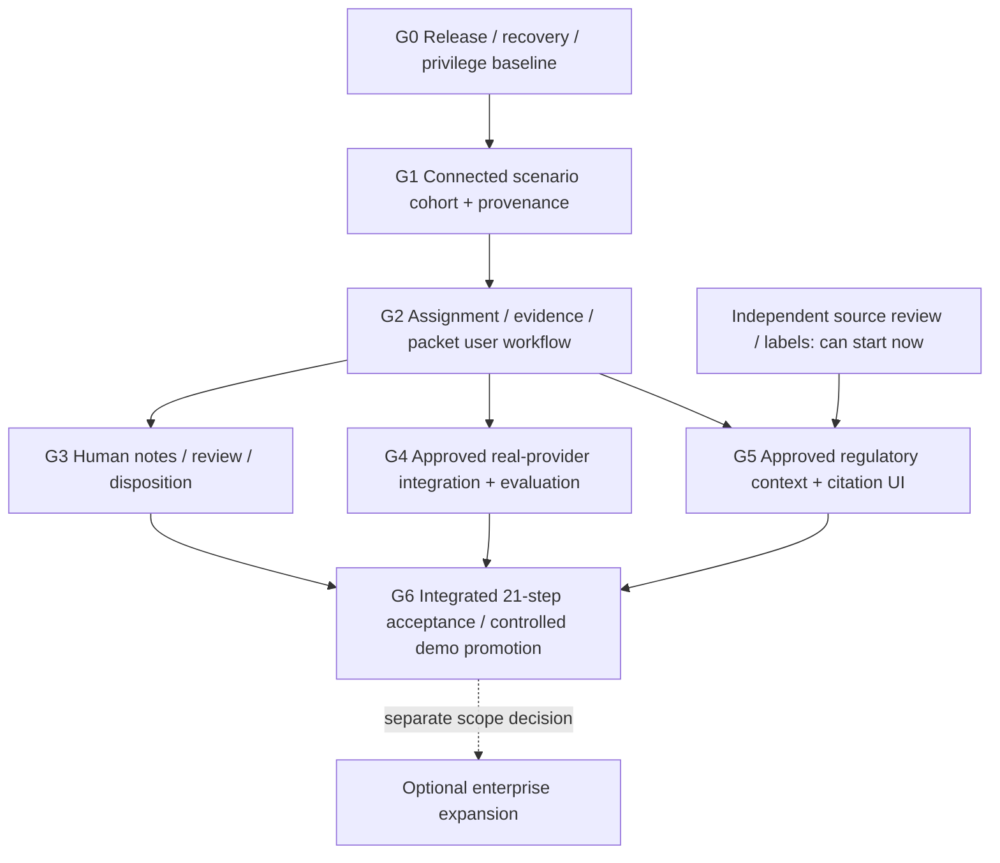
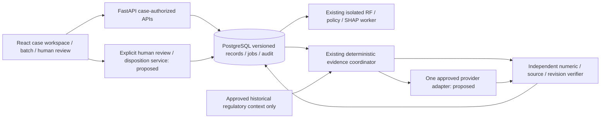

# TrueFlag AI - remaining implementation roadmap

**Planning only; November 13, 2026; baseline HEAD `a3b2ba4`.** No phase below was implemented by this audit. Scope: a realistic, connected synthetic-data capstone with real backend operations, explicit human control and honest AI/regulatory claims. This is not an enterprise certification plan.

## 1. Decision and dependency order

**Recommended first implementation phase: G0 - verified release and recovery baseline.** Do not add another intelligence layer to the older live schema. Resolve current acceptance failures, rehearse migrations/restore on a copy and identify one tested API/UI/worker release before controlled promotion.

The first product slice after G0 is **connected evidence -> authorized analyst review -> verified packet**, reusing existing services. Human case workflow follows; real-provider and source-approval work proceed through separate gates.

G3, G4 and G5 can overlap after the evidence/packet contract stabilizes. Human source review/labeling and provider/data-handling approval can start now without activating anything. If G4/G5 approvals are unavailable, accept an explicitly **restricted evidence-only/simulation demo**; do not call it the complete real-LLM/regulatory platform.

## 2. Architecture to preserve

| Technology / component | Decision / justification |
|---|---|
| FastAPI + PostgreSQL/Alembic | Keep modular services, exact request contracts, transactional jobs/audits and immutable versions; no microservice split required |
| React/TypeScript | Extend existing case workbench and API clients; reuse session cleanup, bounded polling, history, SHAP and batch components |
| PostgreSQL queue/leases | Reuse assessment/import/investigation fencing, backpressure and idempotency; no Kafka/Celery/Redis dependency without a measured need |
| Frozen RF/policy/SHAP | Keep pinned Linux runtime, approved SHA artifacts, preprocessing, class mapping and exact saved outputs; no replacement/retraining |
| Deterministic analytics | Decimal/source-bound calculations stay authoritative; use graph-style one-hop projections for current scope, not a new graph database |
| LLM | One constrained, approved adapter proposes reviewable findings/questions; never computes authoritative totals or grants access/approval |
| Regulatory retrieval | Keep approved-only PostgreSQL lexical/exact-section retrieval until independently measured recall justifies an additional index/embedding model |
| Human decisions | New explicit versioned domain service; model routing and draft text cannot perform a disposition |

## 3. G0 - verified release, recovery and security baseline

| Item | Exact planned work |
|---|---|
| Dependencies | Audit findings and actual current test failures; owner-approved promotion window before changing the live demo |
| G0.1 Acceptance triage | Reproduce/classify current full-suite failures without broad refactoring; establish known host/guest/DB clock behavior. Fix only confirmed defects in a separately authorized implementation task |
| G0.2 Release identity | Record source SHA, working-tree scope, image digests, schema target and worker/frontend versions. Add safe version/readiness attestation; reject mismatched API/worker schema contracts |
| G0.3 Recoverability | Take a protected recoverable copy; verify backup checksum/restore. Rehearse 0012 -> 0013 -> 0014 -> 0015 and integrity checks on that copy; test guarded downgrade behavior without discarding retained history |
| G0.4 Runtime authority | Separate migration owner from web/worker database roles, restrict DDL/trigger bypass, document secret references/rotation; preserve all stored demo records |
| Reuse | `docker-compose.yml`, `backend/app/core/schema.py`, `backend/app/main.py`, `backend/alembic/versions/0013_reference_corpus.py` through 0015, `scripts/verify_regulatory_migration_copy.py`, `scripts/run_investigation_verification.py` |
| Backend/frontend | Controlled aligned image deployment and sanitized release metadata; optional small build/version indicator, no product feature redesign |
| Security/tests | Anonymous access unchanged; wrong schema -> not-ready; least-privilege positive/negative operations; backup/restore and retained-history checks; strict production token issuer under synchronized clocks |
| Acceptance / DoD | Current failures explained/resolved with fresh evidence; restorable copy and aligned release manifest; scoped SQL roles pass normal work while denied DDL; no data loss; explicit promotion record. Health alone is insufficient |

## 4. G1 - connected synthetic scenario and provenance baseline

| Item | Exact planned work |
|---|---|
| Dependencies | G0 isolated verified schema/runtime; scenario/field dictionary agreed before new generation |
| G1.1 Scenario catalog | Separate deterministic seed/version/as-of catalog covering ordinary activity, unusual flows, missing data, contradictions, reversals, high-priority overrides, null/zero income and access revocation |
| G1.2 Safe admission | Reuse `EvidenceService.create_case()` to create new source-bound alerts/cases with customers/accounts/transactions/relationships. Run actual assessments explicitly; provision/assign demo users through supported services |
| G1.3 Feature origin | Per-feature origin: declared synthetic/source-observed/reproducibly derived/unavailable; exact unit, source/window/codebook and version. Keep all 27 current declarations honest. Derive only demonstrably supported fields; do not infer KYC/credit attributes from transactions |
| G1.4 Legacy behavior | CSV/legacy cases without source records remain evidence-incomplete; no fabricated history/backfill. Separate investigation demo cohort from the frozen 4,000 scientific reference set |
| Reuse | `backend/app/services/{synthetic_evidence,evidence,ingestion,assessment_jobs}.py`, evidence schemas/models and source-bound links; `backend/tests/evidence_oracles.py` |
| Backend/frontend | Controlled reproducible scenario/setup command and manifest, provenance dictionary; case IDs/coverage labels for later UI. No arbitrary document ingestion or banking connector |
| Security/tests | Source-to-case binding, cross-case alias denial, same-seed reproducibility/idempotency, corrections/reversals/currency windows, null versus zero, unavailable data abstention; all frozen replays unchanged |
| Acceptance / DoD | Each scenario traces customer -> account -> observed records -> newly bound case -> actual assessment; all input origins documented. Test expected consistency, not desired/fabricated model scores. No frozen fixture changes |

## 5. G2 - assignment, evidence and verified-packet vertical slice

| Item | Exact planned work |
|---|---|
| Dependencies | G1 connected cases; stable authorization/source snapshot/packet contracts |
| G2.1 Assignment | Add minimal eligible-active-analyst directory/projection for supervisors/admins; assignment editor uses existing versioned PUT and atomic audit. New imported/seeded cases become accessible only after authorized assignment |
| G2.2 Evidence workspace | Case tabs for customer/KYC, accounts, paginated transactions, bounded related entities and source/coverage/revision details; show observed facts separately from model signals |
| G2.3 Analytics | Controls for allowed window/currency/calculation; render counts/flows/velocity/concentration/patterns and coverage. Show explicit KYC comparison insufficiency until expected-activity data is supported |
| G2.4 Packet gateway | Protected explicit request/status/history/detail routes over the existing coordinator. Server binds actor/case/selected assessment/current source revisions; bounded pagination, idempotency/conflicts, queue/rate limits and sanitized failures |
| G2.5 Worker/review | Deploy existing investigation worker with separate service token and limits; bounded UI polling with cleanup. Packet review shows factual observations, independently verified calculations, RF/SHAP signals, gaps/conflicts, questions and abstention |
| Reuse | `backend/app/services/{cases,evidence_read,evidence_analytics,investigation_coordinator,investigation_packets,investigation_verifier}.py`, `backend/app/workers/investigation_worker.py`, existing evidence endpoints, `frontend/src/api.ts`, `frontend/src/workbench.tsx`, `frontend/src/App.tsx` patterns |
| Backend/frontend | New small directory/packet HTTP gateway and worker profile; evidence/packet API client, typed tabs/status/history components. No duplicate analytics/scoring/coordinator implementation |
| Security/tests | Server case/source checks on every read/action, assignment/role/source revocation before publish, stale cursors/packets, optimistic assignment conflict, IDOR/cross-case access, bounded responses and polling/logout cleanup |
| Acceptance / DoD | Real Chromium analyst can log in -> assigned connected case -> evidence/analytics -> request packet -> job completes -> source-backed packet/history; legacy case abstains honestly; permissions revoked mid-run reveal no new result; no LLM required |

## 6. G3 - human casework and final decision history

| Item | Exact planned work |
|---|---|
| Dependencies | G2 authorized workspace/packet identity; role/transition policy explicitly agreed |
| G3.1 Notes/requests | Persist append-only/versioned case notes and evidence requests with author, timestamp, status and references; no raw arbitrary model/tool command execution |
| G3.2 Escalation | Explicit supervisor escalation/response states and ownership. Use in-app state first; external email/messaging only if separately required/authorized |
| G3.3 Findings review | Human adopt/reject/defer records with rationale bound to exact packet/draft/evidence/assessment versions; changed/revoked evidence invalidates pending adoption |
| G3.4 Disposition | Deterministic state transition service, optimistic case version, authorized reason/decision record, optional supervisor confirmation according to chosen policy. No autonomous closure or SAR filing |
| G3.5 Timeline/dossier | Case-authorized paginated timeline; minimal audit projections; authorized bounded dossier export with references/provenance, model-vs-human distinction and sensitive-field allowlist |
| Reuse | `services/cases.py` locking/version pattern, `models/domain.py` case fields/audit, immutable assessment/evidence history, `services/batch_export.py` safe-export patterns and existing frontend workbench |
| Backend/frontend | Minimum new human-action tables/migrations/services/routes; notes/request/escalation/review/disposition controls, conflict/stale-state UX and timeline/export. Do not reuse `decisions` as a human approval entity |
| Security/tests | Role/assignment/active-user rechecks inside transaction; deny invalid transitions/stale versions/self-approval where policy forbids; audit rollback; immutable action history; formula/field-size/export checks |
| Acceptance / DoD | Analyst records notes/request/escalation; authorized human records a reasoned disposition tied to current evidence; another analyst cannot read/write it; concurrent/stale/revoked actions fail safely; full history persists after refresh |

## 7. G4 - approved real-provider integration and independent AI evaluation

| Item | Exact planned work |
|---|---|
| Dependencies | G2 stable minimized packet/gateway; independent scenario labels/rubric; approval **before** live calls |
| G4.1 Approval | Named provider/model/version, deployment region, synthetic-only permitted fields, retention/training terms, egress allowlist, secret handling and spend ceiling |
| G4.2 Adapter | One real adapter behind `Provider`; strict structured outputs, bounded request/timeout/cancel/retry, actual vendor usage, unknown-outcome accounting and durable spend reservation. Keep fake as explicitly labeled offline mode |
| G4.3 Verification/evaluation | Reuse independent numbers/references/revision checks; add independent held-out findings/citation/abstention/contradiction/injection evaluation. Do not treat valid numeric references as semantic entailment |
| G4.4 Human presentation | Protected draft request/status/history/detail over existing orchestration; review screen displays model identity, mode, sources, uncertainty, limitations and actual usage. Integrate G3 adoption/rejection |
| Reuse | `services/{investigation_drafts,investigation_provider,investigation_provider_runner,investigation_draft_verifier}.py`, typed contracts, immutable attempt/receipt records, current packet minimization |
| Backend/frontend | Real transport/config/usage contract and safe gateway, no free-ranging agents/tools; draft review components. Free-form narrative only after separately verified claims/quality requirements |
| Security/tests | No credentials/raw predictors/source prose in unauthorized payloads/logs; default-off/denied egress; timeout/unknown usage/refusal/malformed output/revocation/recovery; live tests only against approved synthetic inputs with budget caps |
| Acceptance / DoD | Actual approved model produces source-bound proposals on unseen synthetic cases; preregistered independent quality/safety criteria met; measured latency/vendor tokens/cost; explicit unsupported-claim failures/manual review. Simulated byte counts cannot satisfy this gate |

## 8. G5 - approved regulatory context and citation workflow

| Item | Exact planned work |
|---|---|
| Dependencies | Qualified independent source/label reviews; G2 gateway; optional G4 for regulatory-language generation, not for deterministic retrieval |
| G5.1 Review | Exact source/hash/version/date/rights/US-bank applicability/exceptions/amendments review; independent 31-case labels and adjudication; historical November 2 scope explicitly chosen or separately approved updated corpus |
| G5.2 Retrieval acceptance | Reproduce isolated candidate metrics with reviewed labels; define answerable/unavailable denominator and acceptance before tuning; evaluate known recordkeeping lexical miss without changing labels/references to force success |
| G5.3 Controlled admission | Approve/admit exact immutable eCFR versions, release membership/grants/server context. Keep unverifiable FAQ HTML excluded. Any dated PDF requires separate justified parser/admission/review, not silent replacement |
| G5.4 Packet/citations | Conditional server-selected context, authority/as-of/version/hash/locator references, before-publication withdrawal/access checks; evidence-only fallback when absent; UI passage/citation/applicability view |
| Reuse | `services/{references,reference_parser,reference_evaluation}.py`, `api/references.py`, reference/corpus tables; existing approval dossier, source proposals and independent review templates |
| Backend/frontend | Minimal context join/provenance contract and citation components; no vector database/embeddings unless reviewed recall measurements justify them |
| Security/tests | Unapproved/withdrawn/superseded/future/wrong-entity/forged citations denied; current case/source ACLs; provider cannot select corpus or approve sources; refresh/revocation clears stale citations |
| Acceptance / DoD | Qualified approval + independent labels recorded; retrieved content authorized, approved and applicable to explicit historical scope; sources resolve in UI; quality/filter/latency report includes limitations; unavailable questions abstain; no legal certification claim |

## 9. G6 - complete capstone acceptance and controlled promotion

| Item | Exact planned work |
|---|---|
| Dependencies | G0-G3; G4/G5 for full real-LLM + approved-regulatory claim. Restricted mode must be explicitly named if either gate is absent |
| G6.1 Journey | Execute all [21 steps](END_TO_END_USER_JOURNEY_GAPS.md) as real users through browser/API/DB, including evidence, actual approved provider, citations, human review and disposition |
| G6.2 Reliability | Bounded synthetic workloads within supported limits; measured throughput/p50/p95/resources; queue saturation, worker/API/dispatcher restart, DB interruption, recovery/idempotency/counter integrity |
| G6.3 Security | Wrong roles/cases/sources, role/assignment/source/approval revocation, stale decisions, export injection/limits, logout/session policy, sanitization and no automatic closure/SAR filing |
| G6.4 Release evidence | Linux/PostgreSQL + relevant Windows/SQLite tests, Chromium, frontend lint/build/format, Alembic schema/restore checks, pinned RF/policy/SHAP regressions; isolated private acceptance gate without artifact publication |
| Backend/frontend | Defect fixes only, final demo setup/runbook and clear UI restricted/live/source status. No last-minute agent/framework rewrite |
| Reuse | Existing test fixtures, `scripts/run_*verification.py`, `scripts/run_frontend_e2e.py`, benchmarks, monitoring, audits, private read-only scientific assets and CI patterns |
| Acceptance / DoD | No unresolved critical workflow/security failures, lost committed jobs or duplicate consequential actions; full traceable source -> case -> assessment -> investigation -> human decision; measured finite-load limits, restore proof and approved controlled release. Report all skipped/unavailable evaluations |

## 10. Optional enterprise expansion - outside minimum critical path

| Capability | Add only when justified by |
|---|---|
| Banking connectors/event-driven transaction monitoring | Real feed schema, consent/retention, operational detection requirements and measured ingestion volume |
| Rolling feature store/behavior/anomaly models | Defined windows/units/lineage and independent data/label evaluation; maintain the frozen model as a separate versioned contract |
| Entity resolution/multi-hop graph | Demonstrated cross-account/entity investigation requirements beyond bounded one-hop relationships |
| SSO/MFA/tenant RLS/HA | Actual enterprise exposure/identity/availability scope; least-privilege runtime and TLS come earlier |
| New queue/broker/microservices | Measured PostgreSQL queue or isolation bottleneck and a recovery/operational benefit |
| Vector/hybrid retrieval | Independently labeled recall failures that lexical/exact lookup cannot adequately resolve |
| Multi-agent workflows | Distinct bounded tasks that outperform one coordinator/provider under measured quality/cost; no autonomous decision authority |

## 11. Global definition of done

- A feature is complete only when its permitted user workflow is connected, persistent, case-authorized and meaningfully tested; source existence is insufficient.
- Preserve frozen RF/policy/SHAP/private references and existing contracts. New human/evidence/provider features remain modular additions, not model rewrites.
- Re-run only checks appropriate to each change, then the release gate; publish exact commands/counts/skips, label provenance and measured limitations.
- Never manufacture underlying evidence, predictor derivations, legal dates, independent labels, desired risk scores or production capacity.
- Preserve unrelated work. Obtain explicit approval for live provider activation, corpus publication and controlled demo promotion; do not push without authorization.
